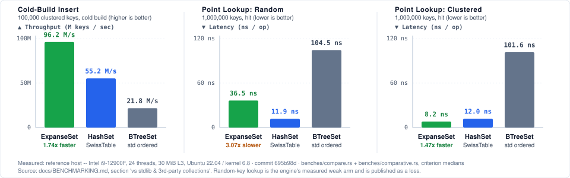
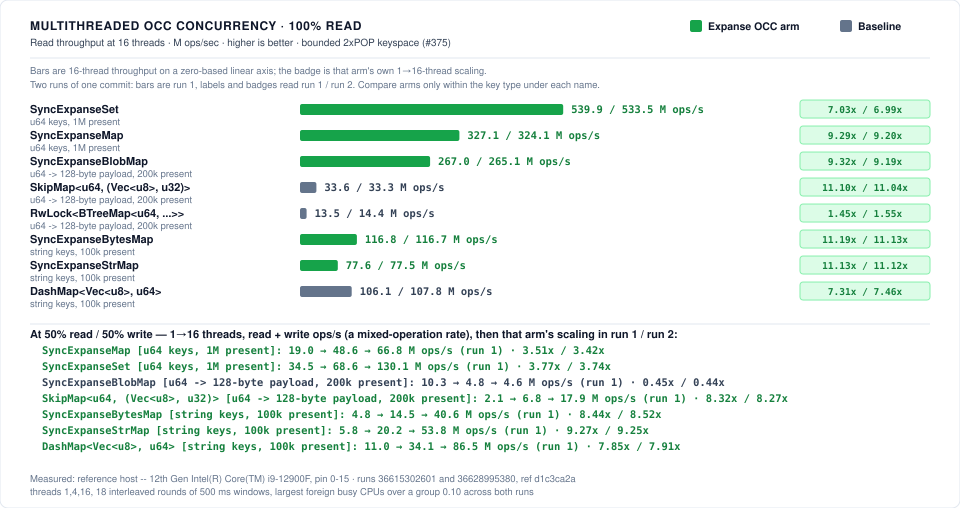
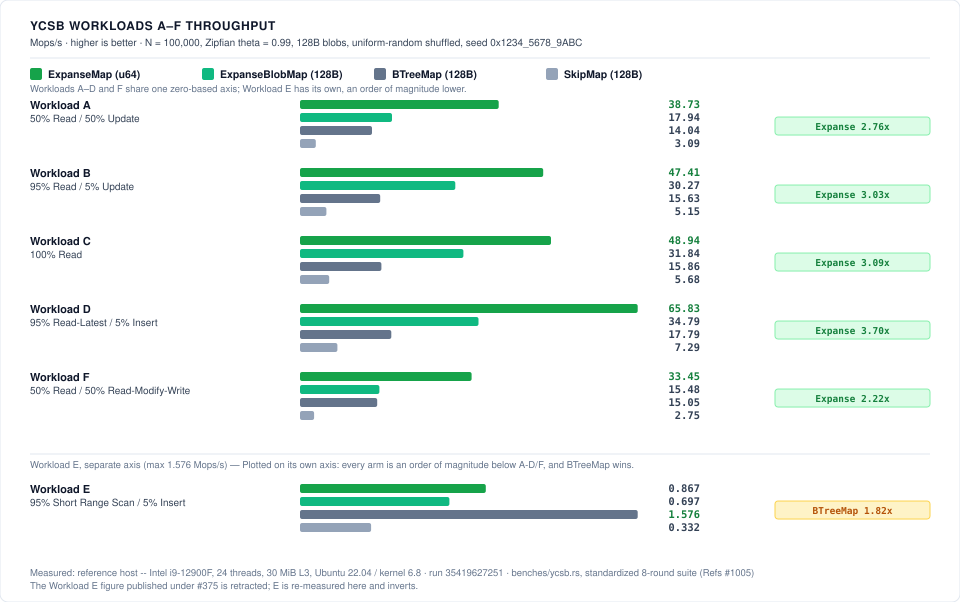
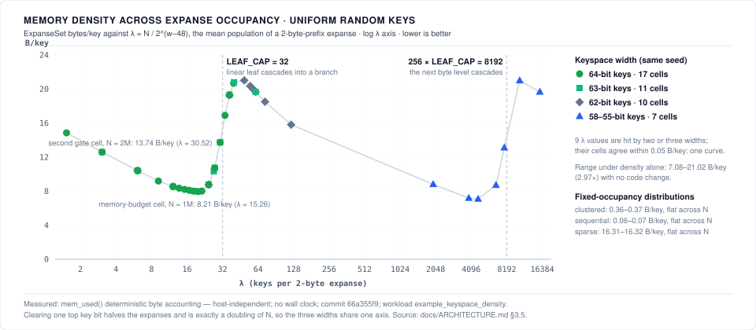

# Expanse

[](https://github.com/orieg/expanse/actions/workflows/ci.yml?query=branch%3Amain)
[](https://crates.io/crates/expanse-trie)
[](https://www.npmjs.com/package/@orieg/expanse)
[](https://www.nuget.org/packages/Orieg.Expanse)
[](https://pypi.org/project/expanse-trie/)
[](https://orieg.github.io/expanse/apt/)
[](https://orieg.github.io/expanse/rpm/)
[](#platform-support)
[-informational.svg?style=flat-square)](Cargo.toml)
[](LICENSE-MIT)
[](https://doi.org/10.5281/zenodo.22152112)

A **clean-room, pure-Rust implementation of Judy arrays**, modernized for modern 64-bit and 32-bit embedded microarchitectures, with **`libexpanse` — a high-performance, drop-in C ABI replacement for `libjudy`**.

*Drop-in* is a compatibility claim: the same symbols and the same results, with no source change. Speed and memory against stock libJudy are measured per workload, and they do not carry over to programs that keep many small JudyL arrays, where libexpanse is several times slower on inserts and holds tens of times the memory ([the measured losses](#where-libexpanse-is-slower-or-larger-than-stock); [#1742](https://github.com/orieg/expanse/issues/1742)).

Judy arrays (invented by Doug Baskins at Hewlett-Packard, ~2002) are sparse, dynamic associative structures built as 256-ary digital tries partitioned by **expanse** (decoding keys byte by byte over fixed digit ranges) rather than by population like comparison-based trees. Their speed comes from adaptive node compression — linear, bitmap, and uncompressed branches; linear and bitmap leaves; keys stored immediately inside pointers — tuned to keep every node traversal within a few cache-line fills.

**Jump to:** [Install](#install) · [Key features](#key-features) · [Benchmarks](#comparative-performance-vs-industry-primitives) · [Quick starts by language](#distribution--quick-start) · [Platforms](#platform-support) · [Packaging guide](docs/PACKAGING.md)

---

## Install

The C library (`libexpanse`, headers, man pages, and the `libJudy` drop-in links):

```bash
# macOS, or Homebrew on Linux (formula ships from v0.7.0)
brew install orieg/tap/expanse
# The formula conflicts with Homebrew's stock `judy` (both install Judy.h and libJudy);
# if judy is installed, `brew unlink judy` first. The judy keg stays at `$(brew --prefix judy)`.

# Debian / Ubuntu
echo "deb [trusted=yes] https://orieg.github.io/expanse/apt/ stable main" | sudo tee /etc/apt/sources.list.d/expanse.list
sudo apt-get update && sudo apt-get install -y libexpanse1 libexpanse-dev libjudy-compat

# Fedora / RHEL / Rocky / Amazon Linux
sudo dnf config-manager --add-repo https://orieg.github.io/expanse/rpm/expanse.repo
sudo dnf install -y libexpanse libexpanse-devel libjudy-compat
```

Prebuilt archives for Linux (glibc, musl), macOS and Windows, with `SHA256SUMS`, are on the [Releases page](https://github.com/orieg/expanse/releases/latest); vcpkg, NuGet and MacPorts are covered in the [packaging guide](docs/PACKAGING.md).

Language packages:

| Language | Install | Quick start |
|---|---|---|
| Rust | `cargo add expanse-trie` | [Rust](#1-rust--cargo-64-bit--32-bit) |
| Python | `pip install expanse-trie` | [Python](#8-python-quickstart-pip-install-expanse-trie) |
| Node.js / Bun / Deno | `npm i @orieg/expanse` | [Node.js](#12-nodejs-bun--deno-quickstart-npm-i-oriegexpanse) |
| .NET | `dotnet add package Orieg.Expanse` | [.NET](#10-net--c-quickstart-oriegexpanse) |
| Java / Scala | Maven `io.github.orieg:expanse-java` | [Java](#9-java--scala-quickstart-iogithuboriegexpanse-java) |
| PHP | `composer require orieg/expanse` | [PHP](#11-php-quickstart-oriegexpanse) |
| Ruby | `gem install expanse` | [docs/bindings/ruby.md](docs/bindings/ruby.md) |
| Go | `go get github.com/orieg/expanse/bindings/go` | [bindings/go](bindings/go/README.md) |
| WebAssembly | `npm i @orieg/expanse-wasm` | [crates/expanse-wasm](crates/expanse-wasm) |
| ESP-IDF | component `components/expanse` | [ESP-IDF](#13-espressif-esp-idf-component-esp32-c2c3c6h2p4) |

Then link with `-lexpanse` (or keep `-lJudy`), or see the [C](#4-modern-c-api-expanseh), [C++](#5-modern-c20-header-only-api-expansehpp) and [legacy `Judy.h`](#6-drop-in-legacy-c-api-judyh) examples.

---

## Why "Expanse"?

*Expanse* is the Judy design's own defining term — so central that the published descriptions stop to define it before anything else, and use it as the precise contrast with population-partitioned trees (B-trees, binary trees):

> "Expanse, population, and density are not commonly used terms in tree search literature, so let's define them here: **Expanse** is a range of possible keys […]"  
> — Doug Baskins, [*A 10-Minute Description of How Judy Arrays Work and Why They Are So Fast*](https://judy.sourceforge.net/doc/10minutes.htm) (2002)

> "A digital tree divides up the population (index set) uniformly **by expanse** (dividing and redividing the initial expanse evenly), while other methods, such as b-trees, divide up the population by the distribution of the population itself."  
> — Alan Silverstein, [*Judy IV Shop Manual*](https://judy.sourceforge.net/doc/shop_interm.pdf) (2002), "Digital Trees"

Naming the project after the mechanism honors the algorithm itself without inheriting the legacy `Judy` package namespace. Crate: `expanse-trie` (bare `expanse` is squatted on crates.io by an abandoned unrelated crate). C library: `libexpanse`, with a `libjudy-compat` shim for drop-in use.

---

## Key Features

- **Verified drop-in for libJudy**: swap `-lJudy` for `-lexpanse`, or `LD_PRELOAD` `libexpanse.so`, with no source change (Judy1, JudyL, JudySL, JudyHS; 64-bit builds). Four standing CI gates check it: a differential oracle against a `dlopen`'d stock libJudy on all four families, including zmap's JudyHS evict-and-reinsert window; the `php-judy` suite at 221/221 on Linux and macOS; the same suite built with Windows MSVC; and `LD_PRELOAD` transcripts identical to stock, among them a replay of MariaDB OQGraph's Judy1 colour map. Unmodified stress-ng, zmap, OQGraph and gtkwave have been run against it: [Verified in real projects](#verified-in-real-projects). These gates and runs establish identical results; speed and memory against stock are measured separately, in the next item.
- **Faster than stock libJudy on most measured shapes, not all**: through the identical C ABI at 1,000,000 keys, libexpanse takes 0.379–0.884× stock's time on sequential, random and clustered insert and lookup, every BCa 95% upper bound at or below 0.892 in two runs *(measured: Intel Core i9-12900F reference host, commit `cbbc762a`; [`results/baseline_vs_libjudy.json`](results/baseline_vs_libjudy.json), [`results/baseline_vs_libjudy_run2.json`](results/baseline_vs_libjudy_run2.json); workload: `capi_bench_vs_libjudy`)*. It is slower on sequential lookup at 100,000 keys, on stress-ng's 4 Mi-key inserts and deletes, on OQGraph's colour map, and by the widest margin on stress-ng's many-small-array `hashjudy` method (puts 0.105–0.157× stock's rate, 49–77× its peak memory); it also holds more memory on zmap's sparse window. Callgrind counts fewer instructions than stock on 54 of the 63 vs-stock operations and more on nine: six `JudyL` small-array lifetimes (1.500–9.975×), `JudyLPrev` random (1.058×), and `Judy1NextEmpty` and `Judy1PrevEmpty` clustered (1.092× and 1.095×) *(measured: same host, commit `864f8e00`, [`results/baseline_vs_stock.json`](results/baseline_vs_stock.json); workloads differ: `capi_vs_stock` vs `capi_bench_vs_libjudy`)*; an instruction count is not a timing. [Wins](#performance-vs-stock-libjudy) · [Losses](#where-libexpanse-is-slower-or-larger-than-stock).
- **Pure Rust**: `std` by default on every target, and `no_std` + `alloc` with `default-features = false` (CI checks that build for `riscv32imac`, `riscv32imc` and `thumbv7em-none-eabihf`); zero external runtime dependencies. Checked under Miri and Loom in CI. The `Sync*` wrappers' two undefined-behaviour classes (an optimistic-read data race and `&T`/`&mut` aliasing over the engine, [#1086](https://github.com/orieg/expanse/issues/1086)) are closed on the 64-bit and 32-bit wrappers; a nightly Miri census runs each concurrent workload under the race detector and both aliasing models, and [`.github/miri-ub-sites.json`](.github/miri-ub-sites.json) records every entry clean, an observation at its seed range rather than a proof.
- **Hardware Acceleration & Portability**: SSE2 leaf and branch kernels on every x86-64 build, with runtime CPUID dispatch to `POPCNT` and BMI2 `PDEP` on x86-64 only; NEON byte-equality kernels on ARM64 (compile-time baseline, no runtime dispatch). Every other target — 64-bit RISC-V (`RV64GC`) and bare-metal 32-bit embedded (`RV32IMAC`, `Cortex-M4/M7`) — runs the portable scalar paths. `glibc-hwcaps` variants (`x86-64-v2`/`v3`/`v4`) are a build recipe, not part of the released packages ([docs/COMPAT.md](docs/COMPAT.md)).
- **Concurrent Readers and Writers**: Every `Sync*` wrapper serves readers that **take no lock on the common path** and concurrent writers through optimistic lock coupling (a blocking protocol, not lock-free). `SyncExpanseMap` serves **322.8 M reads/s [322.1, 323.5] and 321.6 M reads/s [321.2, 322.1] at 16 threads** in two independent runs, BCa 95% over 18 rounds *(measured: reference host, commit `f9853201`; [`baseline_concurrent_mixed.json`](docs/benchmarks/concurrency/results/baseline_concurrent_mixed.json), [`baseline_concurrent_mixed_run2.json`](docs/benchmarks/concurrency/results/baseline_concurrent_mixed_run2.json); workload: `core_concurrency`)*. [Tables, losses and competitors](#multithreaded-occ-concurrency-scalability).
- **Dense Memory Packing**: Down to **0.07–0.36 bytes/key** on dense and clustered 64-bit **sets** (`ExpanseSet`, key presence only) *(measured: `bytes_per_key` example)*. A **map** stores an 8-byte value word per key, so it cannot go below 8 B/key: `ExpanseMap` measures **8.56–8.61 bytes/key** on the same dense and clustered distributions at 1M keys *(measured: deterministic `mem_used()` accounting, host-independent; `bytes_per_key` example, workload `example_bytes_per_key`; gated copy `docs/visualizer_data.json` → `memory_budget`)* and **~0.31 bytes/key** on clustered 32-bit embedded sets *(measured: `bytes_per_key_32` example)*. On uniform random keys per-key set cost is a sawtooth in key density, **7.08–21.02 bytes/key** *(measured: `keyspace_density` example; [docs/ARCHITECTURE.md §3.5](docs/ARCHITECTURE.md#35-per-key-memory-is-a-sawtooth-in-expanse-occupancy-and-leaf_cap-sets-the-tooth))*.

---

## Visual Performance Comparison









---

## API Surfaces

| Surface | Crate / Package | Deliverable |
|---|---|---|
| **Native Rust API (64-Bit)** | [`crates/expanse`](crates/expanse) (package `expanse-trie`) | Pure-Rust library: `ExpanseSet` (bit set), `ExpanseMap` (word→word), `ExpanseStrMap` (string→word), `ExpanseBytesMap` (bytes→word), `ExpanseBlobMap`, plus iterators and the concurrent wrappers `SyncExpanseSet`, `SyncExpanseMap`, `SyncExpanseStrMap`, `SyncExpanseBytesMap`, `SyncExpanseBlobMap` (`std` feature) |
| **Native Embedded Rust (32-Bit)** | [`crates/expanse`](crates/expanse) (`no_std` with `default-features = false`) | 32-bit microprocessor collections: `ExpanseSet32` (bit set), `ExpanseMap32` (u32→u32 map), `ExpanseBlobMap32`, and the concurrent `SyncExpanseSet32` / `SyncExpanseMap32`, with compact 8-byte `Edge32` layout and 32-byte cache line alignment |
| **C ABI (`libexpanse`)** | [`crates/expanse-capi`](crates/expanse-capi) | `cdylib`/`staticlib` exporting **both** the legacy `Judy.h` surface (`Judy1*`, `JudyL*`, `JudySL*`, `JudyHS*` — allowing consumers like [php-judy](https://github.com/orieg/php-judy) to swap `libJudy` for `libexpanse` without source changes) **and** modern `expanse.h` |
| **Modern C++20 Header** | [`include/expanse.hpp`](include/expanse.hpp) | Modern header-only C++20 STL-compatible RAII wrapper (`expanse::set`, `expanse::map`, `expanse::str_map`, `expanse::bytes_map`, `expanse::blob_map`, `expanse::sync_set`, `expanse::sync_map`), `std::span` zero-copy access, `std::forward_iterator` ranges, and optimistic OCC readers |
| **Java / Scala FFM API** | [`bindings/java`](bindings/java) (`io.github.orieg:expanse-java`) | Java 22+ / 21 LTS Project Panama Foreign Function & Memory bindings: zero-GC off-heap collections (`ExpanseMap`, `ExpanseSet`, `ExpanseStrMap`, `ExpanseBytesMap`, `ExpanseBlobMap`, `SyncExpanseMap`, `SyncExpanseSet`), value slots, `NavigableMap`/`NavigableSet` adapters |
| **.NET / C# API** | [`bindings/dotnet`](bindings/dotnet) (`Orieg.Expanse`) | .NET 8.0/9.0+ C# bindings & NuGet package via P/Invoke: zero-GC off-heap collections (`ExpanseSet`, `ExpanseMap`, `ExpanseStrMap`, `ExpanseBytesMap`, `ExpanseBlobMap`, `ExpanseSyncMap`, `ExpanseSyncSet`) |
| **Go API** | [`bindings/go`](bindings/go) (`github.com/orieg/expanse/bindings/go`) | Native Go bindings via CGO, or CGO-free via purego (`CGO_ENABLED=0` or the `expanse_purego` build tag): zero-GC off-heap collections (`Set`, `Map`, `StrMap`, `BytesMap`, `BlobMap`, `SyncSet`, `SyncMap`) |
| **PHP API** | [`bindings/php`](bindings/php) (`orieg/expanse`) | Native PHP bindings via FFI & PIE: `Expanse\Set`, `Expanse\Map`, `Expanse\StrMap`, `Expanse\BytesMap`, `Expanse\BlobMap`, `Expanse\SyncMap`, `Expanse\SyncSet` |
| **Python API** | [`bindings/python`](bindings/python) (`pip install expanse-trie`) | High-performance Python extension via PyO3 ([`crates/expanse-py`](crates/expanse-py)): `ExpanseSet`, `ExpanseMap`, `ExpanseStrMap`, `ExpanseBytesMap`, `ExpanseBlobMap`, `SyncExpanseSet`, `SyncExpanseMap`, `SyncExpanseStrMap`, `SyncExpanseBytesMap`, `SyncExpanseOrderedBytesMap`, `SyncExpanseBlobMap`, GIL-released queries |
| **Node.js / Bun / Deno API** | [`crates/expanse-node`](crates/expanse-node) (`@orieg/expanse`) | Native high-performance N-API bindings via `napi-rs`: `ExpanseSet`, `ExpanseMap`, `ExpanseStrMap`, `ExpanseBytesMap`, `ExpanseBlobMap`, `SyncExpanseMap`, `SyncExpanseSet` |
| **WebAssembly / Edge** | [`crates/expanse-wasm`](crates/expanse-wasm) (`@orieg/expanse-wasm`) | WebAssembly bindings for edge runtimes (Cloudflare Workers, Fastly) and browsers |
| **Ruby API** | [`bindings/ruby`](bindings/ruby) (`gem install expanse`) | Native Ruby extension via Fiddle / C ABI: `Expanse::Set`, `Expanse::Map`, `Expanse::StrMap`, `Expanse::BytesMap`, `Expanse::BlobMap` |
| **RocksDB Pluggable MemTable** | [`integrations/rocksdb`](integrations/rocksdb) (`rocksdb-expanse`) | Official RocksDB `MemTableRep` / `MemTableRepFactory` implementation. Against a fair variable-height skiplist baseline: **1.42× higher key density in RAM** (13.2 vs 18.7 B/entry, deterministic accounting), point lookup **1.49×** [1.4901, 1.5073], range seek **1.53×** [1.5225, 1.5414], sequential scan **3.07×–3.14×** [3.0480, 3.2269], batch scan **2.13×** [2.0452, 2.3111] — each interval spans both runs *(measured: reference host, two runs; [`baseline_rocksdb.json`](docs/benchmarks/rocksdb_memtable/results/baseline_rocksdb.json))*. Fewer L0 flushes is inferred (target). See [`docs/benchmarks/rocksdb_memtable/`](docs/benchmarks/rocksdb_memtable/README.md) and [`integrations/rocksdb/`](integrations/rocksdb/README.md) |

Legacy ↔ modern naming:

| Legacy C API | Modern Rust Type | Modern C Type | Description |
|---|---|---|---|
| `Judy1` | `ExpanseSet` | `expanse_set_t` | Dynamic bit set / integer presence index |
| `JudyL` | `ExpanseMap` | `expanse_map_t` | Word-to-word associative map |
| `JudySL` | `ExpanseStrMap` | `expanse_strmap_t` | Null-terminated string-to-word map |
| `JudyHS` | `ExpanseBytesMap` | `expanse_bytesmap_t` | Arbitrary byte array-to-word map |

---

## Modernization Thesis

| Component | Original Judy IV (2002) | Expanse (2026) |
|---|---|---|
| **Cache-line geometry** | Assumed 128-byte lines | Nodes sized to 64-byte lines (1 or 2 cache lines per node) |
| **Bit scan / rank** | SWAR bit hacks, unrolled loops | Hardware `POPCNT` / `TZCNT` / `LZCNT` / ARM `cnt` (runtime CPUID dispatch on hot read paths; SWAR fallback on generic baseline builds; native in `x86-64-v2`/`v3` packages) |
| **Linear search** | Scalar unrolled byte compares | Vectorized SIMD byte scans (SSE2 on x86-64, NEON on ARM64; AVX2/AVX-512 not yet implemented) |
| **Allocation** | Custom 2001 chunk/buddy allocator | High-performance slab page pooling + intrusive freelists |
| **Pointer layout** | Full 16-byte JP per edge | 16-byte `Edge`: word 0 is the raw untruncated 64-bit pointer, tag and metadata live in word 1 — zero upper-bit stealing, so it stays correct under 57-bit LA57 and 52-bit ARM64 LVA ([encoding reference](docs/ARCHITECTURE.md#10-bit-level-encoding-reference)) |
| **Concurrency** | Single-threaded, external locks | Optimistic lock coupling: readers take no lock on the common path, and concurrent writers lock only the nodes they change (a blocking protocol, not lock-free) |

Full architectural specifications: [docs/ARCHITECTURE.md](docs/ARCHITECTURE.md) · Embedded 32-Bit design: [docs/design/32-bit-embedded.md](docs/design/32-bit-embedded.md) · Large-Value design: [docs/design/large-values.md](docs/design/large-values.md) · Database engine patterns: [docs/DATABASE.md](docs/DATABASE.md) · CI/CD: [docs/CI.md](docs/CI.md).

---

## Database Engine Subsystems & Architecture

Expanse provides modern, hardware-vectorized digital trie primitives tailored for core database engine subsystems:

- **Inverted Indexes & Posting Lists (`ExpanseSet`)**: Doc-ID tracking at **0.07–0.36 bytes/docID** (presence only, no value) on clustered/dense sets — denser than Roaring Bitmaps on those distributions — with bitwise set algebra directly over compressed trie edges and $O(\text{depth})$ skip-scan acceleration.
- **MVCC Visibility Maps & Active Transaction Tracking (`SyncExpanseSet`)**: Optimistic active transaction (`xid`) tracking with no reader-side lock on the common path, and safe epoch reclamation under continuous OLTP churn.
- **Columnar String & Symbol Dictionaries (`ExpanseStrMap`)**: High-cardinality string deduplication and symbol tables using 8-byte chunk decomposition and tail collapse, preserving lexicographical order while sharing common prefix nodes.
- **Secondary Indexes & MemTables (`ExpanseMap` / `ExpanseMemTableRep`)**: Rebalance-free ordered key indexing, **2.7×–13.1× faster point lookups** than `std::collections::BTreeMap` at 1M keys (workload: `core_compare`), and full ordered `iter()` faster than `BTreeMap::iter()` on sequential, clustered and random keys at 1M — sparse-key iteration, and iteration at 10k keys, are slower *(measured: reference host, commit `82eb56af`, two runs, [`results/baseline_compare.json`](results/baseline_compare.json) and [`results/baseline_compare_run2.json`](results/baseline_compare_run2.json); intervals in [docs/BENCHMARKING.md](docs/BENCHMARKING.md#vs-stdlib--3rd-party-collections))*; see [docs/DATABASE.md](docs/DATABASE.md) §7.1. Ships an official [RocksDB Pluggable MemTable (`integrations/rocksdb`)](integrations/rocksdb) integration.
- **Zero-Copy Shared-Memory Analytics** *(roadmap)*: Position-independent base-relative layouts for cross-worker IPC and parallel query execution with zero serialization — a design target; not yet implemented (see [docs/DATABASE.md](docs/DATABASE.md) §6).

See [docs/DATABASE.md](docs/DATABASE.md) and [integrations/rocksdb/README.md](integrations/rocksdb/README.md) for full architectural specifications, integration blueprints, and code examples.

---

## Comparative Performance vs Industry Primitives

Where Expanse wins, where it loses, and where to read the full tables. Losses are listed as plainly as wins; every suite publishes BCa 95% intervals per cell. Decision matrix: [docs/DATABASE.md §7](docs/DATABASE.md). Methodology: [docs/BENCHMARKING.md](docs/BENCHMARKING.md). "Reference host" throughout is a quiet Intel Core i9-12900F; the commit, run and interval behind each figure are in the linked docs.

### 1. `ExpanseSet` vs `RoaringBitmap`

- **Sparse and clustered sets — Expanse.** `contains` is **1.24×–2.09× faster**: sparse 1.77× [1.76, 1.77] at 10k and 2.09× [2.08, 2.09] at 100k, clustered 1.59× [1.59, 1.60] and 1.24× [1.24, 1.24].
- **Dense sets and rank/select — Roaring.** Its bit containers win dense `contains` by **7.86× [7.84, 7.89]** at 10k and **3.11× [3.11, 3.13]** at 100k, and its rank index beats `count_below`/`by_count` in every cell measured.
- **Memory — parity on dense data.** `ExpanseSet` holds **0.07–0.36 bytes/key** on clustered and dense sets *(measured: `bytes_per_key` example, deterministic allocator accounting)*; that is key presence only — an `ExpanseMap` holding an 8-byte value per key measures 8.56–8.61 bytes/key on the same keys at 1M (same instrument), with ordered forward and backward iteration.

Rule of thumb: Expanse for membership on sparse and clustered sets, Roaring for dense sets and heavy rank/select *(measured: reference host, 50% hit rate; [`results/baseline_comparative.json`](results/baseline_comparative.json); workload: `core_comparative`)*.

### 2. `ExpanseMap` vs `hashbrown::HashMap` & `BTreeMap`

- **vs `BTreeMap` — Expanse on lookups.** `ExpanseMap` point lookups are **2.7×–13.1× faster** at 1M keys, from random keys (time ratio [0.367, 0.374]) to sparse ([0.076, 0.078]); sequential is [11.46, 11.91] ns vs [106.4, 107.4] ns (workload: `core_compare`). Ordered `iter()` at 1M keys is also faster on sequential, clustered and random keys ([0.558, 0.758]× the time of `BTreeMap::iter()`), but **slower on sparse keys** ([1.074, 1.088]×) and on every distribution at 10k keys *(measured: reference host, commit `82eb56af`, two runs, [`results/baseline_compare.json`](results/baseline_compare.json) and [`results/baseline_compare_run2.json`](results/baseline_compare_run2.json); intervals in [docs/BENCHMARKING.md](docs/BENCHMARKING.md#vs-stdlib--3rd-party-collections))*. Details: [docs/DATABASE.md §7.1](docs/DATABASE.md).
- **vs `hashbrown` — hashbrown on random keys.** On 1M uniform-random keys `std::collections::HashMap` (a hashbrown Swiss table with std's default SipHash-1-3 hasher, `RandomState`) answers a lookup in [3.315, 3.375]× less time than `ExpanseMap`. The gap is small while the set is cache-resident ([1.142, 1.164]× at 10k). On sequential and sparse keys `ExpanseMap` is faster at both sizes, and on clustered keys it is faster at 10k and slower at 1M ([1.037, 1.050]×) (workload: `core_compare`) *(measured: reference host, commit `82eb56af`, two runs, [`results/baseline_compare.json`](results/baseline_compare.json) and [`results/baseline_compare_run2.json`](results/baseline_compare_run2.json); intervals in [docs/BENCHMARKING.md](docs/BENCHMARKING.md#vs-stdlib--3rd-party-collections))*. What Expanse offers in exchange: strict key ordering, ordered iteration, prefix search, and a smaller footprint on clustered integer keys.

Rule of thumb: a hash table for unordered point lookups on random or hashed keys — nothing in such a workload uses order or shared prefixes, which is what a trie is paid for; Expanse where order, prefix or range queries matter, or where keys are clustered. When a trie is the wrong tool: [docs/DATABASE.md §7.3](docs/DATABASE.md#73-architectural-selection-guide).

### 3. Trie competitors: ART, HOT and Masstree

Measured at 1M keys unless noted, ratios above 1 = Expanse faster. Full suites: [ART](docs/benchmarks/art_comparison/README.md) · [HOT](docs/benchmarks/hot_comparison/README.md) · [Masstree](docs/benchmarks/masstree_comparison/README.md).

| Competitor | Point lookup | Insert | Ordered scan | Memory |
|---|---|---|---|---|
| **ART** (integer keys) | **Expanse** 1.54×–3.21× | **Expanse** 4.84× (sequential) | **Expanse**: k = 10 by 1.50×–1.53× on structured keys, 2.67× on random | see suite |
| **HOT** (integer keys) | **Expanse** in most cells; **HOT** on uniform-random map lookup, 0.946 [0.934, 0.960] | mostly **Expanse** | **HOT**: 0.39–0.52 on random keys at k = 1000 (100k keys) | **HOT** flat 11.7–12.1 B/key (set); Expanse lower only for λ ∈ [8, 23] |
| **HOT** (string keys) | **Expanse** on `skewed` 1.22×–2.00×; **HOT** on `prefixed` 0.80× | **Expanse** on `prefixed` 1.34×–1.43× (`ExpanseStrMap`); **HOT** 0.74× (`ExpanseBytesMap`) | **HOT** in 72 of 72 cells, 0.646 [0.643, 0.650] down to 0.050 [0.049, 0.050] | **HOT** 36.2 vs 54.6 B/key (workload: `hot_str_ptr`) |
| **Masstree** (integer keys) | **Expanse** 2.9×–13.5× | **Masstree** 0.68×–0.75× on sorted `random`/`sparse`; **Expanse** 1.89× on shuffled `random` | **Expanse** 1.08×–2.54× on structured keys and `random` at 1M; **Masstree** 0.49×–0.67× on `random` at 10k–100k | **Masstree** flat 22.8 B/key; Expanse 17.6–20.0 for λ ∈ [8, 30], 23.8–24.7 past it |
| **Masstree** (string keys) | **Expanse** on `short` 1.33×, `skewed` 1.47×, `prefixed` 1.12×; **Masstree** on `counter` 0.95× | **Masstree** 0.43×–0.96× | **Masstree** in 33 of 36 cells, 0.09×–0.83×; **Expanse** on `prefixed` k = 10, 1.53×–2.27× | **Masstree** 33.9 vs 54.6 B/key (workload: `masstree_str_map`) |

The two string-key Memory cells are deterministic allocator censuses at `c1b604ad`, after design B ([#1586](https://github.com/orieg/expanse/issues/1586)) moved `ExpanseStrMap`'s node shells and suffix leaves into its allocator. Before it they read 36.2 vs 48.2 (HOT) and 33.9 vs 48.2 (Masstree), now superseded (two runs each, identical; [hot_comparison §6](docs/benchmarks/hot_comparison/README.md), [masstree_comparison §1](docs/benchmarks/masstree_comparison/README.md)).

Across the HOT integer suite, 112 of 144 latency cells go to Expanse, 31 to HOT (28 of them scans) and 1 to parity, identically in two runs.

- **Ordered scans are the systematic loss against HOT**, on integer and string keys alike.
- **Insert verdicts are sorted-order verdicts.** Ascending insertion is a B+-tree's best case; the Masstree `random` insert cell flips to Expanse on a shuffled permutation of the same keys.
- **Memory depends on density.** Expanse's bytes/key is a sawtooth in expanse occupancy λ = N / 2¹⁶ ([docs/ARCHITECTURE.md §3.5](docs/ARCHITECTURE.md#35-per-key-memory-is-a-sawtooth-in-expanse-occupancy-and-leaf_cap-sets-the-tooth)), while HOT and Masstree are flat, so the winner changes with λ.
- **Key-length limits.** HOT and Masstree cap string keys at 255 bytes (HOT drops longer keys silently, Masstree refuses them); the Expanse arms are not restricted to match.
- **Concurrent arms** (HOT-ROWEX, concurrent Masstree) are in the [next section](#against-tries-that-admit-concurrent-writers).

*(measured: reference host, two runs per suite agreeing on every winner quoted; hosts, commits, intervals and per-cell artifacts are in the three suite READMEs linked above; workloads: `art_scan`, `hot_latency`, `hot_memory_curve`, `hot_string_latency`, `hot_str_ptr`, `masstree_map_64bit`, `masstree_str_map`. Memory figures are deterministic allocator censuses.)*

---

## Multithreaded OCC Concurrency Scalability

Every `Sync*` wrapper (`SyncExpanseSet`, `SyncExpanseMap`, `SyncExpanseStrMap`, `SyncExpanseBytesMap`, `SyncExpanseBlobMap`) serves concurrent readers and concurrent writers.

- **Readers take no lock on the common path.** A reader samples a version, walks, and re-validates; retired memory is reclaimed through epochs.
- **Writers use [optimistic lock coupling](https://db.in.tum.de/~leis/papers/artsync.pdf)** (Leis, Scheibner, Kemper & Neumann, DaMoN 2016): a writer locks only the node it changes, so writers on disjoint subexpanses proceed in parallel. After a bounded number of restarts, or for a structural change the lock-coupled path does not cover, an operation falls back to an exclusive section.
- **The protocol is blocking — not lock-free and not obstruction-free.** A reader that takes no lock on the common path still spins while a writer's version bracket is open and falls back to the writer mutex after a bounded number of retries. Design, fallback paths and measured fallback rates: [docs/ARCHITECTURE.md §4.1–4.2](docs/ARCHITECTURE.md#41-concurrent-reads-occ--sync) and [docs/benchmarks/concurrency/](docs/benchmarks/concurrency/README.md).

### Throughput at 1 and 16 threads

Total operations per second (reads + writes), bounded keyspaces, two independent runs *(measured: reference host, 16 hardware threads on 8 P-cores; intervals, commit and run links in [concurrency §12](docs/benchmarks/concurrency/README.md) and `docs/benchmarks/concurrency/results/baseline_concurrent_mixed.json`; workload: `core_concurrency`)*.

| arm | keys → values | 1 Thread | 16 Threads, run 1 | 16 Threads, run 2 | Scaling, run 1 / run 2 |
|---|---|---:|---:|---:|---:|
| `SyncExpanseMap` (100% read) | u64 → u64, 1M keys | 35.4 M ops/s | **323 M ops/s** | **322 M ops/s** | **9.12× / 9.15×** |
| `SyncExpanseSet` (100% read) | u64, 1M keys | 76.4 M ops/s | 523 M ops/s | 529 M ops/s | 6.84× / 6.93× |
| `SyncExpanseMap` (50R/50W mixed) | u64 → u64, 1M keys | 18.9 M ops/s | **63.4 M ops/s** | **66.4 M ops/s** | **3.35× / 3.53×** |
| `SyncExpanseSet` (50R/50W mixed) | u64, 1M keys | 34.5 M ops/s | 127 M ops/s | 129 M ops/s | 3.67× / 3.73× |
| `SyncExpanseBlobMap` (100% read) | u64 → 128-byte payload, 200k keys | 28.9 M ops/s | 267 M ops/s | 267 M ops/s | 9.23× / 9.24× |
| `SkipMap` (100% read) | u64 → 128-byte payload, 200k keys | 3.02 M ops/s | 33.7 M ops/s | 33.7 M ops/s | 11.15× / 11.16× |
| `SyncExpanseBlobMap` (50R/50W mixed) | u64 → 128-byte payload, 200k keys | 11.9 M ops/s | 13.2 M ops/s | 13.4 M ops/s | 1.11× / 1.13× |
| `SkipMap` (50R/50W mixed) | u64 → 128-byte payload, 200k keys | 2.15 M ops/s | 17.8 M ops/s | 17.6 M ops/s | 8.25× / 8.23× |
| `SyncExpanseBytesMap` (100% read) | 37-byte string → u64, 100k keys | 10.5 M ops/s | 117 M ops/s | 116 M ops/s | 11.09× / 11.10× |
| `SyncExpanseStrMap` (100% read) | 37-byte string → u64, 100k keys | 7.00 M ops/s | 77.6 M ops/s | 77.6 M ops/s | 11.08× / 11.13× |
| `DashMap<Vec<u8>, u64>` (100% read) | 37-byte string → u64, 100k keys | 14.2 M ops/s | 109 M ops/s | 107 M ops/s | 7.68× / 7.51× |
| `SyncExpanseStrMap` (50R/50W mixed) | 37-byte string → u64, 100k keys | 5.84 M ops/s | **53.5 M ops/s** | **54.0 M ops/s** | **9.17× / 9.23×** |
| `SyncExpanseBytesMap` (50R/50W mixed) | 37-byte string → u64, 100k keys | 4.85 M ops/s | 40.0 M ops/s | 38.9 M ops/s | 8.26× / 8.17× |
| `DashMap` (50R/50W mixed) | 37-byte string → u64, 100k keys | 10.6 M ops/s | 82.7 M ops/s | 86.2 M ops/s | 7.79× / 7.91× |
| `Mutex<Expanse*>` baselines (100% read) | blob and string keys | 8.67–35.3 M ops/s | 2.65–5.76 M ops/s | 2.70–5.65 M ops/s | 0.16×–0.31× (collapse) |

How to read it:

- **Compare rows only within a key type** (u64 → u64, u64 → 128-byte payload, 37-byte string → u64). Populations and key widths differ between the three.
- **Read-only scaling holds to sixteen threads** on every wrapper, where a `Mutex` around the same structure falls below its single-thread rate.
- **The 50R/50W rows are a mixed-operation rate, not read scaling**: every thread picks a read or a write per operation. A write inserts or removes a uniform key, and half of each keyspace is present, so 0.25 of the writes remove a present key. The integer and string wrappers scale there; `SyncExpanseStrMap` reaches 53.5 M ops/s against 2.43 M for the same map behind one mutex, and `SyncExpanseBytesMap` 40.1 M against 2.65 M (workload: `core_concurrency`).
- **Known losses at 50R/50W:** `SyncExpanseBlobMap` scales 1.11× / 1.13× to sixteen threads where `SkipMap` scales 8.2× on the same keys: its removals no longer serialise the writers (#1280), but it peaks at four threads, its in-window arena compactions take 0.15–0.28 of window time, and what limits it past four threads is unmeasured ([concurrency §26–§27](docs/benchmarks/concurrency/README.md)). `DashMap` serves 82.7 M ops/s on string keys against 53.5 M and 40.1 M for the two Expanse wrappers (workload: `core_concurrency`). Earlier blob 50R/50W figures timed an insert that failed once the arena reached its cap, and are withdrawn (#1280).

### Against tries that admit concurrent writers

| Competitor | Writers only | Eight readers alongside writers | Details |
|---|---|---|---|
| **HOT-ROWEX** (integer keys) | **Expanse** at one to eight writers, 1.11×–1.45× | **Expanse** in every cell, 1.200–2.094 | [hot_comparison §7](docs/benchmarks/hot_comparison/README.md) |
| **Masstree** (integer keys) | **Masstree** in every cell, 0.921–0.936 at one writer and 0.689–0.723 at eight | **Expanse**, 2.243–2.564 | [masstree_comparison §7](docs/benchmarks/masstree_comparison/README.md) |
| **Masstree** (`short` string keys) | **Masstree** from one to eight writers, 0.803–0.816 at one; `BOUNDARY_RESULT` at sixteen | **Expanse**, 1.241–1.337 | [masstree_comparison §7](docs/benchmarks/masstree_comparison/README.md) |

Ratios are competitor-relative throughput, above 1 = Expanse faster; each range covers two runs of 15 interleaved rounds, with BCa 95% intervals per cell in the linked sections *(measured: reference host; Masstree rows at `c1b604ad`, after design B; workloads: `hot_rowex_set_63bit`, `hot_rowex_map_64bit`, `masstree_conc_map_64bit`, `masstree_conc_str`)*. Neither arm carries hardware counters, so what sets these levels is unmeasured.

---

## Microarchitecture Scaling: x86-64-v1 vs v3

**Higher ISA tiers do not uniformly help.** On the measured arch sweep — run [33030463060](https://github.com/orieg/expanse/actions/runs/33030463060) on the idle reference host — clustered lookups gain **1.08×–1.14×** over the portable baseline, random is flat to slightly worse (**0.87×–0.95×**), and sequential regresses, including an unexplained **0.34×** `x86-64-v2` cell at N = 10k (cause unknown; published as measurement, not finding). Full table and caveats: [docs/BENCHMARKING.md](docs/BENCHMARKING.md).

Per-tier instruction counts are deterministic: [`docs/visualizer_data.json`](docs/visualizer_data.json) carries Callgrind counts for `x86-64-v1` and `x86-64-v3` on 22 arms of `crates/expanse/benches/instructions.rs` (which holds 93 `#[library_benchmark]` routines) — v1→v3 deltas on those 22 span **−1.9% to −42.6%** (largest on `map_remove/random`).

---

## Compatibility Gates (Standing CI, 100% Green)

| Gate | Verification Target | Status |
|---|---|---|
| **G1: Differential Oracle** | Randomized operation sequences through `libexpanse` and a `dlopen`'d stock `libjudy` must agree identically, on all four families; includes zmap's JudyHS window pattern (evict the oldest key with `JudyHSDel`, re-insert evicted keys) | 🟢 Passing |
| **G2: `php-judy` Drop-in** | `php-judy` compiles unmodified against `libexpanse`; entire test suite passes (221/221 on Linux + macOS) | 🟢 Passing |
| **G3: Windows Parity** | `php-judy` compiles on Windows MSVC against `expanse.dll` / `expanse.lib` and passes full suite | 🟢 Passing |
| **G4: `LD_PRELOAD` Parity** | Unmodified binaries built against stock Judy run identically under `LD_PRELOAD=libexpanse.so`; a replay of MariaDB OQGraph's two-Judy1 colour map runs the same way preloaded, relinked and rebuilt on the shipped `Judy.h` | 🟢 Passing |

What each gate runs is in [docs/COMPAT.md](docs/COMPAT.md) (drop-in gates) and [docs/CI.md](docs/CI.md).

### Verified in real projects

Each project ran unmodified, with only the library behind `libJudy.so.1` (or the link line) changed. Ratios are libexpanse ÷ stock libJudy; for a rate, above 1 means libexpanse is faster, and for a time or a size, below 1 means it is. No independent, non-LLM review of these comparisons has been done. A row's *libexpanse better* column holds for the shapes that row names and no others: a program that keeps many small JudyL arrays is the stress-ng `hashjudy` row, where every put rate and every peak-memory figure is a loss.

| Project | What was checked | Correctness | libexpanse better | libexpanse worse |
|---|---|---|---|---|
| **stress-ng** `judy` and `sparsematrix --sparsematrix-method judy` ([suite](docs/benchmarks/stressng_comparison/README.md)) | One stress-ng binary, its own per-phase rates and bogo-ops/s, 1 Ki, 256 Ki and 4 Mi keys at 1–8 workers; two runs of 12 rounds, two-sample BCa 95% | Runs unmodified. The suite measures rates; it keeps no separate correctness record beyond stress-ng's own verified-get phase in `sparsematrix` | bogo-ops/s 1.179–1.187× at 1 Ki keys (every lower bound ≥ 1.173) and 1.205–1.220× at 256 Ki (≥ 1.187), wall-clock time 0.847–0.851× and 0.822–0.832×; `sparsematrix` big 1.089–1.153× (≥ 1.088); `sparsematrix` default 1.003–1.006×, parity | 4 Mi keys: inserts 0.951–0.993× (every upper bound ≤ 0.997), deletes 0.927–0.962× (≤ 0.966), bogo-ops/s 0.963–0.993× ([#1679](https://github.com/orieg/expanse/issues/1679), [#1680](https://github.com/orieg/expanse/issues/1680)); `sparsematrix` default gets 0.936–0.937× (≤ 0.939) |
| **stress-ng** `sparsematrix --sparsematrix-method hashjudy` (many small arrays; [suite](docs/benchmarks/stressng_comparison/README.md#the-hashjudy-cells-on-main)) | The same harness on the small-array shape: `default` is 500 JudyL arrays of about 20 keys, `big` 100,000 arrays of about 10, at 1 and 4 workers. A second set rebuilds stress-ng with `JLFA` added to `hashjudy_destroy`, which in stress-ng's own source frees no array, so every bogo op leaks its arrays with either library | Runs unmodified. The suite measures rates and peak memory; it keeps no separate correctness record | `default` gets 1.320–1.336× (every lower bound ≥ 1.314) | The largest gap in the suite. puts/s 0.105–0.127× on `big` (every upper bound ≤ 0.128) and 0.147–0.157× on `default` (≤ 0.158); bogo-ops/s 0.174–0.240× (≤ 0.241) and 0.270–0.288× (≤ 0.290); `big` gets 0.418–0.488× (≤ 0.491); max-rss 77.08–77.21× on `big` and 49.40–49.49× on `default`. With the leak removed, `default` at 4 workers is still 0.326× [0.324, 0.328] and 0.324× [0.322, 0.327] on puts, 0.517× [0.515, 0.520] and 0.515× [0.512, 0.518] on bogo-ops/s, and 4.61× [4.54, 4.68] and 4.63× [4.58, 4.69] on max-rss; on `big` removing it changes neither puts nor max-rss. How the remaining gap splits between the small-array floor and other engine cost is unmeasured ([#1738](https://github.com/orieg/expanse/pull/1738), [#1742](https://github.com/orieg/expanse/issues/1742)) |
| **zmap** response dedup, a 1,000,000-entry JudyHS window on 8-byte keys ([§3.7](docs/ARCHITECTURE.md#37-string-and-byte-maps-key-domains-tail-collapse-and-ordered-arbitrary-byte-keys-808); [suite](docs/benchmarks/zmap_comparison/README.md)) | The window's call pattern in CI, end-to-end scans, and the cachehash harness | The window's evict-and-reinsert pattern matches stock in the differential oracle (G1). At 0.18.0, 0 dedup mismatches over 9,429,885 responses in 12 live runs (four configurations each on the stock build, the libexpanse build and the stock binary on libexpanse), and an identical churn differential ([correctness record](docs/benchmarks/zmap_comparison/results/era_0_18_82eb56af/correctness/)) | Dense responders: peak RSS lower by 0.22–0.53 MB, every interval below zero. cachehash time per response (workloads: `zmap_dedup_m1_miss`, `zmap_dedup_m2_dup50`, `zmap_dedup_m3_evict`) 0.871 [0.867, 0.874] to 0.872 [0.869, 0.874], 0.884 [0.882, 0.886] in both runs, and 0.754 [0.729, 0.759] to 0.759 [0.758, 0.761] | Sparse responders with the window full: peak RSS +10.05 [9.87, 10.11] and +10.09 [9.96, 10.28] MB, about 10% of stock's peak, and +13.06 and +13.27 MB through eviction, a characterised limitation (upper bounds: every target in the rig answers). cachehash RSS growth 1.196–1.206× stock's, every lower bound ≥ 1.194. End-to-end receive time per response 1.0045 [1.0028, 1.0065] and 1.0063 [1.0026, 1.0166] on `zmap_e2e_e2_probes2`; no difference detected on `zmap_e2e_e1_probes1`, 1.0026 [0.9996, 1.0093] and 1.0018 [0.9996, 1.0041] |
| **MariaDB OQGraph**, two Judy1 arrays as a breadth-first search's colour map ([§3.2](docs/ARCHITECTURE.md#32-branches); [suite](docs/benchmarks/oqgraph_comparison/README.md)) | The colour-map call pattern in CI (G4) and Callgrind, top-down counters per call, the engine's `mtr` suite, and whole-query wall clock | The colour-map replay is identical to stock in CI (G4). At 0.18.0 every timed query returned the same row count in every arm, round and run, over 40 cells ([timed record](docs/benchmarks/oqgraph_comparison/results/era_0_18_82eb56af/)). The `mtr` suite's results are identical, 26/26 tests and 1,428 SQL result comparisons (unsourced pending re-measurement: that record was not found with the timed record, [#1682](https://github.com/orieg/expanse/issues/1682)) | 0.787× and 0.758× the instructions per search at 10k and 100k vertices (`Judy1` colouring rows below) | More cycles per Judy1 call despite fewer instructions: +6.34 [5.73, 6.97] and +7.56 [6.64, 8.29] at 10k vertices, +10.57 [9.81, 11.89] and +10.54 [9.57, 11.35] at 100k, from branch mispredicts and front-end stalls (`topdown-bad-spec`, `topdown-fe-bound`), a characterised limitation ([#1728](https://github.com/orieg/expanse/pull/1728)). Whole-query wall clock at 0.18.0 (`82eb56af`), two runs over 40 cells (workloads: `oq_bfs_from`, `oq_bfs_path`, `oq_bfs_to`, `oq_dijkstra_from`, `oq_dijkstra_path`, `oq_leaves_from`): the native `expanse.h` port 1.011–1.062× stock's time, slower in both runs on all 40 cells, every lower bound above 1 and every upper bound ≤ 1.078; the stock binary on libexpanse 0.998–1.060× (≤ 1.066), slower in both runs on 28; the `Judy.h` rebuild 0.991–1.040× (0.978 to 1.051 over every interval), slower in both runs on 16 and faster on 1. Not re-run since ([#1682](https://github.com/orieg/expanse/issues/1682)) |
| **gtkwave** 3.3.116, JudySL scope and symbol tables, the FST writer's JudyHS alias search and a Judy1 selection set ([suite](docs/benchmarks/gtkwave_comparison/README.md)) | The project's own `vcd2fst`/`fst2vcd` on its example dumps and two synthetic VCDs, the viewer headless under Xvfb, Callgrind and peak RSS; stock build, `Judy.h` rebuild, and the stock binary on libexpanse. A local evaluation: no wall clock | gtkwave ships no automated tests (`make check` runs none). 14 of 14 converted outputs and 3 of 3 viewer facility listings byte-identical across the three arms | Instructions inside the Judy library 0.438× and 0.624× stock's on the two conversions, and 0.9906× for the whole smaller conversion (workloads: `gtkwave_vcd2fst_syn_small`, `gtkwave_vcd2fst_syn_large`) | Peak RSS higher in every cell, 1.0658–1.0825× and 1.1298–1.1300× on the conversions and 1.037–1.078× on `fst2vcd`, which executes almost no Judy code. On the larger conversion the added `malloc`/`free` work in libc exceeds the engine's saving: 1.0002× the process's instructions |
| **Small arrays** (the per-array floor, [COMPAT.md](docs/COMPAT.md#what-judy1memused--judylmemused-count-and-the-small-array-floor)) | Allocator accounting of a 20-key JudyL array, gated by the `memory-budget` CI job | — | — | A 20-key array holds 20,864 B of slab pages (`mem_held`) for 384 B of live nodes; stock's resident cost is 399.3 B per such array, keys uniform on `[0, 500)`, measured at 0.18.0 ([evaluation record](docs/benchmarks/stressng_comparison/README.md#evaluation-record-resident-memory-per-small-array-0180-82eb56af), [#1666](https://github.com/orieg/expanse/issues/1666)) |

*(stress-ng — measured: Intel Core i9-12900F reference host, P-cores pinned, libexpanse `5f4892932`; [`diagnostic_delete_main_ref_run1.json`](docs/benchmarks/stressng_comparison/results/diagnostic_delete_main_ref_run1.json), [`_run2`](docs/benchmarks/stressng_comparison/results/diagnostic_delete_main_ref_run2.json), [`diagnostic_sm_main_ref_run1.json`](docs/benchmarks/stressng_comparison/results/diagnostic_sm_main_ref_run1.json), [`_run2`](docs/benchmarks/stressng_comparison/results/diagnostic_sm_main_ref_run2.json); workloads: `sng_judy_1k`, `sng_judy_256k`, `sng_judy_4m`, `sng_sm_judy_default`, `sng_sm_judy_big`. These main-branch figures are a diagnostic re-measure outside the suite's pre-registration, taken on the reference host only; the second host (AMD Zen 5) has not been re-run on main. stress-ng hashjudy — measured: same host and pin, libexpanse `aacc1add4`; `diagnostic_hj_main_ref_run{1,2}.json` (main against stock) and `diagnostic_hj_leak_ref_run{1,2}.json` (with and without the leak) under `docs/benchmarks/stressng_comparison/results/`, two-sample BCa 95%; workloads: `sng_sm_hashjudy_default`, `sng_sm_hashjudy_big`; also a re-measure outside the pre-registration. zmap memory — measured: 2× Xeon E5-2697 v4 (sparse) and the reference host (dense), libexpanse `edee6bfa5`, [`results/zmap_judyhs_rss_edee6bfa.json`](results/zmap_judyhs_rss_edee6bfa.json). zmap timing — measured: reference host, P-cores pinned one SMT sibling each, libexpanse `edee6bfa5`, two runs, two-sample BCa 95%, [`docs/benchmarks/zmap_comparison/results/rerun_edee6bfa/`](docs/benchmarks/zmap_comparison/results/rerun_edee6bfa/); zmap correctness — measured: reference host, libexpanse `82eb56af`, [`docs/benchmarks/zmap_comparison/results/era_0_18_82eb56af/correctness/`](docs/benchmarks/zmap_comparison/results/era_0_18_82eb56af/correctness/). Small-array stock RSS — measured: 2× Xeon E5-2697 v4, libexpanse `82eb56af`, [`memprobe_small_arrays_82eb56af.json`](docs/benchmarks/stressng_comparison/results/memprobe_small_arrays_82eb56af.json). OQGraph cycles — measured: reference host P-cores, commit `5e64fcf17`, `results/colour_topdown_5e64fcf17.json`, two runs of 10 paired processes. OQGraph wall clock and timed row counts — measured: reference host, container on CPUs 0–15, `mariadbd` on 2,4,6,8 and the client on 10, libexpanse `82eb56af`, MariaDB `8e291917`, [`docs/benchmarks/oqgraph_comparison/results/era_0_18_82eb56af/`](docs/benchmarks/oqgraph_comparison/results/era_0_18_82eb56af/), two runs of 10 rounds, paired BCa 95%, 0 void rounds; workloads: the six `oq_*` workloads on 40 cells. gtkwave — measured: Apple M1 4P+4E, 16 GB, Docker Desktop Linux VM with 4 vCPUs, Ubuntu 24.04 aarch64 container, libexpanse `4af9e927`, gtkwave 3.3.116-1build2, Callgrind (exact) and one peak-RSS process per cell, [`docs/benchmarks/gtkwave_comparison/results/local_m1_4af9e927/`](docs/benchmarks/gtkwave_comparison/results/local_m1_4af9e927/); workloads: `gtkwave_vcd2fst_syn_small`, `gtkwave_vcd2fst_syn_large`, `gtkwave_fst2vcd_syn_small`, `gtkwave_fst2vcd_syn_large`. Small array — measured: deterministic `bytes_per_key` small-array rows, gated by the `memory-budget` CI job.)*

---

## Performance vs Stock libjudy

Wall-clock latency and instructions retired through the identical C ABI on identical key streams. **Below 1.00 = libexpanse does less work / runs faster than original libjudy.**

> **Provenance.** Two runs of the harness at one commit (workload: `capi_bench_vs_libjudy`): 15 paired rounds per run, arms interleaved, 50% hit rate, value slot dereferenced, ratios `expanse_dl / stock` with BCa 95% intervals, `expanse_dl` being `libexpanse.so` `dlopen`'d exactly as stock is *(measured: Intel Core i9-12900F reference host, commit `cbbc762a`, run 1 [43689413621](https://github.com/orieg/expanse/actions/runs/43689413621), run 2 [43689749825](https://github.com/orieg/expanse/actions/runs/43689749825); per-round data, load windows and byte counts in [`results/baseline_vs_libjudy.json`](results/baseline_vs_libjudy.json) and [`results/baseline_vs_libjudy_run2.json`](results/baseline_vs_libjudy_run2.json))*. The `B/k` columns are exact `JudyLMemUsed` accounting from the same runs, identical in every round, so they carry no interval. Every cell, 100,000 keys included, is in [docs/BENCHMARKING.md](docs/BENCHMARKING.md#measured-libexpanse-vs-stock-libjudy).

| Benchmark Workload (workload: `capi_bench_vs_libjudy`) | Ratio, run 1 [BCa 95%] | Ratio, run 2 [BCa 95%] | Bytes/key (Expanse vs Stock) | Status |
|---|---:|---:|---|---|
| **Sequential 1,000,000 insert** | **0.379×** [0.378, 0.380] | **0.379×** [0.378, 0.380] | 8.56 B/k vs **8.32 B/k** (1.03×) | 🟢 0.38× stock's time; 3% more memory |
| **Sequential 1,000,000 lookup** | **0.853×** [0.850, 0.855] | **0.849×** [0.845, 0.853] | 8.56 B/k vs **8.32 B/k** (1.03×) | 🟢 0.85× stock's time; 3% more memory |
| **Random 1,000,000 insert** | **0.786×** [0.783, 0.788] | **0.785×** [0.783, 0.787] | **17.58 B/k** vs 17.67 B/k (0.995×) | 🟢 0.79× stock's time; memory at parity |
| **Random 1,000,000 lookup** | **0.825×** [0.821, 0.827] | **0.828×** [0.825, 0.832] | **17.58 B/k** vs 17.67 B/k (0.995×) | 🟢 0.83× stock's time; memory at parity |
| **Clustered 1,000,000 insert** | **0.794×** [0.792, 0.796] | **0.796×** [0.793, 0.797] | **8.61 B/k** vs 9.32 B/k (0.92×) | 🟢 0.80× stock's time; 8% less memory |
| **Clustered 1,000,000 lookup** | **0.884×** [0.881, 0.892] | **0.879×** [0.876, 0.882] | **8.61 B/k** vs 9.32 B/k (0.92×) | 🟢 0.88× stock's time; 8% less memory |
| **Sequential 100,000 lookup** | 1.102× [1.099, 1.107] | 1.098× [1.097, 1.100] | 8.57 B/k vs **8.41 B/k** (1.02×) | 🔴 1.10× stock's time, a loss in both runs |

Instructions retired, in millions, through the same C ABI. `.so` is `libexpanse.so` `dlopen`'d exactly as stock is, and is the like-for-like arm; `rlib` is the Rust library linked into the harness with LTO, a shape no C consumer gets. Callgrind counts are exact integers, so they carry no interval, and they are not timings: the sequential 100,000-key lookup above is a wall-clock loss although every `JudyLGet` arm here retires fewer instructions than stock *(measured: Intel Core i9-12900F reference host, commit `864f8e00`, [run 45709424282](https://github.com/orieg/expanse/actions/runs/45709424282); [`results/baseline_vs_stock.json`](results/baseline_vs_stock.json), 189 arms; harness [`crates/expanse-capi/benches/vs_stock.rs`](crates/expanse-capi/benches/vs_stock.rs); workloads differ: `capi_vs_stock` vs `capi_bench_vs_libjudy`)*. The rows below are a subset; all 63 operations are in [docs/BENCHMARKING.md](docs/BENCHMARKING.md#instructions-retired-same-surface-workload-capi_vs_stock).

| Operation (workload: `capi_vs_stock`) | Keys | libexpanse `.so` | libexpanse rlib | stock libjudy | `.so` / stock | rlib / stock | Instructions (`.so`) |
|---|---:|---:|---:|---:|---:|---:|---|
| `JudyLIns`, sequential | 30,000 | **6.14** | 6.00 | 14.71 | **0.417×** | 0.408× | 58% fewer |
| `JudyLIns`, random | 30,000 | **17.11** | 16.67 | 18.98 | **0.901×** | 0.878× | 10% fewer |
| `JudyLIns`, clustered | 30,000 | **11.05** | 10.74 | 13.37 | **0.827×** | 0.804× | 17% fewer |
| `JudyLGet`, sequential | 30,000 | **4.20** | 4.35 | 6.69 | **0.628×** | 0.650× | 37% fewer |
| `JudyLGet`, random | 30,000 | **3.67** | 3.82 | 6.77 | **0.543×** | 0.565× | 46% fewer |
| `JudyLGet`, clustered | 30,000 | **3.48** | 3.63 | 5.86 | **0.594×** | 0.619× | 41% fewer |
| `JudyLGet`, random | 1,500,000 | **296.27** | 303.77 | 478.17 | **0.620×** | 0.635× | 38% fewer |
| `JudyL` churn (upsert, insert neighbour, delete it), random | 30,000 | **38.35** | 36.72 | 56.30 | **0.681×** | 0.652× | 32% fewer |
| `Judy1Set`, random | 30,000 | **14.17** | 14.27 | 17.26 | **0.821×** | 0.827× | 18% fewer |
| `Judy1Set`, clustered | 30,000 | **6.79** | 6.87 | 11.90 | **0.571×** | 0.577× | 43% fewer |
| `Judy1Test`, random | 30,000 | **3.88** | 3.88 | 5.77 | **0.673×** | 0.673× | 33% fewer |
| `Judy1` breadth-first colouring | 10,000 vertices | **22.19** | 22.30 | 28.19 | **0.787×** | 0.791× | 21% fewer |
| `Judy1` breadth-first colouring | 100,000 vertices | **254.75** | 255.21 | 336.28 | **0.758×** | 0.759× | 24% fewer |
| `JudyHSIns`, fixed 8-byte keys | 30,000 | **25.20** | 24.72 | 28.92 | **0.871×** | 0.855× | 13% fewer |
| `JudyHSIns`, route keys | 30,000 | **37.79** | 35.31 | 45.04 | **0.839×** | 0.784× | 16% fewer |
| `JudyLPrev`, random | 30,000 | 13.25 | 12.60 | **12.52** | 1.058× | 1.006× | 🔴 5.8% more |

### Where libexpanse is slower or larger than stock

Every loss measured so far, with its source:

- **Sequential lookup at 100,000 keys**: 1.102× [1.099, 1.107] and 1.098× [1.097, 1.100] stock's time, a loss in both runs (workload: `capi_bench_vs_libjudy`, table above). At 1,000,000 keys the same lookup is a win.
- **Nine vs-stock operations retire more instructions than stock** through the `.so`: `JudyLPrev` random 1.058× (table above), `Judy1NextEmpty` and `Judy1PrevEmpty` clustered 1.092× and 1.095×, and the six `JudyL` small-array lifetimes 1.500–9.975×, the instruction-count side of the many-small-arrays loss below ([all 63 operations](docs/BENCHMARKING.md#instructions-retired-same-surface-workload-capi_vs_stock)). `JudyHSIns` on route keys, listed here before at 1.076×, now retires 0.839× stock's instructions; the earlier count is superseded.
- **stress-ng at 4 Mi keys**: inserts and deletes below stock's rate, and the `sparsematrix` default gets at 0.936–0.937× ([Verified in real projects](#verified-in-real-projects); [#1679](https://github.com/orieg/expanse/issues/1679), [#1680](https://github.com/orieg/expanse/issues/1680)).
- **Many small arrays** (stress-ng `sparsematrix --sparsematrix-method hashjudy`): puts 0.105–0.157× stock's rate and peak memory 49–77×, and with stress-ng's own leak removed still 0.32× on puts and 4.6× on memory at 4 workers ([Verified in real projects](#verified-in-real-projects); [#1742](https://github.com/orieg/expanse/issues/1742)). The performance claims above do not cover this shape. On main, puts read 0.105 [0.105, 0.106] to 0.157 [0.156, 0.158] of stock's rate over both cells, worker counts and runs, gets 0.418 [0.411, 0.425] to 0.488 [0.486, 0.491] on `big` (100,000 arrays of about 10 keys) and 1.320 [1.314, 1.324] to 1.336 [1.332, 1.345] on `default` (500 arrays of about 20 keys), and peak memory 49.40 [49.26, 49.55] to 77.21 [77.20, 77.22] times stock's *(measured: Intel Core i9-12900F reference host, P-cores pinned, libexpanse `aacc1add4`, two runs, two-sample BCa 95%; `docs/benchmarks/stressng_comparison/results/diagnostic_hj_main_ref_run{1,2}.json`; workloads: `sng_sm_hashjudy_default`, `sng_sm_hashjudy_big`)*. Two candidate fixes were measured and not shipped: a 512 B first slab page ([#1743](https://github.com/orieg/expanse/pull/1743)) and a small-array form in the `JudyL` shim ([#1751](https://github.com/orieg/expanse/pull/1751)); each broke a pre-registered bound ([suite](docs/benchmarks/stressng_comparison/README.md#second-records-result-reference-host-fail)).
- **Judy1 on a small key range** (MariaDB OQGraph's colour map): more cycles per call than stock despite fewer instructions ([docs/ARCHITECTURE.md §3.2](docs/ARCHITECTURE.md#32-branches), *Known cost*).
- **JudyHS peak memory on sparse 8-byte keys** (zmap with a full window): about 10 MB more peak RSS ([docs/ARCHITECTURE.md §3.7](docs/ARCHITECTURE.md#37-string-and-byte-maps-key-domains-tail-collapse-and-ordered-arbitrary-byte-keys-808), *Known cost*).
- **Small arrays**: a 20-key JudyL array holds 20,864 B of slab pages ([docs/COMPAT.md](docs/COMPAT.md#what-judy1memused--judylmemused-count-and-the-small-array-floor)).
- **Sequential keys' memory**: 8.56 against 8.32 bytes/key at 1,000,000 keys, 1.03× (table above).

---

## Platform Support

| Platform | Target Triple | Distribution & Packaging |
|---|---|---|
| **Linux x86-64** | `x86_64-unknown-linux-gnu` | `libexpanse` APT/RPM package, `.tar.gz` |
| **Linux ARM64** | `aarch64-unknown-linux-gnu` | `libexpanse` APT/RPM package (Graviton, Raspberry Pi 4/5), `.tar.gz` |
| **Linux RISC-V 64-bit** | `riscv64gc-unknown-linux-gnu` | `libexpanse` APT/RPM package (RV64GC edge/server), `.tar.gz` |
| **Linux x86-64 Static** | `x86_64-unknown-linux-musl` | Static musl archives, Alpine Linux compatible `.tar.gz` |
| **macOS Apple Silicon** | `aarch64-apple-darwin` | Universal / Native AArch64 `.tar.gz`, Homebrew tap (`orieg/tap/expanse`), MacPorts Portfile |
| **macOS Intel** | `x86_64-apple-darwin` | x86-64 `.tar.gz`, Homebrew tap (`orieg/tap/expanse`), MacPorts Portfile |
| **Windows x86-64** | `x86_64-pc-windows-msvc` | Precompiled `expanse.dll` / `expanse.lib` `.zip`, vcpkg, NuGet |
| **RISC-V 32-Bit (RV32)** | `riscv32imac-unknown-none-elf` | `#![no_std]` staticlib / embedded crate ([design #109](docs/design/32-bit-embedded.md)) |
| **ARM Cortex-M (M4/M7)** | `thumbv7em-none-eabihf` | `#![no_std]` staticlib / embedded crate ([design #109](docs/design/32-bit-embedded.md)); C ABI measured on-target on an STM32H747I-DISCO Cortex-M7 and Cortex-M4 ([harness](integrations/stm32h747/README.md), [results](docs/benchmarks/stm32h747/README.md)); executed on every PR on an emulated Cortex-M3 (`thumbv7m-none-eabi`, QEMU `mps2-an385`, [smoke](integrations/qemu-cortex-m3/README.md)) |
| **Espressif RISC-V (ESP-IDF)** | `riscv32imc-unknown-none-elf` (C2/C3 — RV32IMC, no A extension), `riscv32imac-unknown-none-elf` (C6/H2), `riscv32imafc-unknown-none-elf` (P4 — hard-float ilp32f, matching ESP-IDF) | ESP-IDF Component (`components/expanse/`), `#![no_std]`. RISC-V parts only — the Xtensa ESP32/S2/S3 have no mainline rustc target. No `Judy*` symbols at 32-bit ([docs](components/expanse/README.md)). Per-part ISA, HP/LP core counts and CAS soundness are sourced to the Espressif datasheets/TRMs in [docs/HARDWARE.md §4.3](docs/HARDWARE.md#43-espressif-risc-v-per-part-core-inventory--cas-soundness--validated-567) |
| **WebAssembly (wasm32)** | `wasm32-unknown-unknown` | npm `@orieg/expanse-wasm` (`WasmExpanseMap32`, `WasmExpanseSet32`) |
| **WebAssembly Memory64 (wasm64)** | `wasm64-unknown-unknown` | 64-bit engine (`ExpanseMap`, `ExpanseSet`), Node.js Memory64 (`--experimental-wasm-memory64`) |

---

## 32-Bit Embedded Microprocessor Architecture (`#![no_std]`)

Expanse provides first-class support for 32-bit embedded microprocessors (`ExpanseSet32`, `ExpanseMap32`, `ExpanseBlobMap32`) designed to operate in tightly constrained internal SRAM:

- **Compact 8-Byte `Edge32`**: 50% structural SRAM reduction vs 64-bit descriptors (`[ptr (4B) | aux (3B) | tag (1B)]`), packing up to 7 immediate keys with zero heap allocations.
- **32-Byte Cache Alignment**: Nodes are sized for embedded microarchitectures (`BranchL2_32` = 32B = 1 cache line on Cortex-M7/ESP32; `BranchL6_32` = 64B = 2 cache lines).
- **Polymorphic `ValueSlot32`**: Payloads $\le 3\text{ bytes}$ (CAN-bus flags, status codes, checksums) fit inline with zero heap allocations.
- **Microcontroller SRAM Footprint** — real `mem_used()` byte accounting from `cargo run --release --example bytes_per_key_32` *(measured; deterministic — host-independent for the fixed 8-byte `Edge32` layout)*:
  - Clustered sensor timestamps (10k consecutive): **$0.31\text{ B/key}$** (0.3120 B/key).
  - Sparse 29-bit CAN IDs (500 IDs): **$9.86\text{ B/key}$** (9.8560 B/key — genuinely sparse, keys spread across 29-bit space).
  - IPv4 subnet /24 routing map (2k routes): **$8.42\text{ B/key}$** (8.4160 B/key).
  - Dense consecutive map (10k, `u32→u32`): **$4.42\text{ B/key}$** (4.4240 B/key).

---

## Distribution & Quick Start

### 1. Rust / Cargo (64-Bit & 32-Bit)
```toml
[dependencies]
expanse-trie = "0.19.0"
```

```rust
use expanse_trie::{ExpanseMap, ExpanseMap32};

fn main() {
    // 64-bit server map
    let mut map = ExpanseMap::new();
    map.insert(42, 100);
    assert_eq!(map.get(42), Some(100));

    // 32-bit embedded map
    let mut map32 = ExpanseMap32::new();
    map32.insert(100, 500);
    assert_eq!(map32.get(100), Some(500));
}
```

### 2. Debian / Ubuntu Official APT Repository
```bash
# Add official repository
echo "deb [trusted=yes] https://orieg.github.io/expanse/apt/ stable main" | sudo tee /etc/apt/sources.list.d/expanse.list

# Update & install runtime, dev headers, and legacy Judy compatibility symlinks
sudo apt-get update
sudo apt-get install -y libexpanse1 libexpanse-dev libjudy-compat
```

### 3. Enterprise Linux Official RPM Repository (RHEL / CentOS / Fedora / Rocky / Amazon Linux)
```bash
# 1. Add official repository configuration
sudo dnf config-manager --add-repo https://orieg.github.io/expanse/rpm/expanse.repo

# 2. Update & install runtime, dev headers, and legacy Judy compatibility symlinks
sudo dnf install -y libexpanse libexpanse-devel libjudy-compat
```

### 3b. macOS: Homebrew & MacPorts
```bash
brew install orieg/tap/expanse   # macOS, or Homebrew on Linux
brew test orieg/tap/expanse      # compiles and runs one program against expanse.h and one against Judy.h
```
Installs `libexpanse` (dylib and static), `expanse.h` / `expanse.hpp` / `Judy.h`, the manual pages, pkg-config files and the `libJudy` compatibility links; it also works under Homebrew on Linux. The formula declares `conflicts_with "judy"`, since both install `Judy.h` and a `libJudy` library: if Homebrew's stock `judy` is installed, run `brew unlink judy` first. The `judy` keg stays in the Cellar and remains reachable at `$(brew --prefix judy)`, which is where the `oracle` tests and `bench_vs_libjudy` look for stock libjudy on macOS. Upgrade with `brew update && brew upgrade expanse`. A MacPorts `Portfile` ships with every release — see [docs/PACKAGING.md §2.15](docs/PACKAGING.md).

### 4. Modern C API (`expanse.h`)
```c
#include <inttypes.h>
#include <stdio.h>
#include <expanse.h>

int main(void) {
    expanse_map_t *map = expanse_map_new();
    
    // Insert key -> value
    expanse_map_insert(map, 42, 100, NULL);
    
    // Fast O(depth) lookup
    expanse_word_t val;
    if (expanse_map_get(map, 42, &val)) {
        printf("Key 42 -> %" PRIu64 "\n", (uint64_t)val);
    }
    
    // Exact byte memory accounting
    printf("Memory: %zu bytes\n", expanse_map_mem_used(map));
    
    expanse_map_free(map);
    return 0;
}
```
Compile and link directly:
```bash
gcc main.c -lexpanse -o main
```

### 5. Modern C++20 Header-Only API (`expanse.hpp`)
```cpp
#include <iostream>
#include <string_view>
#include <expanse.hpp>

int main() {
    // 1. Bitset (Judy1) with range iteration & O(depth) rank/select
    expanse::set s;
    s.insert(42);
    s.insert(100);
    for (uint64_t key : s) {
        std::cout << "Key: " << key << "\n";
    }
    std::cout << "Rank of 50: " << s.rank(50) << "\n";

    // 2. Word map (JudyL) with operator[] and structured binding iteration
    expanse::map<uint64_t, uint64_t> m;
    m[42] = 1000;
    for (auto [k, v] : m) {
        std::cout << k << " -> " << v << "\n";
    }

    // 3. String trie (JudySL) with std::string_view keys
    expanse::str_map<uint64_t> sm;
    sm["apple"] = 10;
    sm["banana"] = 20;

    // 4. Large-value off-heap blob map with zero-copy views
    expanse::blob_map bm;
    bm.insert(1, std::string_view("arbitrary payload bytes"), 0x01);
    if (auto view = bm.get(1)) {
        std::cout << "Blob: " << view->as_string_view() << "\n";
    }

    // 5. Multi-threaded OCC concurrent map
    expanse::sync_map sync_m;
    sync_m.insert(10, 500);
    auto reader = sync_m.make_reader();
    std::cout << "Read concurrent: " << reader.get(10).value_or(0) << "\n";
    return 0;
}
```
Compile with any C++20 compiler:
```bash
clang++ -std=c++20 main.cpp -Iinclude -lexpanse -lpthread -ldl -lm -o main
```

### 6. Drop-in Legacy C API (`Judy.h`)
```c
#include <stdio.h>
#include <Judy.h>

int main(void) {
    Pvoid_t judy = (Pvoid_t)NULL;
    Word_t *val;
    
    // JudyL insert macro
    JLI(val, judy, 42);
    *val = 100;
    
    // JudyL lookup macro
    JLG(val, judy, 42);
    if (val != NULL) {
        printf("Value: %zu\n", (size_t)*val);
    }
    
    // Exact memory used macro
    Word_t bytes;
    JLMU(bytes, judy);
    printf("Memory: %zu bytes\n", (size_t)bytes);
    
    // Free array macro
    Word_t freed;
    JLFA(freed, judy);
    return 0;
}
```
Compile with `-lexpanse` or drop-in `-lJudy`:
```bash
gcc legacy.c -lJudy -o legacy
```

### 7. Windows MSVC / vcpkg / NuGet
- **Release Bundle**: `expanse-v0.19.0-x86_64-pc-windows-msvc.zip` with DLL, import lib, and headers.
- **vcpkg**: `vcpkg install expanse` using `extra/vcpkg/`.
- **NuGet**: Visual Studio C++ package template in `extra/nuget/`.

### 8. Python Quickstart (`pip install expanse-trie`)
```python
from expanse_trie import ExpanseSet, ExpanseMap, SyncExpanseMap

# 1. Dynamic sparse 64-bit integer set (Judy1)
s = ExpanseSet([10, 20, 50, 100])
assert 20 in s
assert s.next_at_or_after(25) == 50
assert s.count_range(10, 50) == 3

# 2. Key-value associative map (JudyL)
m = ExpanseMap({1: 100, 2: 200})
m[42] = 1000
assert m.range(0, 50) == [(1, 100), (2, 200), (42, 1000)]

# 3. Multithreaded optimistic OCC map (GIL-free queries)
sync_m = SyncExpanseMap()
sync_m[10] = 100
assert sync_m[10] == 100
```
See [docs/bindings/python.md](docs/bindings/python.md) for full Python documentation and benchmarks.

### 9. Java & Scala Quickstart (`io.github.orieg:expanse-java`)

> **Not yet on Maven Central.** No `io.github.orieg` artifact is published yet (Maven Central returns 404 / `numFound:0`); publication is wired into `.github/workflows/release.yml` (`package-maven`) to deploy on release tags. Build from `bindings/java` locally until first publish. The coordinates below are the planned ones.

```xml
<dependency>
    <groupId>io.github.orieg</groupId>
    <artifactId>expanse-java</artifactId>
    <version>0.19.0</version>
</dependency>
```

```java
import io.github.orieg.expanse.ExpanseMap;
import io.github.orieg.expanse.ExpanseSet;

// Zero-allocation, off-heap ordered map & set (Project Panama FFM, Java 22+)
try (ExpanseMap map = new ExpanseMap();
     ExpanseSet set = new ExpanseSet()) {
    // Inserts & lookups with zero JVM heap allocations
    map.put(42L, 1000L);
    long val = map.getOrDefault(42L, -1L);

    set.add(100L);
    set.add(200L);
    long count = set.countRange(50L, 250L); // O(depth) rank
}
```
**JDK Baseline**: Java 22+ (finalized Project Panama FFM - [JEP 454](https://openjdk.org/jeps/454)). Requires `--enable-native-access=ALL-UNNAMED`. Java 21 LTS supported for source builds with `--enable-preview`. See [docs/bindings/java.md](docs/bindings/java.md) for Panama FFM architecture, bundled multi-arch native platform matrix, GC elimination benchmarks, and Spark/Flink off-heap integration patterns.

### 10. .NET & C# Quickstart (`Orieg.Expanse`)

```bash
dotnet add package Orieg.Expanse
```

```csharp
using Expanse;

// Zero-GC, off-heap ordered bit set & word map
using var set = new ExpanseSet();
using var map = new ExpanseMap();

set.Add(42);
map[42] = 1000;

ulong rank = set.Rank(100); // O(depth) rank
bool found = map.TryGet(42, out ulong value);
```
See [bindings/dotnet/README.md](bindings/dotnet/README.md) for full .NET documentation and guides. Go (CGO or CGO-free purego): see [bindings/go/README.md](bindings/go/README.md).

### 11. PHP Quickstart (`orieg/expanse`)
```bash
composer require orieg/expanse
```

```php
use Expanse\Set;
use Expanse\Map;

$set = new Set();
$set->add(42);
$rank = $set->rank(100);

$map = new Map();
$map->set(42, 1000);
$val = $map->get(42);
```
See [docs/bindings/php.md](docs/bindings/php.md) and [bindings/php/README.md](bindings/php/README.md) for full PHP documentation.

### 12. Node.js, Bun & Deno Quickstart (`npm i @orieg/expanse`)
```bash
npm install @orieg/expanse
# or bun add @orieg/expanse
```

```javascript
import expanse from '@orieg/expanse'; // CommonJS package: named ESM imports are not exposed
const { ExpanseSet, ExpanseMap, ExpanseBlobMap } = expanse;

// 1. Dynamic sparse 64-bit integer set (Judy1)
const set = new ExpanseSet([10n, 20n, 50n, 100n]);
console.log(set.has(20n));               // true
console.log(set.next(25n));              // 50n
console.log(set.countRange(10n, 50n));   // 3n

// 2. Key-value associative map (JudyL)
const map = new ExpanseMap();
map.set(42n, 1000n);
console.log(map.get(42n));               // 1000n

// 3. High-performance polymorphic blob map (inline packing + arena)
const blobmap = new ExpanseBlobMap();
blobmap.set(1n, Buffer.from('inline'), 0 /* 24-bit hot metadata; 0 keeps a payload of <= 7 bytes inline */);
const res = blobmap.getWithMeta(1n);
console.log(res.isInline);               // true (0 heap allocations)
blobmap.set(2n, Buffer.from('tagged'), 10); // with metadata: an arena record that keeps it
console.log(blobmap.getWithMeta(2n).hotMeta); // 10
```
See [crates/expanse-node/README.md](crates/expanse-node/README.md) for full Node.js documentation.

### 13. Espressif ESP-IDF Component (ESP32-C2/C3/C6/H2/P4, and ESP32/S2/S3 with the esp-rs toolchain)

Add `expanse` to your ESP-IDF project's `main/idf_component.yml`:
```yaml
dependencies:
  expanse:
    version: "^0.19.0"
```
Or clone directly into your project's `components/` directory:
```bash
git clone https://github.com/orieg/expanse.git components/expanse
```

```c
#include "expanse.h"
#include "expanse_esp_idf.h"
#include "esp_log.h"

void app_main(void) {
    // 32-bit digital map (compact 8-byte Edge32, 32-byte aligned nodes).
    // Keys and values are expanse_word_t — one machine word, uint32_t here.
    expanse_map_t *map = expanse_map_new();
    expanse_map_insert(map, 0x18FF50E5 /* CAN ID */, 42 /* value */, NULL);

    expanse_word_t val = 0;
    if (expanse_map_get(map, 0x18FF50E5, &val)) {
        ESP_LOGI("expanse", "Found CAN ID 0x18FF50E5 -> Value %u", (unsigned int)val);
    }
    expanse_map_free(map);
}
```

The 32-bit library exports the ordered `expanse_set_*` / `expanse_map_*` core
and **no `Judy*` symbols** — the drop-in ABI is a 64-bit-only guarantee. See the
[surface matrix](docs/COMPAT.md#build-configuration-surface-matrix).
See [components/expanse/README.md](components/expanse/README.md) for full ESP-IDF component documentation and `Kconfig` options.
See [docs/PACKAGING.md](docs/PACKAGING.md) for full packaging instructions across all platforms.

---

## Clean-Room Statement

The original Judy C library is LGPL. **No code from it has been consulted or ported.** This implementation derives strictly from published algorithm papers and shop manuals:
- Doug Baskins, [*A 10-Minute Description of How Judy Arrays Work and Why They Are So Fast*](https://judy.sourceforge.net/doc/10minutes.htm) (Hewlett-Packard, 2002)
- Alan Silverstein, [*Judy IV Shop Manual*](https://judy.sourceforge.net/doc/shop_interm.pdf) (Hewlett-Packard, 2002)

C API compatibility is defined by the documented API contract (man pages, published documentation) and validated by black-box differential testing. Licensed under **MIT OR Apache-2.0**.

---

## Citation

Expanse is archived on Zenodo. Machine-readable metadata is in [`CITATION.cff`](CITATION.cff); GitHub renders it under **Cite this repository**.

Two DOIs are minted. Cite the **concept DOI** for the project as a whole — it always resolves to the latest release — or a **version DOI** to pin the exact release you used:

| Scope | DOI |
|---|---|
| Concept (all versions) | [`10.5281/zenodo.22152112`](https://doi.org/10.5281/zenodo.22152112) |
| v0.19.0 | [`10.5281/zenodo.24267316`](https://doi.org/10.5281/zenodo.24267316) |
| v0.18.0 | [`10.5281/zenodo.24074634`](https://doi.org/10.5281/zenodo.24074634) |
| v0.17.0 | [`10.5281/zenodo.23874845`](https://doi.org/10.5281/zenodo.23874845) |
| v0.16.0 | [`10.5281/zenodo.23654223`](https://doi.org/10.5281/zenodo.23654223) |
| v0.15.0 | [`10.5281/zenodo.23482398`](https://doi.org/10.5281/zenodo.23482398) |
| v0.14.0 | [`10.5281/zenodo.23448475`](https://doi.org/10.5281/zenodo.23448475) |
| v0.13.0 | [`10.5281/zenodo.23383430`](https://doi.org/10.5281/zenodo.23383430) |
| v0.12.0 | [`10.5281/zenodo.23325373`](https://doi.org/10.5281/zenodo.23325373) |
| v0.11.2 | [`10.5281/zenodo.23250151`](https://doi.org/10.5281/zenodo.23250151) |
| v0.11.1 | [`10.5281/zenodo.23175906`](https://doi.org/10.5281/zenodo.23175906) |
| v0.11.0 | [`10.5281/zenodo.23143791`](https://doi.org/10.5281/zenodo.23143791) |
| v0.10.2 | [`10.5281/zenodo.23123969`](https://doi.org/10.5281/zenodo.23123969) |
| v0.10.1 | [`10.5281/zenodo.23096677`](https://doi.org/10.5281/zenodo.23096677) |
| v0.10.0 | [`10.5281/zenodo.23091733`](https://doi.org/10.5281/zenodo.23091733) |
| v0.9.2 | [`10.5281/zenodo.23043802`](https://doi.org/10.5281/zenodo.23043802) |
| v0.9.1 | [`10.5281/zenodo.23033289`](https://doi.org/10.5281/zenodo.23033289) |
| v0.9.0 | [`10.5281/zenodo.23005353`](https://doi.org/10.5281/zenodo.23005353) |
| v0.8.2 | [`10.5281/zenodo.22946275`](https://doi.org/10.5281/zenodo.22946275) |
| v0.8.1 | [`10.5281/zenodo.22930163`](https://doi.org/10.5281/zenodo.22930163) |
| v0.8.0 | [`10.5281/zenodo.22928508`](https://doi.org/10.5281/zenodo.22928508) |
| v0.7.1 | [`10.5281/zenodo.22901468`](https://doi.org/10.5281/zenodo.22901468) |
| v0.7.0 | [`10.5281/zenodo.22884696`](https://doi.org/10.5281/zenodo.22884696) |
| v0.6.0 | [`10.5281/zenodo.22569440`](https://doi.org/10.5281/zenodo.22569440) |
| v0.5.0 | [`10.5281/zenodo.22152113`](https://doi.org/10.5281/zenodo.22152113) |

```bibtex
@software{brousse_expanse,
  author  = {Brousse, Nicolas},
  title   = {{Expanse: clean-room Judy arrays in Rust with a
             drop-in libjudy C ABI}},
  year    = {2026},
  version = {0.19.0},
  doi     = {10.5281/zenodo.22152112},
  url     = {https://github.com/orieg/expanse}
}
```

If your claim depends on a measured number, cite the version DOI rather than the concept DOI: figures are re-measured between releases, and several changed in v0.5.0.

---

## Contributing

[`CONTRIBUTING.md`](CONTRIBUTING.md) covers what a mergeable change looks like: the clean-room rule, `scripts/gate.sh`, the pull request flow, and the evidence standard any performance number has to meet. [`AGENTS.md`](AGENTS.md) is the full engineering guide behind it, for humans and coding agents alike. Bug, performance, and feature reports have [issue forms](.github/ISSUE_TEMPLATE) that ask for the evidence triage needs; suspected vulnerabilities go through the private channel in [`SECURITY.md`](SECURITY.md), never a public issue. Participation is covered by the [Code of Conduct](CODE_OF_CONDUCT.md).

---

## License

Dual-licensed under [MIT](LICENSE-MIT) or [Apache-2.0](LICENSE-APACHE), at your option.
