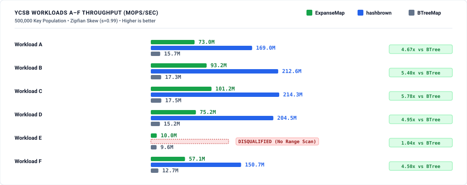
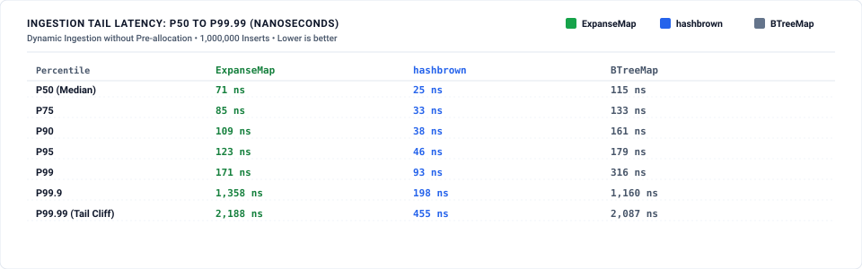
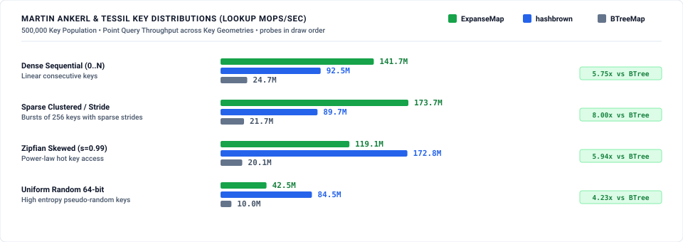
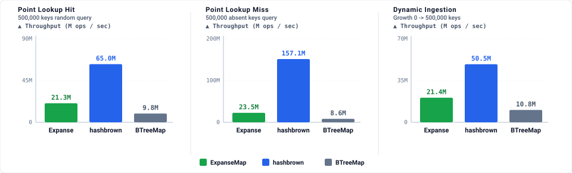

# Expanse vs. Hashbrown vs. BTreeMap: Empirical Comparative Benchmark Suite

This directory contains the reproducible benchmark suite, raw measurements, methodology specifications, and dual-theme visualization assets comparing **Expanse** (`ExpanseMap`), **Hashbrown / Google SwissTable** (`hashbrown::HashMap`), and **B-Tree** (`std::collections::BTreeMap`).

---

## 1. Architectural Feature Matrix

| Capability / Property | `hashbrown::HashMap` (SwissTable) | `std::collections::BTreeMap` | `expanse::ExpanseMap` |
| :--- | :--- | :--- | :--- |
| **Underlying Data Structure** | Flat 1-Byte Control Array + Buckets | Cache-Oblivious B-Tree | Expanse-Partitioned Digital Trie |
| **Point Query Complexity** | O(1) amortized expected | O(log N) | O(k) ≤ 8 digit steps |
| **Ordered Traversal & Range Scans** | ❌ **Disqualified** (O(N log N)) | ✅ Supported | ✅ Supported |
| **Sequential Key Memory Density** (16 to 4M keys) | 19.6 – 35.7 Bytes / Key | 31.5 – 42.0 Bytes / Key | **8.6 Bytes / Key** at 4M keys, below both from 5,623 keys up; 1,296 Bytes / Key at 16 keys |
| **Key Hashing Required** | Required (SipHash / FoldHash) | Not needed — direct ordering | Not needed — direct radix prefix slicing |
| **Dynamic Ingestion Growth Model** | Global Table Doubling (Rehash) | Node Splitting | Local Subexpanse Allocation |

---

## 2. Key Findings & Empirical Results

The YCSB pillar and Pillars 2, 4 and 6 carry their own provenance below. Pillars 3 and 5 were measured together:

*(measured: the reference host — Intel i9-12900F, 24 threads, 30 MiB L3, Ubuntu 22.04 / kernel 6.8, `powersave` governor, CPUs `0-15`, commit 2f82cd07; `run.sh --skip-ycsb`, two runs of 9 rounds, one process per round with the arm order rotated; every round process in its own load window, foreign busy CPU at most 0.04 core-equivalents in any window; means with BCa 95% intervals, ratios paired per round, run 1 first and run 2 in parentheses; `results/baseline_{native,tail_latency,memory}.json`, run 2 at `results/baseline_*_run2.json`)*

### Pillar 1: YCSB (Yahoo! Cloud Serving Benchmark) Workloads A–F
Zipfian access distribution ($s = 0.99$, power-law skew) on 500,000 dense sequential keys (`1..=N`) with `u64` values (workload: `hashbrown_ycsb`).

*(measured: the reference host — Intel i9-12900F, 24 threads, 30 MiB L3, Ubuntu 22.04 / kernel 6.8, commit 21a382f3; 8 paired rounds via `scripts/ycsb_bench.py --suite hashbrown`, pinned CPUs `0,2,4,6,8,10,12,14`, idle host — load < 0.4 before and between rounds; BCa 95% intervals and paired per-round ratios; `results/baseline_ycsb.json` and run 2 at `results/baseline_ycsb_run2.json`)*

> **This workload E is not `workload_ycsb`'s workload E** (`docs/BENCHMARKING.md`, "Standardized YCSB Workload Suite"): here a scan takes 10–59 records with no predicate over dense sequential `u64` values; there it takes 10–100 records that pass a key-parity predicate over uniform-random keys and 128 B blobs. The two are not comparable, and the near-parity below does not contradict the 1.55× loss published there.



- **Workload E (Short Range Scans):** SwissTable is structurally disqualified (`DISQUALIFIED: cannot perform ordered range scans without full O(N log N) dump and sort`). `ExpanseMap` and `BTreeMap` execute ordered range queries natively:
  - Shuffled keys: `ExpanseMap` leads `BTreeMap` **1.259× [1.253, 1.263]** (Run 2: 1.265× [1.258, 1.274]) ($9.57\text{ vs }7.60\text{ Mops/s}$).
  - Sorted keys: `ExpanseMap` leads `BTreeMap` **1.039× [1.032, 1.054]** (Run 2: 1.040× [1.034, 1.048]) ($10.00\text{ vs }9.62\text{ Mops/s}$).
- **Read & Update Heavy Workloads (A, B, C, D, F):** `ExpanseMap` delivers $57.1\text{–}101.2\text{ Mops/s}$ (sorted) / $47.4\text{–}77.7\text{ Mops/s}$ (shuffled):
  - Shuffled keys: `ExpanseMap` leads `BTreeMap` **4.54× to 6.62×** (A: 4.539× [4.480, 4.604], B: 6.258× [6.141, 6.307], C: 6.624× [6.588, 6.655], D: 5.470× [5.375, 5.529], F: 4.859× [4.837, 4.907]; Run 2: A 4.561×, B 6.342×, C 6.561×, D 5.478×, F 4.866×).
  - Sorted keys: `ExpanseMap` leads `BTreeMap` **4.50× to 5.78×** (A: 4.672× [4.495, 4.786], B: 5.396× [5.101, 5.855], C: 5.778× [5.467, 6.181], D: 4.946× [4.770, 5.185], F: 4.497× [4.329, 4.676]; Run 2: A 4.668×, B 5.410×, C 5.853×, D 4.964×, F 4.513×).
- **`hashbrown` leads the pure point-op workloads** on dense sequential integer keys ($150.7\text{–}214.3\text{ Mops/s}$ sorted, $137.9\text{–}192.1\text{ Mops/s}$ shuffled; `ExpanseMap` trails 0.368× to 0.548× across geometries, e.g. C shuffled 0.548× [0.544, 0.553], D sorted 0.368× [0.356, 0.381]) — an unordered flat table's home turf. The trade is ordered capability (Workload E) and worst-case latency (Pillar 3 rehash cliffs), not average point throughput.

---

### Pillar 2: Memory Footprint (Live Heap Bytes / Key)
Measured via custom `GlobalAlloc` hooks tracking requested heap bytes at steady state. A single population samples two sawtooths at an arbitrary phase — `hashbrown` doubles its table when full, Expanse's footprint follows leaf occupancy — so the headline is the range across Pillar 6's 26-population sweep (16 to 4,194,304 keys; workload: `hashbrown_pop_sweep`), not one N.

| Key Pattern | `hashbrown` min – max | `BTreeMap` min – max | `ExpanseMap` min – max |
| :--- | :--- | :--- | :--- |
| **Dense Sequential (0 … N)** | 19.6 – 35.7 B/key | 31.5 – 42.0 B/key | 8.6 (at 4M) – 1,296.0 (at 16) B/key |
| **Uniform Random 64-bit** | 19.6 – 35.7 B/key | 25.5 – 42.0 B/key | 24.6 (at 1M) – 1,296.0 (at 16) B/key |

From 1,000 keys up, Expanse requests 58.3–69.4 B/key at 1,000 keys and falls from there; on sequential keys it is below both competitors from 5,623 keys up, while on random keys it is below `hashbrown` only where `hashbrown` sits near the top of its sawtooth (31,623 and 316,228–1,000,000 and 4,194,304 keys) and above it everywhere else in the sweep. Below about 1,000 keys Expanse is the largest of the three by an order of magnitude. Per-population values, crossovers and the sweep's min / mean / max are in Pillar 6 *(measured: commit 0c2152c4, runs 43140570831 and 43141321251, `results/baseline_pop_sweep.json`)*. The earlier four-population census (1k, 10k, 100k, 500k; `results/baseline_memory.json`, commit 2f82cd07, reproduced byte-identical at 99d5b5ff) gives, at 500,000 keys, sequential 8.7 against 35.7 and random 24.7 against 35.7 B/key, and at 100,000 random keys 30.6 against 22.3 B/key (workload: `hashbrown_memory_alloc`): points on the same two curves.

---

### Pillar 3: Ingestion Tail Latency & Rehash Cliffs
Dynamic table expansion from $0 \to 10^6$ keys without pre-allocating capacity, measured via `HdrHistogram` (`total_inserts` in `results/baseline_tail_latency.json`).



Every figure below is the mean over 9 rounds of that round's percentile, with its BCa 95% interval (workload: `hashbrown_tail_latency`).

| Percentile | `ExpanseMap` | `hashbrown` | `BTreeMap` |
| :--- | :--- | :--- | :--- |
| $P_{50}$ | 71 ns [71, 72] (71 [70, 71]) | 25 ns [25, 26] (25 [25, 26]) | 115 ns [115, 116] (116 [115, 116]) |
| $P_{99.99}$ | 2,188 ns [2,102, 2,281] (2,146 [2,111, 2,173]) | 455 ns [450, 461] (456 [453, 461]) | 2,087 ns [2,041, 2,161] (2,065 [2,027, 2,108]) |
| Max | 53.7 µs [25.3, 97.3] (38.4 µs [18.0, 81.7]) | 10.93 ms [10.86, 11.05] (11.04 ms [10.90, 11.31]) | 35.1 µs [25.1, 51.2] (45.8 µs [24.4, 80.9]) |

- `hashbrown` wins every percentile up to $P_{99.99}$: its median is 0.355× Expanse's [0.350, 0.360] (0.359× [0.354, 0.363]) and its $P_{99.99}$ 0.209× [0.199, 0.219] (0.213× [0.210, 0.218]), paired per round. Its **worst insert is about 11 ms in every round** — the global-rehash cliff, where the entire table is reallocated and rehashed at once.
- **Expanse's worst insert is 4.5–154 µs across the 18 rounds**, because growth is local subexpanse allocation: no global rehash exists in the structure. Paired per round, hashbrown's maximum is 743× Expanse's [328, 1457] (552× [340, 735]). A maximum is one sample per round, so its interval is wide; both runs put the ratio above 300×.
- `BTreeMap` sits beside Expanse in the tail: its $P_{99.99}$ is 0.958× Expanse's [0.907, 1.000] (0.963× [0.938, 0.991]), and the ratio of the two maxima, 2.630× [0.924, 7.137] (2.447× [1.310, 4.171]), is not resolved in run 1.
- *Timer-overhead disclosure:* the per-op `Instant::now()`/`elapsed()` bracket in this pillar is **uncalibrated**, so the low percentiles ($`P_{50}`$/$`P_{75}`$) sit near clock resolution and include the bracket's own cost; the tail/max cells (the cliffs above) are orders of magnitude larger and unaffected. Follow-up: subtract a calibrated bracket cost the way `crates/expanse/benches/ycsb.rs` does.

---

### Pillar 4: Key Distributions (Ankerl & Tessil geometries, Barrett's trie-adversarial classes)
Point lookup throughput (Mops/sec) across key geometries ($N = 500,000$ draws; means of 9 rounds, run 1), in two probe orders over the same build: **draw order**, the inserted key sequence as generated (`0, 1, 2, …` on dense sequential keys), and **shuffled**, a Fisher–Yates permutation of the same keys from the suite PRNG. The last five rows are the trie-adversarial classes of [Barrett's Judy versus hash-table comparison](https://www.nothings.org/computer/judy/), as 64-bit keys (`workload_common::KeyGen`): a dense random $2^{22}$ sub-range, the same keys byte-reversed into the top bytes (so neighbours differ at the top digit; the pair holds the key set fixed), one ASCII character per byte, and `i * 64`. The two 22-bit classes draw with repetition and hold 471,413 distinct keys. Ratios are Expanse over the competitor, paired per round, above 1 = Expanse faster, with run 2 in parentheses (workload: `hashbrown_container_dists`). `hashbrown` uses its default hasher (foldhash). Insert throughput and its ratios are in `results/baseline_distributions.json`.

*(measured: the reference host — Intel i9-12900F, 24 threads, 30 MiB L3, Ubuntu 22.04 / kernel 6.8, `performance` governor, CPUs `0-15`, commit 4659016f; bench_baremetal runs [43120638706](https://github.com/orieg/expanse/actions/runs/43120638706) and [43121004998](https://github.com/orieg/expanse/actions/runs/43121004998), `run_all.py --skip-ycsb`, 9 rounds each, one process per round with the arm order rotated; foreign busy CPU at most 0.03 core-equivalents in any round's window; BCa 95% intervals; `results/baseline_distributions.json` and run 2 at `results/baseline_distributions_run2.json`)*



**Hits:**

| Key Geometry (N = 500,000) | `hashbrown` draw / shuffled | `BTreeMap` draw / shuffled | `ExpanseMap` draw / shuffled | Expanse / `hashbrown`, draw | Expanse / `hashbrown`, shuffled | Expanse / `BTreeMap`, draw | Expanse / `BTreeMap`, shuffled |
| :--- | :--- | :--- | :--- | :--- | :--- | :--- | :--- |
| **Sparse Clustered / Stride** | 90.2 / 95.3 | 21.4 / 9.6 | 172.9 / 60.8 | **1.919× [1.888, 1.957]** (1.869× [1.763, 1.938]) | 0.639× [0.623, 0.660] (0.641× [0.626, 0.659]) | **8.085× [8.018, 8.171]** (8.142× [8.084, 8.229]) | **6.342× [6.321, 6.364]** (6.319× [6.281, 6.351]) |
| **Dense Sequential (0 … N)** | 97.4 / 110.7 | 24.8 / 9.8 | 134.6 / 65.1 | **1.384× [1.339, 1.421]** (1.347× [1.282, 1.413]) | 0.602× [0.550, 0.673] (0.607× [0.561, 0.667]) | **5.433× [5.365, 5.525]** (5.407× [5.353, 5.471]) | **6.672× [6.595, 6.769]** (6.683× [6.616, 6.773]) |
| **Zipfian Skewed (s = 0.99)** | 178.0 / 253.8 | 19.7 / 19.7 | 118.0 / 118.5 | 0.666× [0.633, 0.691] (0.676× [0.651, 0.707]) | 0.467× [0.462, 0.475] (0.478× [0.468, 0.506]) | **5.978× [5.961, 5.994]** (5.983× [5.960, 6.007]) | **6.011× [5.990, 6.034]** (5.974× [5.881, 6.012]) |
| **Uniform Random 64-bit** | 84.6 / 88.1 | 10.0 / 9.9 | 42.4 / 42.3 | 0.501× [0.495, 0.510] (0.498× [0.494, 0.501]) | 0.480× [0.475, 0.485] (0.479× [0.475, 0.485]) | **4.261× [4.241, 4.290]** (4.273× [4.245, 4.293]) | **4.261× [4.253, 4.275]** (4.255× [4.240, 4.284]) |
| **Dense random 2^22 sub-range** (`rand22`) | 85.8 / 90.3 | 10.2 / 10.1 | 48.1 / 47.8 | 0.561× [0.558, 0.563] (0.562× [0.558, 0.567]) | 0.529× [0.524, 0.535] (0.524× [0.519, 0.530]) | **4.736× [4.687, 4.814]** (4.744× [4.704, 4.809]) | **4.728× [4.696, 4.752]** (4.736× [4.716, 4.773]) |
| **Byte-swapped dense random** (`rand22_bswap`) | 85.0 / 88.3 | 10.1 / 10.1 | 42.4 / 42.0 | 0.498× [0.494, 0.503] (0.500× [0.496, 0.504]) | 0.476× [0.469, 0.483] (0.473× [0.468, 0.479]) | **4.187× [4.153, 4.210]** (4.203× [4.189, 4.218]) | **4.168× [4.090, 4.195]** (4.171× [4.138, 4.199]) |
| **ASCII `A–Z` per byte** (`ascii_upper`) | 85.1 / 87.8 | 9.9 / 9.9 | 15.9 / 15.8 | 0.187× [0.186, 0.188] (0.186× [0.184, 0.188]) | 0.181× [0.178, 0.185] (0.180× [0.179, 0.182]) | **1.603× [1.597, 1.611]** (1.602× [1.592, 1.608]) | **1.605× [1.595, 1.622]** (1.612× [1.606, 1.624]) |
| **ASCII `[0-9A-Za-z]` per byte** (`ascii_alnum`) | 84.6 / 87.2 | 9.9 / 9.9 | 20.5 / 20.2 | 0.242× [0.241, 0.245] (0.244× [0.242, 0.245]) | 0.232× [0.231, 0.233] (0.233× [0.232, 0.235]) | **2.065× [2.053, 2.080]** (2.074× [2.065, 2.086]) | **2.050× [2.043, 2.057]** (2.048× [2.042, 2.056]) |
| **Stride 64** (`stride64`) | 100.1 / 110.2 | 24.7 / 9.8 | 94.3 / 38.4 | 0.944× [0.921, 0.974] (0.959× [0.935, 0.986]) | 0.355× [0.328, 0.394] (0.357× [0.331, 0.395]) | **3.815× [3.787, 3.860]** (3.831× [3.788, 3.873]) | **3.920× [3.895, 3.943]** (3.932× [3.917, 3.953]) |

**Misses** (N distinct absent keys from each distribution's own generator, resumed at N and rejected on membership, cycled; `zipfian` has none, since N Zipf draws over `1..=N` leave too few absent values):

| Key Geometry (N = 500,000) | `hashbrown` | `BTreeMap` | `ExpanseMap` | Expanse / `hashbrown` | Expanse / `BTreeMap` |
| :--- | :--- | :--- | :--- | :--- | :--- |
| **Sparse Clustered / Stride** | 196.9 | 51.4 | 254.7 | **1.338× [1.163, 1.465]** (1.327× [1.138, 1.463]) | **4.953× [4.896, 5.001]** (4.995× [4.932, 5.049]) |
| **Dense Sequential (0 … N)** | 192.9 | 31.1 | 215.9 | **1.167× [1.006, 1.299]** (1.086× [0.924, 1.207]) | **6.943× [6.880, 7.043]** (6.966× [6.848, 7.158]) |
| **Uniform Random 64-bit** | 165.1 | 9.8 | 41.2 | 0.250× [0.244, 0.259] (0.250× [0.244, 0.256]) | **4.217× [4.153, 4.298]** (4.209× [4.150, 4.282]) |
| **Dense random 2^22 sub-range** (`rand22`) | 186.1 | 10.0 | 60.0 | 0.324× [0.310, 0.343] (0.323× [0.314, 0.336]) | **6.013× [5.918, 6.098]** (6.011× [5.940, 6.083]) |
| **Byte-swapped dense random** (`rand22_bswap`) | 176.9 | 9.9 | 41.7 | 0.237× [0.228, 0.249] (0.245× [0.232, 0.266]) | **4.219× [4.145, 4.309]** (4.223× [4.145, 4.315]) |
| **ASCII `A–Z` per byte** (`ascii_upper`) | 164.9 | 9.7 | 17.2 | 0.104× [0.102, 0.106] (0.104× [0.102, 0.105]) | **1.764× [1.747, 1.771]** (1.767× [1.762, 1.773]) |
| **ASCII `[0-9A-Za-z]` per byte** (`ascii_alnum`) | 161.5 | 9.7 | 24.1 | 0.149× [0.146, 0.155] (0.149× [0.146, 0.152]) | **2.475× [2.449, 2.516]** (2.492× [2.470, 2.524]) |
| **Stride 64** (`stride64`) | 197.6 | 31.3 | 191.0 | 1.012× [0.868, 1.145] (1.002× [0.850, 1.118]) | **6.102× [5.991, 6.175]** (6.024× [5.943, 6.114]) |

- **Probe order decides the sequential, clustered and stride-64 results.** With the build unchanged, shuffling the probes turns Expanse's lead over `hashbrown` on dense sequential keys (1.384×) into a loss (0.602×), on clustered keys from 1.919× into 0.639×, and on stride-64 keys from near parity (0.944×) into 0.355×; in both runs, with intervals that do not overlap 1. In draw order consecutive probes land in the same or the adjacent Expanse leaf; that the loss is that locality going away is a hypothesis, not measured here (no cache counter was taken). On the random classes, where draw order is already random, the two orders agree within a few percent.
- **The adversarial classes all lose to `hashbrown`, and the worst is not the byte-swapped one.** One ASCII character per byte is the slowest shape measured: 0.187× on hits and 0.104× on misses (uppercase), 0.242× and 0.149× (alphanumeric). Byte-reversing the dense 22-bit keys costs Expanse about 11% against its un-swapped control (0.498× against 0.561× on hits, 0.237× against 0.324× on misses) — measurably worse, but the ASCII classes are worse by far. Every class still beats `BTreeMap`, from 1.60× (`ascii_upper`) upward.
- **Misses.** Expanse leads `hashbrown` on clustered misses (1.338×), is level on stride-64 misses (intervals contain 1 in both runs), and on dense sequential misses leads in run 1 (1.167× [1.006, 1.299]) while run 2's interval contains 1 (1.086× [0.924, 1.207]), so that cell is not claimed. Every random and adversarial class loses its misses by more than its hits.
- **Correction.** The first pair of runs of this pillar (commit 2f82cd07, `powersave` governor, draw order only) published dense sequential at 1.740× [1.694, 1.787] (run 2 1.781× [1.758, 1.822]) and uniform random at 0.340× [0.338, 0.342] over `hashbrown`; re-measured in the same draw order, dense sequential is 1.384× and uniform random 0.501× here. Both runs moved those cells, zipfian and every `BTreeMap` ratio the same way, with intervals disjoint from the earlier ones; the commit and the host's frequency governor both changed, so the shift is not attributed. A pair of runs between the two, at 99d5b5ff with the four original distributions only ([43118879867](https://github.com/orieg/expanse/actions/runs/43118879867), [43119259121](https://github.com/orieg/expanse/actions/runs/43119259121)), measured dense sequential draw order at 1.532× [1.516, 1.556] (1.519× [1.485, 1.576]) and shuffled at 0.607× (0.605×): the engine is the same, and the draw-order figure moved between the two harness versions while the shuffled one did not. Which change to the process (five more distributions, and the miss sets built before each round's maps) moves the draw-order figure is not measured. The figure that describes a lookup independent of probe order and of that sensitivity is the shuffled one: about 0.60× on dense sequential keys.

---

### Pillar 5: Native Hashbrown Criterion Suite Port
Point query hit/miss and dynamic growth throughput ported from `hashbrown/benches/bench.rs` (chart shows the largest population band, $`N = 500,000`$; the $`10^4`$/$`10^5`$ bands are in `results/baseline_native.json`):

The growth arms time each build alone and drop the map after the clock stops. Per-arm intervals and paired ratios for every population and op are in `results/baseline_native.json` (workload: `hashbrown_native_suite`).



---

### Pillar 6: Population Sweep — Crossovers and Both Memory Sawtooths
Point lookup (hit and miss) and live heap bytes per key from 16 to 4,194,304 keys: 16, 24, 31, 32 (around `ROOT_LEAF_CAP` = 31, below which a map is one root leaf), 48, 64, then four populations per decade and $2^{22}$ (workload: `hashbrown_pop_sweep`). Each cell times 1,048,576 probes drawn uniformly with replacement from the keys (never in draw order) and as many from N distinct absent keys of the distribution's own generator (at most 65,536), against foldhash `hashbrown` and `BTreeMap`. Ratios are Expanse's throughput over the competitor's, above 1 = Expanse faster; each cell is the union of the two runs' BCa intervals of the paired per-round ratio, **bold** where both runs put Expanse ahead, ‡ where one run's interval contains 1 and the other's does not. Bytes per key are requested `Layout::size` bytes over the distinct key count.

*(measured: the reference host — Intel i9-12900F, 24 threads, 30 MiB L3, Ubuntu 22.04 / kernel 6.8, `performance` governor, CPUs `0-15`, commit 0c2152c4; bench_baremetal runs [43140570831](https://github.com/orieg/expanse/actions/runs/43140570831) and [43141321251](https://github.com/orieg/expanse/actions/runs/43141321251), `run_all.py --skip-ycsb`, 9 rounds each, one process per round with the arm order rotated; foreign busy CPU at most 0.02 core-equivalents in any round's window; BCa 95% intervals; `results/baseline_pop_sweep.json` and run 2 at `results/baseline_pop_sweep_run2.json`; the live-heap counts are exact and identical in every round of both runs)*

- **No lookup crossover against `hashbrown` in the measured range.** On hits `hashbrown` is faster at every population from 16 to 4,194,304 keys on all three distributions, in both runs (a few sequential cells tie in one run). The cache-resident range is not an exception here: at 1,000 random keys Expanse runs at [0.103, 0.112]× `hashbrown`'s rate. Misses follow the same pattern on random and byte-swapped keys; on sequential keys Expanse's misses are faster at 1,778, 56,234 and 1,778,279 keys in both runs and slower or level elsewhere, so the sequential-miss winner changes six times across the sweep (`summary.sequential.crossovers` in the artifact) — those are the only crossovers against `hashbrown` the sweep found.
- **Against `BTreeMap` the one loss is at 32 sequential keys**: Expanse is faster at every other population and distribution, and slower at exactly 32 sequential keys ([0.523, 0.529]× on hits), the population one past `ROOT_LEAF_CAP`, where the sequential map also requests 1,295 B/key.
- **Memory is two sawtooths, and the small-N end is Expanse's worst.** An `ExpanseMap` requests 1,296 B/key at 16 keys (about 20 KiB), falling to 58.3 (random) and 69.4 (sequential) B/key at 1,000 keys; `hashbrown` stays between 19.6 and 35.7 B/key at every population and `BTreeMap` between 25.5 and 42.0. Above 1,000 keys Expanse is below `hashbrown` on sequential keys from 5,623 keys up (8.6 B/key at 4M), and on random keys only at 31,623 and at 316,228–1,000,000 and 4,194,304 keys, the populations where `hashbrown` is near the top of its resize sawtooth.

Sweep summary per distribution, live heap bytes per key over all 26 populations (`summary` in the artifact; the mean is dominated by the small-N points and is not a typical value — read the per-population table):

| distribution | `ExpanseMap` min / mean / max | `hashbrown` min / mean / max | `BTreeMap` min / mean / max |
|---|---|---|---|
| random | 24.6 (at 1,000,000) / 249.1 / 1,296.0 (at 16) | 19.6 (at 1,778) / 27.9 / 35.7 (at 1,000,000) | 25.5 (at 64) / 28.8 / 42.0 (at 16) |
| sequential | 8.6 (at 4,194,304) / 289.8 / 1,296.0 (at 16) | 19.6 (at 1,778) / 27.9 / 35.7 (at 1,000,000) | 31.5 (at 64) / 34.4 / 42.0 (at 16) |
| rand22_bswap | 25.0 (at 562,341) / 246.4 / 1,296.0 (at 16) | 19.6 (at 1,778) / 27.7 / 35.6 (at 31) | 25.9 (at 100) / 28.7 / 42.0 (at 16) |

**`random`**

| N | hit: Expanse / `hashbrown` | miss: Expanse / `hashbrown` | hit: Expanse / `BTreeMap` | B/key `ExpanseMap` | B/key `hashbrown` | B/key `BTreeMap` |
|---:|---:|---:|---:|---:|---:|---:|
| 16 | [0.466, 0.645] | [0.540, 0.924] | **[4.141, 4.343]** | 1296.0 | 35.0 | 42.0 |
| 24 | [0.376, 0.528] | [0.481, 0.793] | **[3.814, 3.934]** | 869.3 | 23.3 | 36.0 |
| 31 | [0.359, 0.432] | [0.441, 0.598] | **[3.905, 3.975]** | 677.2 | 35.6 | 34.1 |
| 32 | [0.247, 0.305] | [0.402, 0.614] | **[2.689, 2.741]** | 1024.0 | 34.5 | 33.0 |
| 48 | [0.239, 0.282] | [0.610, 0.939] | **[2.805, 2.857]** | 682.7 | 23.0 | 30.0 |
| 64 | [0.192, 0.209] | [0.376, 0.482] | **[2.462, 2.508]** | 580.0 | 34.2 | 25.5 |
| 100 | [0.156, 0.184] | [0.351, 0.595] | **[2.278, 2.315]** | 380.2 | 21.9 | 33.6 |
| 178 | [0.102, 0.119] | [0.232, 0.339] | **[1.570, 1.592]** | 218.6 | 24.5 | 29.1 |
| 316 | [0.084, 0.092] | [0.172, 0.219] | **[1.525, 1.540]** | 140.2 | 27.6 | 27.0 |
| 562 | [0.101, 0.107] | [0.161, 0.186] | **[1.978, 1.995]** | 87.6 | 31.0 | 25.6 |
| 1,000 | [0.103, 0.112] | [0.136, 0.146] | **[2.451, 2.478]** | 58.3 | 34.8 | 27.7 |
| 1,778 | [0.174, 0.188] | [0.709, 0.795] | **[2.909, 2.930]** | 44.5 | 19.6 | 26.6 |
| 3,162 | [0.139, 0.150] | [0.332, 0.380] | **[3.170, 3.193]** | 38.1 | 22.0 | 26.8 |
| 5,623 | [0.073, 0.078] | [0.143, 0.153] | **[2.036, 2.047]** | 33.1 | 24.8 | 27.0 |
| 10,000 | [0.134, 0.143] | [0.234, 0.251] | **[4.224, 4.250]** | 32.9 | 27.9 | 26.8 |
| 17,783 | [0.138, 0.146] | [0.264, 0.271] | **[4.434, 4.453]** | 31.3 | 31.3 | 27.0 |
| 31,623 | [0.114, 0.119] | [0.185, 0.190] | **[3.378, 3.401]** | 32.8 | 35.2 | 27.3 |
| 56,234 | [0.115, 0.118] | [0.667, 0.690] | **[2.679, 2.711]** | 33.0 | 19.8 | 27.2 |
| 100,000 | [0.109, 0.113] | [0.267, 0.278] | **[3.156, 3.191]** | 30.5 | 22.3 | 27.2 |
| 177,828 | [0.138, 0.155] | [0.175, 0.180] | **[3.677, 3.732]** | 27.2 | 25.1 | 27.1 |
| 316,228 | [0.210, 0.227] | [0.128, 0.132] | **[4.258, 4.321]** | 25.6 | 28.2 | 27.1 |
| 562,341 | [0.282, 0.295] | [0.117, 0.121] | **[5.203, 5.361]** | 24.9 | 31.7 | 27.1 |
| 1,000,000 | [0.335, 0.343] | [0.114, 0.120] | **[4.793, 4.940]** | 24.6 | 35.7 | 27.1 |
| 1,778,279 | [0.166, 0.172] | [0.283, 0.289] | **[3.394, 3.492]** | 25.2 | 20.0 | 27.1 |
| 3,162,278 | [0.243, 0.246] | [0.396, 0.404] | **[4.813, 4.862]** | 29.2 | 22.5 | 27.1 |
| 4,194,304 | [0.259, 0.263] | [0.209, 0.218] | **[4.939, 4.976]** | 28.7 | 34.0 | 27.1 |

**`sequential`**

| N | hit: Expanse / `hashbrown` | miss: Expanse / `hashbrown` | hit: Expanse / `BTreeMap` | B/key `ExpanseMap` | B/key `hashbrown` | B/key `BTreeMap` |
|---:|---:|---:|---:|---:|---:|---:|
| 16 | [0.467, 0.481] | [0.452, 1.014] ‡ | **[4.456, 4.518]** | 1296.0 | 35.0 | 42.0 |
| 24 | [0.370, 0.382] | [0.467, 1.237] | **[3.856, 3.934]** | 869.3 | 23.3 | 36.0 |
| 31 | [0.360, 0.454] | [0.372, 0.988] | **[3.831, 3.913]** | 677.2 | 35.6 | 34.1 |
| 32 | [0.049, 0.076] | [0.149, 0.553] | [0.523, 0.529] | 1295.0 | 34.5 | 33.0 |
| 48 | [0.282, 0.745] | [0.365, 1.395] ‡ | **[3.191, 3.286]** | 1114.7 | 23.0 | 34.0 |
| 64 | [0.273, 0.330] | [0.288, 0.748] | **[3.354, 3.397]** | 840.0 | 34.2 | 31.5 |
| 100 | [0.297, 1.233] ‡ | [0.550, 1.453] | **[4.138, 4.265]** | 540.2 | 21.9 | 35.5 |
| 178 | [0.279, 1.101] ‡ | [0.247, 0.754] | **[4.532, 4.644]** | 306.3 | 24.5 | 33.4 |
| 316 | [0.185, 0.753] | [0.212, 0.691] | **[3.208, 3.281]** | 202.5 | 27.6 | 33.7 |
| 562 | [0.129, 0.689] | [0.215, 0.731] | **[2.494, 2.526]** | 117.1 | 31.0 | 33.5 |
| 1,000 | [0.200, 0.275] | [0.352, 0.728] | **[4.700, 4.851]** | 69.4 | 34.8 | 34.4 |
| 1,778 | [0.262, 0.924] | **[1.326, 2.346]** | **[5.245, 5.356]** | 42.5 | 19.6 | 34.2 |
| 3,162 | [0.252, 0.566] | [0.769, 1.643] | **[6.130, 6.251]** | 27.5 | 22.0 | 34.2 |
| 5,623 | [0.243, 0.497] | [0.578, 1.443] ‡ | **[7.076, 7.286]** | 19.0 | 24.8 | 34.2 |
| 10,000 | [0.249, 0.612] | [0.449, 1.510] ‡ | **[8.003, 8.481]** | 14.6 | 27.9 | 34.3 |
| 17,783 | [0.255, 0.754] | [0.416, 1.222] ‡ | **[8.095, 8.288]** | 12.0 | 31.3 | 34.3 |
| 31,623 | [0.305, 0.819] | [0.398, 0.939] | **[9.259, 9.471]** | 10.5 | 35.2 | 34.3 |
| 56,234 | [0.348, 1.338] ‡ | **[1.309, 2.849]** | **[8.501, 8.621]** | 9.7 | 19.8 | 34.3 |
| 100,000 | [0.239, 0.534] | [0.480, 1.078] ‡ | **[6.969, 7.067]** | 9.3 | 22.3 | 34.3 |
| 177,828 | [0.224, 0.268] | [0.386, 0.667] | **[6.201, 6.276]** | 9.0 | 25.1 | 34.3 |
| 316,228 | [0.369, 0.411] | [0.389, 0.590] | **[8.689, 9.423]** | 8.8 | 28.2 | 34.3 |
| 562,341 | [0.418, 0.484] | [0.265, 0.356] | **[8.291, 9.595]** | 8.7 | 31.7 | 34.3 |
| 1,000,000 | [0.514, 0.594] | [0.324, 0.367] | **[8.130, 9.493]** | 8.7 | 35.7 | 34.3 |
| 1,778,279 | [0.439, 0.479] | **[1.313, 1.631]** | **[9.910, 10.711]** | 8.6 | 20.0 | 34.3 |
| 3,162,278 | [0.404, 0.428] | [0.664, 0.804] | **[8.362, 8.827]** | 8.6 | 22.5 | 34.3 |
| 4,194,304 | [0.393, 0.408] | [0.686, 0.723] | **[7.607, 7.907]** | 8.6 | 34.0 | 34.3 |

**`rand22_bswap`**

| N | hit: Expanse / `hashbrown` | miss: Expanse / `hashbrown` | hit: Expanse / `BTreeMap` | B/key `ExpanseMap` | B/key `hashbrown` | B/key `BTreeMap` |
|---:|---:|---:|---:|---:|---:|---:|
| 16 | [0.463, 0.629] | [0.595, 0.906] | **[4.351, 4.482]** | 1296.0 | 35.0 | 42.0 |
| 24 | [0.374, 0.460] | [0.580, 0.925] | **[3.849, 3.902]** | 869.3 | 23.3 | 36.0 |
| 31 | [0.359, 0.490] | [0.471, 0.673] | **[3.958, 4.021]** | 677.2 | 35.6 | 34.1 |
| 32 | [0.179, 0.213] | [0.410, 0.558] | **[1.982, 2.008]** | 1024.0 | 34.5 | 33.0 |
| 48 | [0.159, 0.221] | [0.417, 1.070] ‡ | **[1.843, 1.881]** | 682.7 | 23.0 | 30.0 |
| 64 | [0.170, 0.220] | [0.348, 0.458] | **[2.115, 2.151]** | 512.0 | 34.2 | 28.5 |
| 100 | [0.147, 0.171] | [0.521, 0.929] | **[1.805, 1.838]** | 376.3 | 21.9 | 25.9 |
| 178 | [0.112, 0.124] | [0.258, 0.387] | **[1.749, 1.769]** | 221.5 | 24.5 | 27.5 |
| 316 | [0.084, 0.091] | [0.164, 0.217] | **[1.511, 1.529]** | 140.2 | 27.6 | 27.6 |
| 562 | [0.096, 0.100] | [0.154, 0.174] | **[1.889, 1.909]** | 87.6 | 31.0 | 27.3 |
| 1,000 | [0.104, 0.113] | [0.136, 0.145] | **[2.427, 2.454]** | 58.3 | 34.8 | 27.2 |
| 1,778 | [0.172, 0.189] | [0.683, 0.780] | **[2.865, 2.905]** | 46.9 | 19.6 | 26.8 |
| 3,162 | [0.135, 0.147] | [0.340, 0.404] | **[3.170, 3.215]** | 38.2 | 22.0 | 27.6 |
| 5,623 | [0.074, 0.079] | [0.144, 0.158] | **[2.051, 2.075]** | 33.3 | 24.8 | 27.3 |
| 10,000 | [0.119, 0.122] | [0.203, 0.214] | **[3.793, 3.831]** | 32.3 | 27.9 | 27.5 |
| 17,783 | [0.137, 0.142] | [0.264, 0.282] | **[4.430, 4.463]** | 31.0 | 31.4 | 27.0 |
| 31,623 | [0.115, 0.118] | [0.185, 0.190] | **[3.400, 3.433]** | 32.7 | 35.4 | 26.9 |
| 56,234 | [0.112, 0.115] | [0.642, 0.672] | **[2.672, 2.697]** | 33.1 | 19.9 | 27.0 |
| 100,000 | [0.110, 0.115] | [0.254, 0.267] | **[3.179, 3.268]** | 30.6 | 22.5 | 27.2 |
| 177,828 | [0.132, 0.146] | [0.159, 0.167] | **[3.702, 3.742]** | 27.2 | 25.6 | 27.0 |
| 316,228 | [0.189, 0.208] | [0.114, 0.127] | **[4.199, 4.276]** | 25.8 | 29.2 | 27.1 |
| 562,341 | [0.285, 0.293] | [0.105, 0.122] | **[5.184, 5.246]** | 25.0 | 33.8 | 27.1 |
| 1,000,000 | [0.188, 0.205] | [0.408, 0.506] | **[5.142, 5.277]** | 25.3 | 20.0 | 27.1 |
| 1,778,279 | [0.205, 0.209] | [0.111, 0.143] | **[3.983, 4.033]** | 26.0 | 24.6 | 27.1 |
| 3,162,278 | [0.253, 0.262] | [0.104, 0.123] | **[4.419, 4.501]** | 27.2 | 32.1 | 27.1 |
| 4,194,304 | [0.305, 0.308] | [0.296, 0.382] | **[5.741, 5.844]** | 27.6 | 26.9 | 27.1 |

---

## 3. Performance Investigation & Optimization Roadmap

During benchmark profiling, two key performance characteristics were identified:

1. **`MapRange` & `SetRange` Iterator Cursor Seeking (Implemented):**
   - **Optimization:** Refactored `MapRange` and `SetRange` to wrap `RawIter` with direct target descent seeking (`RawIter::from_tree_range`, `RawIter::from_root_leaf_range`).
   - **Result:** Eliminates $O(L \cdot 8)$ root restarts, allowing bounded range scans to stream contiguous leaf elements in $O(1)$ amortized time per key without heap allocation.

2. **Sparse Random Key Branch Allocation:**
   - **Observation:** On uniform random 64-bit keys at $N = 500,000$, Expanse consumes $24.7\text{ B/key}$ vs SwissTable's $35.7\text{ B/key}$; at $N = 100,000$ the ordering inverts ($30.6$ vs $22.3\text{ B/key}$) as sparse trie branches sit at low occupancy.
   - **Root Cause:** In high-entropy random distributions without shared prefixes, 64-bit keys create separate branch paths across levels 7 down to 0 with low occupancy per branch.
   - **Optimization Item:** Evaluate adaptive narrow pointer promotion / linear leaf inline key packing for sparse subexpanses.

---

## 4. How to Reproduce

All benchmarks can be reproduced with a single command:

```bash
# From repository root
./docs/benchmarks/hashbrown_comparison/run.sh

# Or quick verification mode:
./docs/benchmarks/hashbrown_comparison/run.sh --quick
```

### Directory Structure

```
docs/benchmarks/hashbrown_comparison/
├── README.md                      # Consolidated report and overview
├── METHODOLOGY.md                 # Rigor, isolation rules, and hardware setup
├── run.sh                         # 1-command reproduction runner
├── scripts/
│   ├── theme.py                   # Shared dual-theme CSS and SVG template module
│   ├── run_all.py                 # Master benchmark orchestrator
│   └── generate_charts.py         # Dual-theme SVG visualizer
└── results/                       # Raw JSON telemetry and generated SVGs
    ├── baseline_native.json
    ├── baseline_ycsb.json
    ├── baseline_tail_latency.json
    ├── baseline_distributions.json
    ├── baseline_memory.json
    ├── baseline_*_run2.json       # second run of each re-measured pillar
    ├── bench_native_throughput.svg
    ├── bench_ycsb_workloads.svg
    ├── bench_tail_latency.svg
    ├── bench_key_distributions.svg
    └── bench_memory_footprint.svg
```
