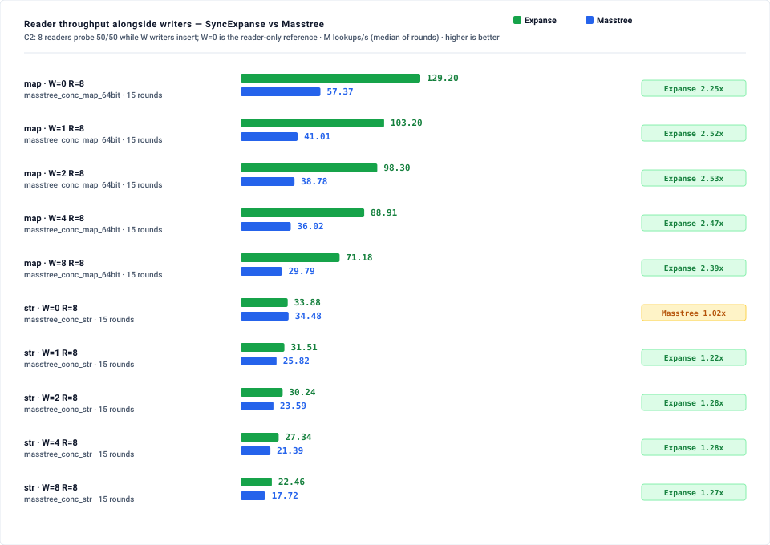
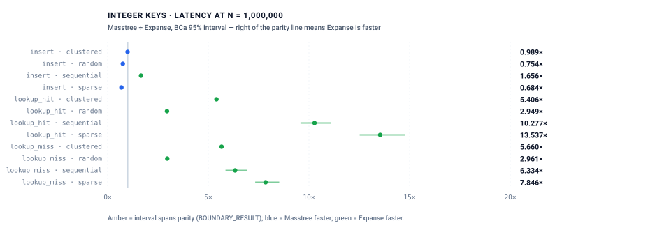
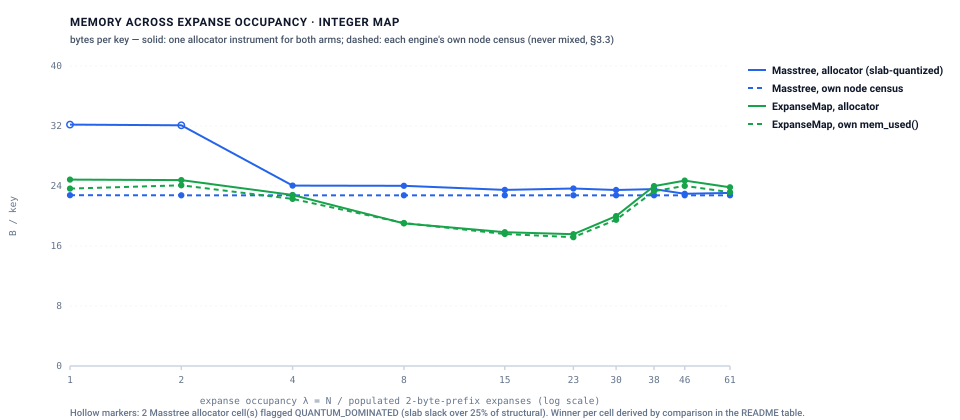
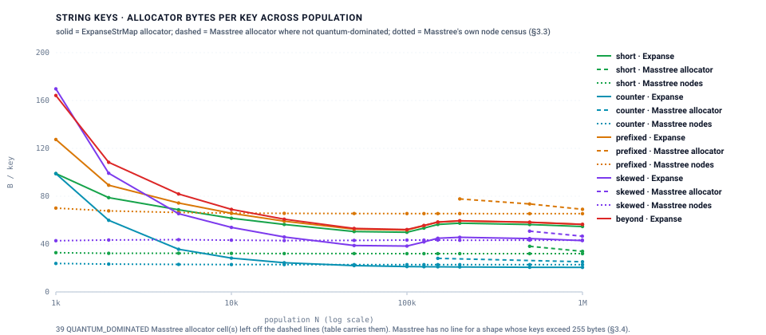
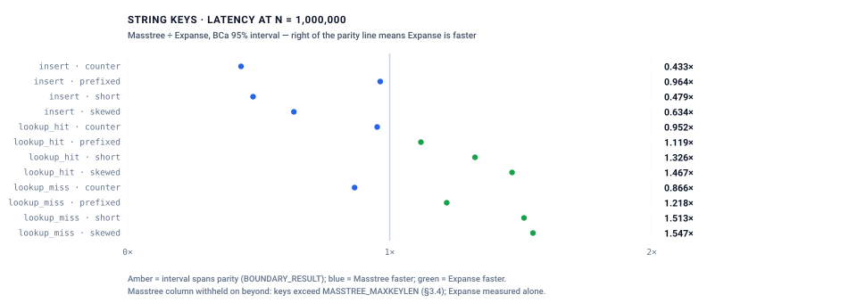

# Expanse vs. Masstree: Empirical Benchmark Suite

Head-to-head evaluation of `ExpanseMap`, `ExpanseStrMap`, `SyncExpanseMap` and
`SyncExpanseStrMap` against **Masstree**
([Mao, Kohler & Morris, EuroSys 2012](https://doi.org/10.1145/2168836.2168855)),
the trie of B+-trees, reached through a C++ FFI shim over the reference
implementation. The last of the three SOTA arms
[#387](https://github.com/orieg/expanse/issues/387) filed, and the second,
independent measurement of write concurrency beside the one
[#692](https://github.com/orieg/expanse/issues/692) took against HOT-ROWEX.

> **Tracking & provenance.** Delivers
> [#661](https://github.com/orieg/expanse/issues/661).
> *(measured: reference host — Intel Core i9-12900F, 8P+8E/24 threads, 30 MiB L3, Ubuntu 22.04, kernel 6.8; Masstree [`kohler/masstree-beta`](https://github.com/kohler/masstree-beta) `1119842`, MIT with a publicity clause; single-threaded phases (§1–§6 and the single-threaded cells of the §8 scorecard) re-measured at commit `b868fb2e` with `docs/benchmarks/masstree_comparison/run.sh`, **twice** — the tables are run 1, and run 2 at the same commit on the same host (`results/baseline_*_run2.json`) is the between-run check `docs/BENCHMARKING.md` rule 18 asks for (§8, "Two runs"); **the concurrent phases (§7: MC1, MC2, H and M) were re-measured at commit `929574b5`, two runs under each of two pins; under the pin the §7 level tables use, `0-15`, load average 0.97 and 1.08 at the runs' starts and at most 4.91 and 4.58 during them — the sweep's own threads, which is why it runs last — with foreign busy CPU at most 0.02 core-equivalents in any cell, and under the per-core pin `0,2,4,6,8,10,12,14` 0.93 and 1.30 at the starts, at most 4.71 and 6.20, foreign at most 0.03**; benchmark shell pinned to CPUs 0-15 and every concurrent row records the `Cpus_allowed_list` of its pin; both arms built for one ISA target — `-C target-cpu=haswell` and `-march=haswell -O3 -std=c++17 -DNDEBUG`, assertions off, superpages on, glibc 2.35 `malloc`; load average 1.00 at every one of the seven snapshots of both runs, start to end, with busy CPU 1.00–1.22 core-equivalents between consecutive snapshots in run 1 and 1.00–1.15 in run 2, of which the benchmark's own process accounts for 0.96–1.19 and 0.96–1.18, and a largest foreign busy-CPU delta of 0.04 core-equivalents in each run; frequency driver `intel_pstate` in `powersave`, transparent huge pages `madvise`, P-cores `0-15` with SMT and E-cores `16-23` outside the pin; 15 rounds per wall-clock cell, the arm timed first alternating per round, per-arm medians reported beside a mean-of-rounds ratio with its BCa 95% bootstrap interval over 2,000 resamples, every round's samples in `rounds_raw`; `results/baseline_*.json`; gate transcript `results/validate.log`)*
>
> Pre-registration, locked constraints and every amendment:
> [`METHODOLOGY.md`](METHODOLOGY.md). Every table below is the output of
> `scripts/tables.py` over `results/`; no number in a table is typed by hand.
> Ratios are **Masstree ÷ Expanse for latency and Expanse ÷ Masstree for
> throughput, so above 1.000 always means Expanse is faster**; memory is
> deterministic and carries no interval. This is internal work; no external
> peer review has been performed on any claim here.

---

## 1. The losses first

**Write concurrency is a loss on integer and on string keys, at 0.679–0.850
of Masstree's rate from two to eight writers.** `SyncExpanseMap` admits concurrent
writers through optimistic lock coupling over per-node version words, and since
#1001 `SyncExpanseStrMap` runs the same write bodies under each `StrNode`'s
cover word (`docs/ARCHITECTURE.md` §4.2); Masstree's per-node locks admit
writers on both. With eight writers inserting 2²⁰ fresh keys into a 2²⁰
prefill, Masstree sustains 32.16 M inserts/s against Expanse's 22.44 in run 1,
ratio 0.689 [0.649, 0.719] and 0.723 [0.684, 0.748] in run 2; at sixteen,
0.739 [0.676, 0.784] and 0.707 [0.640, 0.765] — sixteen threads on eight
physical P-cores with SMT *(workload: `masstree_conc_map_64bit`)*. Expanse's
aggregate integer insert rate runs 4.75 → 7.50 → 12.30 → 22.44 → 27.93 M/s
from one to sixteen writers (run 1) and Masstree's
5.12 → 9.60 → 17.90 → 32.16 → 34.42. The single-writer integer cell is
Masstree's in both runs, 0.936 [0.909, 0.962] and 0.921 [0.894, 0.946],
inside the registration "Masstree wins or `BOUNDARY_RESULT`", which is
**`CONFIRMED`**. On `short` string keys Masstree wins every writer cell from one
to eight writers in both runs: 0.803 [0.742, 0.869] and 0.816 [0.750, 0.881]
with one writer, 0.745–0.758 at two, 0.754–0.764 at four and 0.838–0.850 at
eight. At sixteen the cell is `BOUNDARY_RESULT` in both runs, 0.983
[0.894, 1.079] and 0.950 [0.866, 1.045], with the Expanse string writers at
26.47–27.01 M inserts/s against Masstree's 24.74–28.70 *(workload:
`masstree_conc_str`)*. Every string writer-only cell is bimodal by round in
both runs: both arms run slower in the odd rounds. The medians above pool the
two modes, and §7 table O gives each mode. These are two runs at `c1b604ad`, after design B
([#1586](https://github.com/orieg/expanse/issues/1586)). What limits either
Expanse arm's scaling is **unmeasured** — this arm carries no hardware counters
(§8.9) — and no mechanism is claimed. §6.1 rows 1 and 2 are **`CONFIRMED`**.

> **Correction: the `929574b5` pair is superseded.** §7 table C sets every
> cell against it. That pair had eight integer writers at 0.751 [0.719, 0.774]
> and 0.743 [0.704, 0.766], and the string writers at 0.726 and 0.678 with one
> writer, 0.760–0.766 at eight and 0.802–0.804 at sixteen, a Masstree win, with
> Expanse previously at 25.41–26.52 M inserts/s against 31.71–31.93. The two pairs are
> separate runs at two commits, not an interleaved A/B
> (`docs/BENCHMARKING.md` rule 18). No difference between them is attributed
> to design B. Design B's own cost on shared string inserts was measured by its
> gate, a paired comparison in another harness (concurrency `METHODOLOGY.md`
> §47.13). The pair is kept at `results/at_929574b5/`.

> **Correction (AGENTS.md §8.7).** Before the `929574b5` pair, these cells were published from
> two runs at `6f8d6ba5`, a commit that precedes #997 (the deferred-gated
> allocator shards and the padded writer state promoted to the default), #1001
> (the per-node optimistic write path for `SyncExpanseStrMap`, whose writers
> serialised on one mutex until then) and #1010 (the allocator's deferred
> path), among the 55 commits between the two. That pair previously had eight integer writers at
> 0.350 [0.344, 0.355] and 0.355 [0.349, 0.362] and sixteen at
> 0.282 [0.261, 0.300] and 0.284 [0.262, 0.302], and the string writers
> previously fell with writer count, from 2.44–2.56 M inserts/s at two to
> 0.46–0.50 at sixteen, 0.017 [0.016, 0.018] and 0.016 [0.015, 0.017]. Every
> writer-only cell at W ≥ 2, on both arms, moved up in both `929574b5` runs, each
> interval clear of both earlier ones (`results/at_929574b5/` against `results/at_6f8d6ba5/`): eight string writers went
> from 1.89–2.02 to 18.39–18.55 M inserts/s and sixteen from 0.46–0.50 to
> 25.41–26.52, eight integer writers from 11.56–11.64 to 24.66–25.19. The two
> pairs are separate runs at two commits with every change between them, not
> an interleaved A/B (`docs/BENCHMARKING.md` rule 18), so nothing is attributed
> to any one of those changes here; the same-commit gate that isolates #1001 is
> `docs/benchmarks/concurrency/README.md` §18. The earlier pair is kept at
> `results/at_6f8d6ba5/`.
>
> **The string single writer is not claimed to have regressed by the
> difference of the two published medians.** Its Expanse median was previously
> 3.66 and 3.88 M inserts/s and was 2.83 and 2.79 at `929574b5` (3.35 and 3.36 at `c1b604ad`), and the verdict went from
> `BOUNDARY_RESULT` in both `6f8d6ba5` runs to Masstree in both `929574b5` runs, both
> intervals below both earlier ones. But the earlier cell is bimodal by round
> order (`results/at_6f8d6ba5/`, split by round order as in §7 table O): Expanse ran at 3.00 M inserts/s in the rounds it was
> timed first and 4.11–4.12 in the rounds it was timed second, so the earlier
> median sat between two modes and described neither. At `929574b5` the
> timed-first median is 2.79–2.80 under pin `0-15` and the timed-second median
> 3.29 in run 1 and 2.80 in run 2, with single rounds up to 3.77. Mode against
> mode, the timed-first level is about 7% lower; in three of the four `929574b5` runs
> (both pins) the timed-second median is within 3% of the timed-first one,
> though single rounds reach 3.62–3.77 in all four, and whether the upper mode
> went with the engine or with whatever produced it is **unmeasured**. The
> same-commit A/B against the serialised wrapper, in another harness, measured the multi-writer path's
> single-writer price at 3.9%–4.8% (`docs/benchmarks/concurrency/README.md`
> §18.3) *(workloads differ: `concurrency_writer_str` vs `masstree_conc_str`;
> not a §8.4 paired claim)*. The cause of the order dependence is
> **unmeasured** and none is named (§8.9).


**String readers under writer load are Expanse's, where they were once
Masstree's by an order of magnitude.** With one writer inserting, Expanse's
eight `short`-key readers run at 31.51–31.60 M lookups/s across the two runs
against Masstree's 25.56–25.82, which is 1.241 [1.207, 1.290] and
1.252 [1.227, 1.343]. The ratio stays at 1.251–1.337 with two to eight writers
*(workload: `masstree_conc_str`; `c1b604ad`)*. The registered Masstree win (§6.1
row 3) is **`REFUTED`** in Expanse's favour on all four string cells in both
runs. **Correction (AGENTS.md §8.7):** the pair published at `6f8d6ba5` had
these readers at 1.07–1.10 M lookups/s under one writer, 0.045 [0.041, 0.053]
and 0.045 [0.043, 0.049], and at 0.200–0.281 with two to eight. The `929574b5`
pair had them at 1.232–1.251 under one writer and 1.189–1.299 with two to
eight. Which change between those commits moved them is not isolated by this
suite, and what sets the readers' level now is **unmeasured**. The §7 health
rows count events without pricing them.

The writer still pays for the readers. With eight readers probing, Expanse's
single string writer runs at 1.98–2.03 M inserts/s against Masstree's
2.88–2.90, and the integer single writer at 2.72–2.81 against 3.76–3.84.
The integer writer ratios are 0.848 [0.780, 0.926] and 0.737 [0.707, 0.794]
*(workload: `masstree_conc_map_64bit`)*. Every writer cell under readers is
Masstree's in both runs, 0.580–0.848 on integers and 0.716–0.834 on strings,
except the string cell with eight writers. That cell is `BOUNDARY_RESULT` in
run 1, 0.926 [0.868, 1.002], and Masstree's in run 2, 0.920 [0.859, 0.975],
so it carries a direction only (rule 18).



**Ordered scan on string keys is a loss in 33 of 36 cells**, 0.090
[0.089, 0.091] at worst (`counter`, k = 1000, N = 10⁴) and 2.271 [2.258, 2.302]
at best (`prefixed`, k = 10, N = 10⁴, where Expanse now wins) *(workload:
`masstree_str_map`)*, with the same winner in every cell in both runs —
**`CONFIRMED`** on the 33, **`REFUTED`** on the three `prefixed` k = 10 cells.

> **Re-measured after [#722](https://github.com/orieg/expanse/issues/722).**
> This pillar used to measure the shipped `ExpanseStrMap` navigation surface —
> `next_at_or_after` / `next_after`, a fresh root descent per element that
> allocated a key the arm then discarded — against Masstree's `scan` visitor,
> which XORs values and never materializes a key. That is an asymmetry (§8.3),
> not a property of the trie, and it is why the loss was read as a finding
> about the surface. `ExpanseStrMap` now has a cursor: one descent, then a
> step along the recorded path, no allocation per element.
>
> **Every one of the 45 scan cells improved, by 1.40× to 10.88× (median
> 2.28×)**, measured as a paired pair of runs differing only in the surface —
> `origin/main`'s positional walk at `82f400b0` against the cursor at
> `7fe02c0b`, same builder, same start distribution, same quiet host. The 15
> pillars the cursor does not touch drifted at most 3.3% between those runs,
> most under 1%, which is the floor the comparison resolves; every scan cell
> cleared it. The superseded cells (0.548 at best, 0.035 at worst) are
> registered in `.github/superseded-figures.json`.
>
> **It narrows the gap; it does not close it.** Masstree still wins 33 of the
> 36 comparable cells, and `counter` at k = 1000 and N = 10⁶ is 0.093
> [0.093, 0.094] at `b868fb2e`. The surface was *a* cause of the loss, not the
> whole of it.

**String insertion at N = 10⁶ is Masstree's on every representable shape**,
0.479 [0.472, 0.485] on `short`, 0.433 [0.427, 0.438] on `counter`, 0.634
[0.631, 0.638] on `skewed`, 0.964 [0.959, 0.968] on `prefixed` *(workload:
`masstree_str_map`)*. Only `prefixed` was registered (**`CONFIRMED`**);
`counter` was registered the other way and is an **`UNPREDICTED LOSS`**;
`short` and `skewed` were not predicted. Below 10⁶ `prefixed` is not
Masstree's. At 10⁵ it is Expanse's in both runs, 1.088 [1.074, 1.107] and
1.076 [1.062, 1.095], a **`REFUTED`** cell and a correction of the earlier
`7fe02c0b` measurement, which had it at `BOUNDARY_RESULT`, 1.005
[0.995, 1.017]; at 10⁴ it is `BOUNDARY_RESULT` in both runs, 1.002
[0.971, 1.068]. The §10.2 sensitivity rows say what is being measured: on a
shuffled permutation of the same keys `short` insertion is 1.118
[1.113, 1.123] and `prefixed` 1.368 [1.355, 1.376], both Expanse's (run 2
1.141 [1.137, 1.144] and 1.361 [1.356, 1.367]; sensitivity set at `c1b604ad`,
after design B). This README earlier quoted 0.969 and 1.208 for those two
cells, figures the `7fe02c0b` artifact already contradicted (1.091 [1.088,
1.095] and 1.268 [1.264, 1.276]); the `b868fb2e` set read 1.089 and 1.297, and
is superseded. Sorted insertion is a B+-tree's best case (every leaf fills,
no split lands mid-leaf) and the shared generator hands both arms the
population sorted.

**Integer insertion on `random`, `sparse` and `clustered` keys is Masstree's
too, in the sorted order the suite builds in** — 0.754 [0.746, 0.760] on
`random` and 0.684 [0.676, 0.691] on `sparse` at N = 10⁶, two
**`UNPREDICTED LOSS`** cells in both runs against a medium-confidence
registration, and 0.989 [0.984, 0.995] on `clustered`, which run 2 puts at
parity (0.996 [0.990, 1.003]), so that third cell is a direction only (rule
18); `sequential` is Expanse's at 1.656 [1.639, 1.672] *(workload:
`masstree_map_64bit`)*. Masstree inserts at a flat 20.4–20.6 ns at that
population whatever the distribution. On the shuffled permutation the same
`random` cell is 1.939 [1.920, 1.968] in Expanse's favour (run 2 1.957
[1.938, 1.989]), and with Masstree's concurrent table 1.193 [1.185, 1.200]
(1.185 [1.175, 1.194]) (§10.3; sensitivity set at `c1b604ad`): the registered win exists, in
the insertion order and the configuration the pre-registration did not name.
At N = 10⁵ `clustered` insertion is `BOUNDARY_RESULT` in both runs, 0.993
[0.970, 1.026], a correction of the earlier `7fe02c0b` measurement's
`UNPREDICTED LOSS`, 0.931 [0.909, 0.969]. At N = 10⁴ `sequential` insertion is
`BOUNDARY_RESULT` in run 1, 1.171 [0.984, 1.556], and Expanse's in run 2,
1.183 [1.001, 1.561]: a direction, not a confirmed win.

**`counter` string lookup at N = 10⁶ is Masstree's**, 0.952 [0.948, 0.956]
at 100% hit and 0.866 [0.863, 0.870] at 50/50, and run 2 agrees (0.964
[0.961, 0.967] and 0.862 [0.858, 0.866]) *(workload: `masstree_str_map`)*. It
was registered as a high-confidence Expanse win at exactly this population:
the 100%-hit cell is an **`UNPREDICTED LOSS`**, and the 50/50 cell, which the
derived table labels `not pre-registered`, lands the same way. **The 100%-hit
verdict is a correction:** the earlier `7fe02c0b` measurement had that cell at
`BOUNDARY_RESULT`, 0.978 [0.971, 1.000]. The change is on the Masstree side —
its median fell from 147.66 to 144.22 ns (146.06 in run 2) while
`ExpanseStrMap`'s is 151.79 (151.97) against 152.18 — and its cause is
unmeasured *(measured: reference host, `results/baseline_string_latency.json`
at `b868fb2e` against the `7fe02c0b` artifact in history)*.

> **The string memory census and the insertion-order set are re-measured after design B.**
> Design B ([#1586](https://github.com/orieg/expanse/issues/1586), concurrency
> `METHODOLOGY.md` §47) made `ExpanseStrMap`'s node shells and suffix leaves
> blocks of the map's own allocator. `mem_used` now counts every block at its
> accounted size, and the allocator census sees slab pages where it saw one
> allocation per shell and suffix. The string memory figures below, the §3
> string tables and the §6 sensitivity set come from
> `results/baseline_string_memory.json` / `_run2.json` and
> `results/baseline_sensitivity.json` / `_run2.json` at `c1b604ad`. Those are two
> runs of `run.sh` dispatched as `masstree_memory`:
> [42509410606](https://github.com/orieg/expanse/actions/runs/42509410606) and
> [42514428711](https://github.com/orieg/expanse/actions/runs/42514428711),
> reference host, pin `0-15`. The busy CPU outside the benchmark was at most
> 0.06 core-equivalents in either run. The integer memory, integer latency and
> string latency tables are still the `b868fb2e` runs. The figures measured
> before design B are given next to their replacements as superseded.

**Memory at the ends of the density sweep goes to Masstree by a few bytes per
key.** Masstree holds 22.76 B/key structurally at
every λ **in the sorted order the suite builds in** — every leaf fills to 15
keys, the B+-tree's bulk-load figure; the same keys shuffled fill 70.7% and
cost 33.10 (§6) — and 23.0–24.1 B/key on the allocator instrument outside the
quantum-dominated cells. Its per-key cost does not depend on key density. `ExpanseMap` is below that from λ = 8
(19.02) through λ = 30 (19.98), with its best at λ = 23 (17.57), and above it
at λ = 38, 46 and 61 (23.99, 24.72, 23.82) — the `LEAF_CAP` cascade
`hot_comparison` §9.4 documents. §6.2 row 1 (λ ∈ [8, 23]) is **`CONFIRMED`**;
row 2 (outside the band) is an **`UNPREDICTED LOSS`** above the cascade and
parity-by-magnitude at λ = 4 (24.05 vs 22.80). **`prefixed` string memory is
not a loss:** `ExpanseStrMap` holds 56.46 against Masstree's 69.09 B/key
(69.08 in run 2; the `ExpanseStrMap` column is identical in both), so the
medium-confidence row is **`CONFIRMED`** by magnitude *(workload:
`masstree_str_map`; census at `c1b604ad`)*. Before design B the census read
63.97 against 68.93, and this README's first reading was 72.53 against 69.06
and an `UNPREDICTED LOSS`, which the `7fe02c0b` artifact had already reversed
(63.46 against 69.00); those figures are superseded. §10.2 records that the
registration leaned on a shuffled-order figure (84.2 B/key structural, which
the sensitivity table reproduces at 88.52 allocator). Memory cells carry no
interval, so these labels are by magnitude, and the taxonomy is the
wall-clock one: a registered Expanse win that landed the other way is an
`UNPREDICTED LOSS`, never a `REFUTED`, which the derived tables reserve for a
registered Masstree win that Expanse took.

## 2. Where Expanse wins

**Integer point lookup, by 2.9× to 13.5× at N = 10⁶, on every distribution
and at every population.** At N = 10⁶ Masstree answers a lookup in 116–117 ns
whatever the distribution — a B+-tree descent of the same height regardless
of key structure — while Expanse answers `sparse` in 9.9 ns (13.537
[12.522, 14.764]), `sequential` in 12.8 (10.277 [9.579, 11.111]), `clustered`
in 22.0 (5.406 [5.342, 5.474]) and `random` in 40.0 (2.949 [2.921, 2.978])
*(workload: `masstree_map_64bit`)*. `sequential`, `sparse` and `random` were
registered (**`CONFIRMED`**); `clustered` was not. The 50/50 pillar follows,
2.961 [2.927, 2.995] to 7.846 [7.329, 8.523]. The two runs agree on every
winner but not on every level: Masstree's medians were 8–13% higher in run 2
on every lookup cell at this population except `sparse` at 100% hit, which
puts run 2's `random` 100%-hit ratio at 3.214 [3.189, 3.241], outside run 1's
interval, so these levels are run 1's and the direction is what both settle.
`ExpanseMap`'s `random` median is 40.04 and 39.92 ns in the two runs against
37.86 at the earlier `7fe02c0b` measurement, cause unmeasured.
Why Masstree's descent costs
what it does here is unmeasured — no counter was taken — and the cross-suite
comparison the reader will want (HOT held random 1M lookup near parity) is one
this suite does not draw (§8 item 6).



**Ordered scan on integer keys goes to Expanse on every structured
distribution and on `random` at 1M, and to Masstree on `random` below 1M.**
Through `ExpanseMap::range()` Expanse visits an element in 1.5–11.8 ns against
Masstree's 3.8–17.1 at N = 10⁶: 1.577 [1.491, 1.675] at k = 10 on `random`,
2.502 [2.453, 2.526] at k = 1000 on `sequential` *(workload:
`masstree_map_64bit`)*. On `random` below 10⁶ the direction reverses from
k = 100 in both runs — 0.665 [0.663, 0.668] and 0.611 [0.609, 0.613] at 10⁴,
0.567 [0.565, 0.571] and 0.490 [0.488, 0.494] at 10⁵, for k = 100 and
k = 1000 — and the k = 10 cells are not settled: at 10⁴ run 1 has Expanse
ahead at 1.006 [1.003, 1.010] and run 2 has Masstree at 0.935 [0.932, 0.939],
and at 10⁵ run 1 has Masstree at 0.957 [0.948, 0.962] and run 2 parity, 1.005
[0.991, 1.016]. Both are quoted as a direction only (rule 18). The 10⁵ cell is
also a correction: the earlier `7fe02c0b` measurement had Expanse ahead there
at 1.074 [1.058, 1.080], which neither run reproduces. §6.1 row 4 registered
Masstree for k = 10 and k = 100 on the strength of the ART and HOT results: it
is **`REFUTED`** on 20 of the 24 registered cells in both runs (21 in run 1)
and **`CONFIRMED`** on `random` at k = 100 at 10⁴ and 10⁵ in both runs; the
two `random` k = 10 cells below 10⁶ are the unsettled pair above. The k = 1000
cells were `not pre-registered`. Masstree's scan is driven through its visitor interface with
a key reassembled per element; why that is cheaper than Expanse's iterator on
a small random population and dearer everywhere else is unmeasured. The k = 10
cells are where the §10.6 start count told most: with a hundred times more
distinct starts per round the per-element cost rose on both arms — on `random`
at 10⁶ Masstree 14.5 → 17.4 ns and Expanse 9.4 → 11.1 against the first run
*(measured: reference host, harness commit `82966aae`, artifacts at `a8da40e3`
in history)* — which is consistent with a colder descent per start and is not
measured further.

**Integer readers, alone and alongside writers.** Eight readers alone:
2.240 [2.219, 2.270] and 2.227 [2.202, 2.256] across the two runs, which is
**`CONFIRMED`**. With one to eight writers inserting, every cell goes to Expanse
in both runs, 2.243–2.564, each interval clear of parity. The registered
Masstree win (§6.1 row 3) is **`REFUTED`** in Expanse's favour on all four
integer cells *(measured: reference host — Intel i9-12900F, commit `c1b604ad`,
two runs, pin `0-15`; workload: `masstree_conc_map_64bit`)*. Against the
`929574b5` pair (2.293–2.314 alone, 2.355–2.625 alongside writers) no integer
reader cell is claimed to have moved. In none of the five cells do both new
intervals lie clear of both earlier ones (§7, table C; `docs/BENCHMARKING.md`
rule 18). What sets these reader levels is **unmeasured**.

**String readers, alone and alongside writers.** Alongside one to eight
writers the string readers are Expanse's in both runs, 1.241–1.337 (§1).
**Alone, the cell is now a loss under `0-15`.** It is Masstree's in both runs,
0.982 [0.975, 0.985] and 0.987 [0.981, 0.991], an **`UNPREDICTED LOSS`**
against the registered Expanse win. Under the per-core pin, eight readers on
eight physical cores, it is `BOUNDARY_RESULT` in both runs, 0.989 [0.938, 1.045] and 0.975 [0.933, 1.017] *(workload: `masstree_conc_str`)*. The two
are separate placements, and each cell is comparable only with cells under its
own pin (AGENTS.md §8.20.5 step 0).

**Correction:** the `929574b5` pair had this cell as Expanse's under `0-15`,
1.034 [1.015, 1.046] and 1.054 [1.045, 1.068], and as no winner under the
per-core pin, 0.998 [0.970, 1.028] and 1.005 [0.975, 1.049]. Under `0-15` both
new intervals lie below both earlier ones (§7, table C). The two pairs are
separate runs at two commits, so the move is not attributed to design B or to
any other change between them (rule 18). In table C, Expanse's readers moved from 35.67–35.96 to 33.88–34.07 M lookups/s and Masstree's from 34.27–34.28 to 34.44–34.48.
The
cause of either move is **unmeasured**. The `6f8d6ba5` pair before that was
direction-only, 0.996 [0.978, 1.006] and 1.013 [1.009, 1.018].

**Memory on structured integer keys and in the density band.** `sequential`
and `clustered` at N = 10⁶: 8.91 and 8.96 B/key against Masstree's flat 23.08
(**`CONFIRMED`**, the low-information cell §6.2 said it would be); `sparse`
16.41 against 23.08 (**`CONFIRMED`**); `random` at λ = 15 and 23: 17.84 and
17.57 against 23.48 and 23.66 (**`CONFIRMED`**) *(workload:
`masstree_map_64bit`)*.

**String point lookup on `short`, `skewed` and, narrowly, `prefixed`.**
At N = 10⁶ and 100% hit, `short` 1.326 [1.322, 1.329] (**`CONFIRMED`**),
`skewed` 1.467 [1.461, 1.472] (`not pre-registered`), and `prefixed` 1.119
[1.116, 1.122] — the issue's stated expectation that Expanse loses on long
shared-prefix keys is **`REFUTED`**, narrowly, at the low confidence it was
registered: both structures descend the same twelve 8-byte slices
(`masstree_envelope.layers_for_shared_prefix(96)`), and the interval sits about
a tenth above parity in both runs (run 2: 1.098 [1.097, 1.100]) *(workload:
`masstree_str_map`)*.

> **How much of this is #723 is not established, and the direction is all that
> is.** Every leaf-bearing shape read faster after the change and `counter` did
> not, which is the shape of the expected effect. But the magnitude cannot be
> attributed on this design: `counter` **is** the no-op control — its
> allocation count did not change with #723 — and between-run spread on these
> single-threaded string cells exceeds the within-run BCa interval. The two
> `b868fb2e` runs, the same binaries on the same host, put `counter` at 100%
> hit at 0.952 [0.948, 0.956] and 0.964 [0.961, 0.967], intervals **not
> overlapping**, exactly as rule 18 documents for concurrent cells, so
> comparing one run's interval against another's is not a §8.4 paired claim and
> is not made here. Attributing the latency would need both binaries built at
> both commits and their arms interleaved in one sweep, which this suite does
> not currently do. **The Expanse memory figures above are not affected by any
> of this**: they are deterministic byte and allocation counts and they
> reproduced to the digit across both runs.

**`counter` and `short`-key memory** *(workload: `masstree_str_map`; census at
`c1b604ad`, identical in both runs)*. `counter`: 20.55 against 25.18 B/key
(**`CONFIRMED`**). The one string memory cell that was registered as a loss is
still a loss: `short` at 33.91 against **54.64** (**`CONFIRMED`** for
Masstree). `skewed` is **42.91 against Masstree's 46.63, Expanse ahead**, where
the pre-registration counted a Masstree win.

> **Correction: design B moved these cells; the `b868fb2e` figures are
> superseded.** The allocator column read 20.54 (`counter`), 48.20 (`short`),
> 41.76 (`skewed`), 63.97 (`prefixed`) and 48.19 (`beyond`). It now reads 20.55,
> 54.64, 42.91, 56.46 and 56.50. `mem_used` moved 43.25 → 53.47 on `short`,
> 38.18 → 41.89 on `skewed` and 47.25 → 55.25 on `beyond`, and held at 19.56 on
> `counter` and 55.25 on `prefixed`. Allocations for 10⁶ `short` keys fell from
> 1,049,567 to 57,063, because shells and suffix leaves are now carved from slab
> pages. No cell changed winner. Masstree's columns are unchanged except the
> slab-quantized `prefixed` figure, which moves by about 0.1 B/key between runs
> as before.

> **Superseded by [#723](https://github.com/orieg/expanse/issues/723).** These
> string memory cells were **69.17** (`short`) and **47.74** (`skewed`) B/key
> when this suite was first published, against a leaf that spent two
> allocations on every key not resolved inside a terminal chunk — a
> `StrSuffix` shell plus a separate byte buffer. The leaf now holds its bytes
> and value in one allocation, and the whole string sweep was re-measured on
> the reference host at the commit that changed it. The superseded figures are
> named here rather than overwritten (§8.7); they are registered in
> `.github/superseded-figures.json` so they cannot return silently. Across that
> change the allocation census moved 1,953,568 → 1,065,010 for 10⁶ `short`
> keys and `mem_used` 50.77 → 42.77 B/key, while `counter` was unchanged in both
> instruments (20.53 B/key, 160,627 allocations) because its keys resolve inside
> terminal chunks and allocate no suffix leaf at all — the control for the
> change. The census has moved again since, identically in both `b868fb2e`
> runs: **1,049,567** allocations and **43.25** B/key `mem_used` for `short`,
> and 141,423 allocations for `counter`; which engine commit moved it is not
> isolated here.

## 3. What the census says, and what it does not

Two instruments per cell, never mixed (§3.3). The allocator column is what
the process holds; on Masstree it is quantized to the 2 MiB pool slab, so at
λ = 1 and λ = 2 and on every string cell below N ≈ 150k the figure is mostly
slab and is flagged `QUANTUM_DOMINATED`. Where it is not flagged, the measured
slack above Masstree's own node census is 0.2–3.5 B/key on the integer cells
(`b868fb2e` runs), 1.9–3.7 B/key on the N = 10⁶ string cells, and 5.2–12.3 B/key
on the unflagged string cells of the population sweep below 10⁶ (string census
at `c1b604ad`, the same in both runs). Masstree's structural
figure is 22.76 B/key on every integer cell in the sorted build order: 66,667
leaves at 100% fill plus 4,448 internodes for 10⁶ keys, exactly what `masstree_envelope.structural_bytes`
gives for those counts — and 33.10 B/key at 70.7% fill on the shuffled
permutation (§10.2). The RCU settle step (§10.4) reclaimed 11.3 and 7.6 B/key of
suffix bags left behind on `prefixed` in the two `c1b604ad` runs (80.34 → 69.09
and 76.70 → 69.08), and nothing on integer keys, which allocate no bags. That
settled `prefixed` figure is the one string memory cell whose two runs differ,
by 0.01 B/key (0.12 between the `b868fb2e` runs). `ExpanseMap`'s own census moved between the earlier `7fe02c0b`
artifacts and these — `random` at λ = 15 from 16.75 to 17.60 B/key `mem_used`
(16.72 → 17.84 allocator), at λ = 23 from 16.20 to 17.18 — identically in both
runs, so the tables below are current; which engine commit moved it is not
isolated here *(workload: `masstree_map_64bit`)*.



#### Memory, integer map: two instruments per cell, bytes per key

`allocator` is what the process holds from the C allocator after a build-only population, one instrument for both arms; on Masstree it is quantized to the 2 MiB pool slab and a cell whose measured slack exceeds 25% of its structural bytes is flagged `QUANTUM_DOMINATED` (§3.3). `structural` is Masstree's own `json_stats` node census; `mem_used` is Expanse's own accounting. The engine columns are never mixed with the allocator columns in one ratio.

| Distribution | λ | N | Masstree allocator, settled (unsettled) | Expanse allocator | Masstree structural | Expanse `mem_used` | Masstree slack | slabs | leaf fill | flag |
|---|---:|---:|---:|---:|---:|---:|---:|---:|---:|---|
| `random` | 1 | 65,536 | 32.19 (32.19) | 24.86 | 22.78 | 23.65 | 9.41 | 1 | 1.000 | `QUANTUM_DOMINATED` |
| `random` | 2 | 131,072 | 32.09 (32.09) | 24.79 | 22.77 | 24.09 | 9.33 | 2 | 1.000 | `QUANTUM_DOMINATED` |
| `random` | 4 | 262,144 | 24.05 (24.05) | 22.80 | 22.76 | 22.28 | 1.29 | 3 | 1.000 | `ok` |
| `random` | 8 | 524,288 | 24.02 (24.02) | 19.02 | 22.76 | 19.07 | 1.27 | 6 | 1.000 | `ok` |
| `random` | 15 | 983,040 | 23.48 (23.48) | 17.84 | 22.76 | 17.60 | 0.72 | 11 | 1.000 | `ok` |
| `random` | 23 | 1,507,328 | 23.66 (23.66) | 17.57 | 22.76 | 17.18 | 0.90 | 17 | 1.000 | `ok` |
| `random` | 30 | 1,966,080 | 23.47 (23.47) | 19.98 | 22.76 | 19.49 | 0.72 | 22 | 1.000 | `ok` |
| `random` | 38 | 2,490,368 | 23.58 (23.58) | 23.99 | 22.76 | 23.30 | 0.83 | 28 | 1.000 | `ok` |
| `random` | 46 | 3,014,656 | 22.96 (22.96) | 24.72 | 22.76 | 24.01 | 0.20 | 33 | 1.000 | `ok` |
| `random` | 61 | 3,997,696 | 23.09 (23.09) | 23.82 | 22.76 | 23.17 | 0.33 | 44 | 1.000 | `ok` |
| `clustered` | — | 1,000,000 | 23.08 (23.08) | 8.96 | 22.76 | 8.61 | 0.32 | 11 | 1.000 | `ok` |
| `sequential` | — | 1,000,000 | 23.08 (23.08) | 8.91 | 22.76 | 8.56 | 0.32 | 11 | 1.000 | `ok` |
| `sparse` | — | 1,000,000 | 23.08 (23.08) | 16.41 | 22.76 | 16.31 | 0.32 | 11 | 1.000 | `ok` |

#### Memory, string map: two instruments per cell, bytes per key

Both sides copy key bytes into their own nodes, so the index column is the ownership column on both (§4). Columns as the integer table.

| Shape | N | mean len | Masstree allocator, settled (unsettled) | Expanse allocator | Masstree structural | Expanse `mem_used` | Masstree slack | layers | flag |
|---|---:|---:|---:|---:|---:|---:|---:|---:|---|
| `beyond` | 1,000,000 | 272.0 | withheld (1,000,000 keys > 255 B) | 56.50 | withheld (1,000,000 keys > 255 B) | 55.25 | withheld (1,000,000 keys > 255 B) | — | `NOT_REPRESENTABLE_MASSTREE` |
| `counter` | 1,000,000 | 12.0 | 25.18 (25.18) | 20.55 | 22.82 | 19.56 | 2.36 | 100 | `ok` |
| `prefixed` | 1,000,000 | 120.0 | 69.09 (80.34) | 56.46 | 65.43 | 55.25 | 3.66 | 12 | `ok` |
| `short` | 1,000,000 | 12.0 | 33.91 (34.02) | 54.64 | 32.02 | 53.47 | 1.89 | 0 | `ok` |
| `skewed` | 998,150 | 14.3 | 46.63 (49.26) | 42.91 | 43.24 | 41.89 | 3.38 | 0 | `ok` |

#### String map, allocator column across the population sweep (Masstree / Expanse B/key)

| N | `beyond` | `counter` | `prefixed` | `short` | `skewed` |
|---:|---:|---:|---:|---:|---:|
| 1,000 | — / 164.2 | 2109.6† / 98.9 | 4241.4† / 127.4 | 6304.4† / 98.9 | 6315.7† / 169.7 |
| 2,000 | — / 108.3 | 1054.8† / 59.9 | 2138.0† / 89.2 | 3152.1† / 78.8 | 3164.7† / 99.2 |
| 5,000 | — / 81.9 | 421.9† / 35.7 | 876.8† / 74.3 | 1261.3† / 68.7 | 1273.8† / 65.4 |
| 10,000 | — / 69.0 | 211.0† / 28.3 | 456.2† / 65.8 | 630.9† / 61.6 | 643.2† / 53.9 |
| 20,000 | — / 60.8 | 105.5† / 24.4 | 246.0† / 59.1 | 315.6† / 56.4 | 327.6† / 45.9 |
| 50,000 | — / 53.1 | 42.2† / 22.0 | 119.9† / 52.5 | 126.4† / 50.4 | 138.9† / 38.8 |
| 100,000 | — / 52.1 | 42.1† / 21.2 | 98.8† / 51.7 | 84.3† / 49.9 | 97.1† / 38.4 |
| 125,000 | — / 55.5 | 33.7† / 21.1 | 86.2† / 55.4 | 67.5† / 53.3 | 80.3† / 41.8 |
| 150,000 | — / 58.4 | 28.0 / 21.0 | 91.7† / 58.3 | 70.3† / 56.4 | 69.1† / 44.9 |
| 200,000 | — / 59.5 | 42.0† / 20.8 | 77.8 / 59.3 | 52.8† / 57.5 | 65.5† / 45.7 |
| 500,000 | — / 58.3 | 29.4† / 20.6 | 73.5 / 58.2 | 38.1 / 56.4 | 50.8 / 44.6 |
| 1,000,000 | — / 56.5 | 25.2 / 20.5 | 69.1 / 56.5 | 33.9 / 54.6 | 46.6 / 42.9 |

† `QUANTUM_DOMINATED`: the allocator figure is mostly the 2 MiB slab, not the index (§3.3).



## 4. Latency tables, integer keys

#### Point lookup, 100% hit, integer keys (N = 1,000,000)

| Distribution | λ | Masstree ns | Expanse ns | Masstree ÷ Expanse [BCa 95%] | Verdict |
|---|---:|---:|---:|---:|---|
| `clustered` | — | 116.46 | 21.99 | 5.406 [5.342, 5.474] | Expanse — `not pre-registered` |
| `random` | 15.3 | 116.40 | 40.04 | 2.949 [2.921, 2.978] | Expanse — `CONFIRMED` |
| `sequential` | — | 116.54 | 12.75 | 10.277 [9.579, 11.111] | Expanse — `CONFIRMED` |
| `sparse` | — | 117.43 | 9.86 | 13.537 [12.522, 14.764] | Expanse — `CONFIRMED` |

#### Point lookup, 50% hit / 50% rejection-sampled miss, integer keys (N = 1,000,000)

> **Measured with the corrected probe builder.** The hit-sampling defect
> [#760](https://github.com/orieg/expanse/issues/760) describes — the hit half of
> the stream drawn from `population[..hits_wanted]`, which the sort above confines
> to one end of the keyspace while the misses span all of it — was fixed in the
> shared builder before this artifact was measured. The cells below come from
> `b868fb2e`, which postdates that fix, so they need no re-measurement and carry
> no withheld figure.

| Distribution | λ | Masstree ns | Expanse ns | Masstree ÷ Expanse [BCa 95%] | Verdict |
|---|---:|---:|---:|---:|---|
| `clustered` | — | 99.10 | 17.93 | 5.660 [5.579, 5.746] | Expanse — `not pre-registered` |
| `random` | 15.3 | 120.29 | 41.09 | 2.961 [2.927, 2.995] | Expanse — `not pre-registered` |
| `sequential` | — | 67.78 | 12.26 | 6.334 [5.855, 6.935] | Expanse — `CONFIRMED` |
| `sparse` | — | 67.96 | 9.78 | 7.846 [7.329, 8.523] | Expanse — `CONFIRMED` |

#### Insertion into a cold structure, integer keys (N = 1,000,000)

| Distribution | λ | Masstree ns | Expanse ns | Masstree ÷ Expanse [BCa 95%] | Verdict |
|---|---:|---:|---:|---:|---|
| `clustered` | — | 20.40 | 20.63 | 0.989 [0.984, 0.995] | Masstree — **`UNPREDICTED LOSS`** |
| `random` | 15.3 | 20.54 | 27.18 | 0.754 [0.746, 0.760] | Masstree — **`UNPREDICTED LOSS`** |
| `sequential` | — | 20.60 | 12.42 | 1.656 [1.639, 1.672] | Expanse — `CONFIRMED` |
| `sparse` | — | 20.50 | 29.95 | 0.684 [0.676, 0.691] | Masstree — **`UNPREDICTED LOSS`** |

#### Ordered range scan, integer keys (N = 1,000,000; Masstree ÷ Expanse per visited element)

| Distribution | k=10 | k=100 | k=1000 |
|---|---:|---:|---:|
| `sequential` | 2.322 [2.217, 2.436] · **`REFUTED`** | 2.289 [2.199, 2.358] · **`REFUTED`** | 2.502 [2.453, 2.526] · `not pre-registered` |
| `clustered` | 2.412 [2.311, 2.522] · **`REFUTED`** | 2.258 [2.171, 2.324] · **`REFUTED`** | 2.454 [2.400, 2.476] · `not pre-registered` |
| `sparse` | 1.639 [1.540, 1.756] · **`REFUTED`** | 1.265 [1.232, 1.296] · **`REFUTED`** | 1.138 [1.124, 1.150] · `not pre-registered` |
| `random` | 1.577 [1.491, 1.675] · **`REFUTED`** | 1.458 [1.382, 1.542] · **`REFUTED`** | 1.496 [1.459, 1.520] · `not pre-registered` |

## 5. Latency tables, string keys



#### Point lookup, 100% hit, string keys (N = 1,000,000)

| Shape | N held | mean len | Masstree ns | Expanse ns | Masstree ÷ Expanse [BCa 95%] | Verdict |
|---|---:|---:|---:|---:|---:|---|
| `beyond` | 1,000,000 | 272.0 | withheld (1,000,000 keys > 255 B) | 334.17 | — | no Masstree cell (§3.4) |
| `counter` | 1,000,000 | 12.0 | 144.22 | 151.79 | 0.952 [0.948, 0.956] | Masstree — **`UNPREDICTED LOSS`** |
| `prefixed` | 1,000,000 | 120.0 | 306.36 | 274.19 | 1.119 [1.116, 1.122] | Expanse — **`REFUTED`** |
| `short` | 1,000,000 | 12.0 | 173.04 | 130.98 | 1.326 [1.322, 1.329] | Expanse — `CONFIRMED` |
| `skewed` | 998,150 | 14.3 | 203.81 | 139.21 | 1.467 [1.461, 1.472] | Expanse — `not pre-registered` |

#### Point lookup, 50% hit / 50% rejection-sampled miss, string keys (N = 1,000,000)

> **Measured with the corrected probe builder**, as the integer pillar above:
> the string builder's hit sampling was fixed
> ([#760](https://github.com/orieg/expanse/issues/760)) before `b868fb2e`.

| Shape | N held | mean len | Masstree ns | Expanse ns | Masstree ÷ Expanse [BCa 95%] | Verdict |
|---|---:|---:|---:|---:|---:|---|
| `beyond` | 1,000,000 | 272.0 | withheld (1,000,000 keys > 255 B) | 302.44 | — | no Masstree cell (§3.4) |
| `counter` | 1,000,000 | 12.0 | 83.62 | 96.93 | 0.866 [0.863, 0.870] | Masstree — `not pre-registered` |
| `prefixed` | 1,000,000 | 120.0 | 290.95 | 239.45 | 1.218 [1.214, 1.221] | Expanse — **`REFUTED`** |
| `short` | 1,000,000 | 12.0 | 173.54 | 114.90 | 1.513 [1.508, 1.517] | Expanse — `not pre-registered` |
| `skewed` | 998,150 | 14.3 | 196.07 | 127.43 | 1.547 [1.542, 1.552] | Expanse — `not pre-registered` |

#### Insertion into a cold structure, string keys (N = 1,000,000)

| Shape | N held | mean len | Masstree ns | Expanse ns | Masstree ÷ Expanse [BCa 95%] | Verdict |
|---|---:|---:|---:|---:|---:|---|
| `beyond` | 1,000,000 | 272.0 | withheld (1,000,000 keys > 255 B) | 250.79 | — | no Masstree cell (§3.4) |
| `counter` | 1,000,000 | 12.0 | 24.63 | 56.87 | 0.433 [0.427, 0.438] | Masstree — **`UNPREDICTED LOSS`** |
| `prefixed` | 1,000,000 | 120.0 | 164.06 | 170.00 | 0.964 [0.959, 0.968] | Masstree — `CONFIRMED` |
| `short` | 1,000,000 | 12.0 | 52.11 | 106.88 | 0.479 [0.472, 0.485] | Masstree — `not pre-registered` |
| `skewed` | 998,150 | 14.3 | 65.97 | 104.14 | 0.634 [0.631, 0.638] | Masstree — `not pre-registered` |

#### Ordered range scan, string keys (N = 1,000,000; Masstree ÷ Expanse per visited element)

| Shape | k=10 | k=100 | k=1000 |
|---|---:|---:|---:|
| `short` | 0.424 [0.422, 0.427] | 0.256 [0.254, 0.259] | 0.227 [0.226, 0.227] |
| `counter` | 0.361 [0.359, 0.362] | 0.135 [0.134, 0.136] | 0.093 [0.093, 0.094] |
| `prefixed` | 1.528 [1.523, 1.534] | 0.635 [0.631, 0.638] | 0.407 [0.405, 0.408] |
| `skewed` | 0.382 [0.379, 0.384] | 0.206 [0.204, 0.207] | 0.172 [0.171, 0.173] |
| `beyond` | Expanse 108 ns; Masstree withheld | Expanse 44 ns; Masstree withheld | Expanse 37 ns; Masstree withheld |

`beyond` (272-byte keys) fails the §3.4 predicate for its whole population:
Masstree's declared contract is `MASSTREE_MAXKEYLEN = 255`, and the validation
gate records that the shim refuses every such key at the call. The Expanse
figures on that shape are published alone.

## 6. Sensitivity: insertion order and table configuration

#### Sensitivity (§10.2 insertion order, §10.3 table configuration) — both arms, same population

Sorted / single is the order the shared generator produces and the table configuration §10.3 assigns, which every cell above was built in. Shuffled is a Fisher–Yates permutation of the same keys: Masstree's leaf fill, footprint and insertion cost depend on the order, and so do Expanse's insertion cost and allocator footprint; Expanse's own node census (`mem_used`) is the one order-invariant figure. Concurrent is Masstree's fenced, spin-locked node version, the configuration the MC cells use, driven single-threaded here to show the protocol's own cost. Ratios are Masstree ÷ Expanse; no verdict is given against §6.

| Arm | Shape | Order | Table | N | Masstree allocator, settled (unsettled) | Masstree structural | leaf fill | Expanse allocator | Expanse `mem_used` | lookup_hit ratio [BCa 95%] | insert ratio [BCa 95%] |
|---|---|---|---|---:|---:|---:|---:|---:|---:|---:|---:|
| map | `random` | sorted | single | 1,000,000 | 23.08 (23.08) | 22.76 | 1.000 | 17.84 | 17.58 | 2.989 [2.963, 3.017] | 0.786 [0.781, 0.791] |
| map | `random` | sorted | concurrent | 1,000,000 | 23.08 (23.08) | 22.76 | 1.000 | 17.84 | 17.58 | 3.086 [3.058, 3.115] | 1.193 [1.185, 1.200] |
| map | `random` | shuffled | single | 1,000,000 | 33.57 (33.57) | 33.10 | 0.707 | 24.75 | 17.58 | 3.176 [3.143, 3.213] | 1.939 [1.920, 1.968] |
| str | `prefixed` | sorted | single | 1,000,000 | 68.97 (81.03) | 65.43 | 1.000 | 56.46 | 55.25 | 1.132 [1.130, 1.135] | 1.045 [1.038, 1.049] |
| str | `prefixed` | shuffled | single | 1,000,000 | 88.52 (91.57) | 84.20 | 0.706 | 59.16 | 55.25 | 1.134 [1.131, 1.137] | 1.368 [1.355, 1.376] |
| str | `short` | sorted | single | 1,000,000 | 33.91 (34.02) | 32.02 | 1.000 | 54.64 | 53.47 | 1.316 [1.312, 1.319] | 0.510 [0.501, 0.517] |
| str | `short` | sorted | concurrent | 1,000,000 | 33.91 (34.02) | 32.02 | 1.000 | 54.64 | 53.47 | 1.462 [1.457, 1.467] | 0.640 [0.627, 0.651] |
| str | `short` | shuffled | single | 1,000,000 | 50.62 (50.93) | 47.99 | 0.707 | 57.35 | 53.47 | 1.513 [1.510, 1.517] | 1.118 [1.113, 1.123] |

*(measured: reference host, pin `0-15`, `c1b604ad`, runs 42509410606 and 42514428711; the table is run 1, `results/baseline_sensitivity.json`, and run 2 is `results/baseline_sensitivity_run2.json`. The census columns of the two runs are identical apart from Masstree's slab-quantized unsettled figures. Every ratio cell has the same winner in both runs.)*

The shuffled rows are the regime the Step 0 gate measured and the §6
predictions leaned on. The sorted rows are the suite's cells in the shared
generator's order, with the table configuration §10.3 assigns. The difference
between them is the finding, and it cuts both ways. **Masstree's insertion
cost (20.3 → 123.7 ns on `random`), leaf fill (1.000 → 0.707) and footprint
(23.08 → 33.57 B/key) depend on insertion order. So do Expanse's insertion
cost (25.8 → 64.1 ns) and its allocator footprint (17.84 → 24.75 B/key). Its
own node census (`mem_used`, 17.58 in both orders) is the one figure that is
order-invariant.** On `short` string keys, `mem_used` is 53.47 B/key in both
orders, against 54.64 sorted and 57.35 shuffled on the allocator. The 7 B/key
the allocator holds beyond `mem_used` on the shuffled integer build is capacity
the engine instrument does not see; its cause is unmeasured. Lookup ratios move
far less with order than insertion does (2.989 sorted, 3.176 shuffled on
`random`), but every latency verdict above is a sorted-order verdict all the
same.

The concurrent-table rows show the protocol's own single-threaded cost. On
`random` integer keys the insertion ratio moves from 0.786 [0.781, 0.791] with
the single-threaded table to 1.193 [1.185, 1.200] with the concurrent one, and
the lookup ratio from 2.989 [2.963, 3.017] to 3.086 [3.058, 3.115]. That is why
the single-threaded pairings use the single-threaded configuration (§10.3)
*(workload: `masstree_map_64bit`)*.

**`prefixed` sorted insertion in this set is Expanse's in both runs**, 1.045
[1.038, 1.049] and 1.040 [1.037, 1.044], where the `b868fb2e` set read 0.970.
The §5 string insertion table, a separate measurement at `b868fb2e`, has the
same cell on Masstree's side. That a design-B effect moved this cell is not
claimed: the two sets are different measurements on different engines, and no
paired comparison of the two builds was run (`docs/BENCHMARKING.md` rule 18).

> **Correction: the `b868fb2e` sensitivity set is superseded.** It read, on
> `random` integer keys, lookup 3.003 / 3.195 / 3.100 and insertion 0.750 /
> 1.137 / 1.891 (sorted single / sorted concurrent / shuffled single). On
> `short` strings it read an Expanse allocator figure of 48.20 sorted and 50.95
> shuffled, with `mem_used` 43.25. On `prefixed` it read 63.96 and 66.74, with
> insertion 0.970 sorted and 1.297 shuffled.

#### Why a string lookup costs about four times a `u64` lookup (#724)

A 12-byte `counter` string key costs `ExpanseStrMap` 151.79 ns at N = 10⁶
where a uniform-random `u64` key costs `ExpanseMap` 40.04 ns — 3.79× at
`b868fb2e` *(workloads differ: `masstree_str_map` vs `masstree_map_64bit`)*. That gap had no measured
mechanism: the counter cells above run **both engines in one process**, and
`perf stat` counts the process, so they cannot attribute anything to one side.

The question is Expanse-internal, so it does not need the competitor.
`crates/expanse/examples/perf_point_lookup.rs` gained `strmap_get` (the
suites' `short` shape) and `strmap_get_counter` beside its existing `map_get`,
and `perf stat` wraps one engine at a time *(measured: reference host, commit
`43c68caa`, `results/counters_strmap_vs_map_lookup_1m.json`; 7 paired runs,
phase-differenced, BCa 95% intervals, every event at 100% `running` — nothing
multiplexed)*:

| per probe, N = 10⁶, 100% hit | `map_get` (u64) | `strmap_get` (`short`) |
|---|---:|---:|
| `cycles` | 186.32 [177.46, 190.85] | 670.49 [658.56, 689.20] |
| `instructions` | 179.98 [179.85, 180.14] | 298.54 [297.96, 299.15] |
| `L1-dcache-load-misses` | 4.235 [4.195, 4.267] | 12.299 [12.254, 12.333] |
| **`LLC-load-misses`** | 0.031 [-0.028, 0.054] | 2.558 [2.539, 2.589] |
| `dTLB-load-misses` | 0.704 [0.692, 0.719] | 3.878 [3.857, 3.923] |
| `branch-misses` | 2.181 [2.175, 2.184] | 2.021 [2.015, 2.025] |

**The gap is memory-latency-bound, not instruction-bound.** `cycles` rise
3.6× while `instructions` rise 1.66×. What rises with the cycles is
`LLC-load-misses` — from a figure indistinguishable from zero to 2.558 per
probe — and `dTLB-load-misses`, 0.704 → 3.878. `branch-misses` do not move at
all. Anything that removes instructions from this path is optimising the term
that is not the cost.

**No ratio is quoted for `LLC-load-misses`, and that is the honest reading.**
The `u64` arm's interval spans zero: at this population its tree is
effectively cache-resident and the phase difference cannot separate it from
nothing. Two runs put the point estimate at 0.055 and 0.031, so a ratio would
read 46× or 82× on run-to-run noise in a near-zero denominator. The absolute
figures are what reproduce — every other cell in this table matched within
2.1% across those two runs — and the absolutes are the finding: a string
lookup misses last-level cache about two and a half times per probe where a
`u64` lookup essentially never does.

**`strmap_get_counter` separates the leaf from the rest.** Its keys resolve
inside a terminal chunk and allocate no suffix leaf, and it costs 796.48
cycles, 509.91 instructions and **1.156** `LLC-load-misses` per probe. So of
the 2.558 misses a `short` lookup takes, roughly 1.4 are the suffix leaf — the
dependent load past the node — and about 1.16 are already there without one.
**The leaf is under half of it**, which is not what the issue assumed: most of
the miss cost is the string tree's own shape. (`counter` retires more
instructions than `short` and is the slower arm in cycles despite fewer
misses. That is its own question and not this one.)

**The huge-page pair is measured, and it refutes the page-size hypothesis.**
[#724](https://github.com/orieg/expanse/issues/724) registered a sensitivity
pair on the strength of that 0.704 → 3.878 `dTLB-load-misses` figure. Running
it needs no engine change: `GLIBC_TUNABLES=glibc.malloc.hugetlb=1` makes
glibc `madvise(MADV_HUGEPAGE)` its arenas, so the shipped code is what gets
measured. The host runs THP in `madvise` mode, and **the treatment was verified
before it was interpreted** — the probe's own `AnonHugePages` went 0 kB →
573 MB under the tunable, so a null result could not have been an inert knob
*(measured: reference host, commit `b1868813`,
`results/counters_strmap_hugepage_off_1m.json` and
`…_on_1m.json`; 7 paired runs each, same events, same quiet host)*:

| per probe, N = 10⁶ | 4 KiB pages | huge pages | change |
|---|---:|---:|---:|
| `strmap_get` `cycles` | 670.08 [662.04, 682.83] | 594.79 [571.97, 624.22] | −11.2% |
| `map_get` `cycles` | 194.97 [187.67, 207.68] | 180.93 [175.88, 189.62] | −7.2% |
| `strmap_get` `dTLB-load-misses` | 3.878 [3.843, 3.912] | **0.002** [0.000, 0.005] | −99.9% |
| `map_get` `dTLB-load-misses` | 0.699 [0.676, 0.715] | **0.001** [-0.000, 0.001] | −99.9% |
| `strmap_get` `LLC-load-misses` | 2.576 [2.553, 2.631] | 2.899 [2.833, 2.969] | +12.5% |
| `strmap_get` `L1-dcache-load-misses` | 12.343 [12.269, 12.424] | 8.556 [8.267, 8.981] | −30.7% |
| **string ÷ `u64`, in cycles** | **3.44×** | **3.29×** | **−4.3%** |

Translation misses go to **zero** on both arms and the gap does not close:
3.44× → 3.29×. The misses were real and removing them is worth about 11% of
the string arm, but **they were not the cost** — 96% of the gap survives their
complete elimination. An `madvise(MADV_HUGEPAGE)` change to the engine's
arenas would buy a real, small win and would not address what #724 is about.
`instructions` are flat to four digits on every arm, which is the control
confirming the two runs executed identical work and only the page mapping
differed.

**What it leaves.** With translation eliminated as a variable, the surviving
memory signal is unambiguous: `LLC-load-misses` 2.899 against `map_get`'s
0.107, and `L1-dcache-load-misses` 8.556 against 3.918, both under huge pages.
Read with `strmap_get_counter` — no suffix leaf, still 1.156 `LLC-load-misses`
— the remaining target is the **string tree's descent and node layout**,
neither the leaf nor the allocator. That `LLC-load-misses` rose 12.5% under
huge pages while L1 misses fell 30.7% is recorded as observed; no counter run
covers why, and this suite does not guess (§8.9).

**The per-function ranking, which §6 requires before any change to this path.**
Callgrind with cache simulation over the same probe at the same population,
phase-differenced so only the lookup loop is attributed. Two things make it
readable as an attribution rather than as numbers: the last-level cache is
forced to 32 MiB / 16-way — the nearest geometry Callgrind accepts to the
reference host's 30 MiB L3, since it requires a power-of-two set count — and
the simulation is checked against the machine before it is believed.
`Ir` comes out at 179.66 and 296.07 per probe against 179.98 and 298.54
measured, **within 0.8%**, and the string-to-`u64` miss ratio at 77× against
83× measured *(measured: reference host counters at `b1868813`; Callgrind at
`ee6b4290`, `results/callgrind_strmap_lookup/`)*.

| `DLmr` per probe, lookup loop only | `map_get` | `strmap_get` | share of the string arm |
|---|---:|---:|---:|
| `ExpanseStrMap::get` — the chunk cascade | — | 0.961 | 25.1% |
| `__memcpy_avx_unaligned_erms` — `chunk_at` | — | 0.830 | 21.7% |
| `leaf::search` | — | 0.633 | 16.5% |
| `get_map_popcnt` | 0.029 | 0.516 | 13.5% |
| the probe's own key vector | — | 0.331 | 8.6% |
| **total** | **0.050** | **3.835** | |

**There is no hot spot, and that is the finding.** The misses spread across
four functions at 13–25% each. No `StrSuffix` dereference dominates — which
agrees with [#723](https://github.com/orieg/expanse/issues/723) having already
collapsed that leaf into one allocation, with `strmap_get_counter` taking 1.156
misses while allocating no leaf at all, and with the huge-page pair above. Three
instruments now say the same thing: this is not one idiom, it is the shape of
the descent.

**A fifth of the cost is reading the key, not walking the tree.** `chunk_at`
copies each 8-byte slice into a `[u8; 8]` with `copy_from_slice`, twice for a
12-byte key, and those reads touch the caller's key bytes — a million separate
allocations in this probe. That is a property of the byte-slice API rather than
of the trie, and it is the one line item here that a caller's own key storage
can move.

**`get_map_popcnt` is the shared word-map node search**, and it is the only
function that appears in both arms: 0.029 misses on `u64` against 0.516 on
strings, 18× for being entered at every cascade level over a larger and
sparser node set.

**What Callgrind cannot say.** Its cache is an LRU model with no prefetcher and
no adjacent-line fetch, so the absolute counts above are not the machine's —
the reference host measures 2.558 `LLC-load-misses` where this simulates 3.835.
The ranking is what is claimed, not the levels, and the `Ir` agreement is the
evidence that the ranking is worth reading.

#### What the counters say about the order effect (#737)

The 7 B/key the allocator holds beyond `mem_used` on the shuffled build, and the
insertion cost that moves with it, now have counters. `perf stat` over the
`insert · random · 10⁶` cell in both orders — the same binary, the same
population, one token different *(measured: reference host, `f173f0e6`,
`results/counters_masstree_insert_random_1m_sorted.json` and
`..._shuffled.json`; PMU `cpu_core`, workload pinned to `0-15`,
`perf_event_paranoid` = 1, 7 repeats, BCa 95% intervals in the artifacts)*:

| event | `masstree_insert_random_1m_sorted` | `masstree_insert_random_1m_shuffled` | ratio |
|---|---:|---:|---:|
| `page-faults` | 0.004621 | 0.006296 | **1.36×** |
| `dTLB-load-misses` | 0.007217 | 0.5137 | **71.18×** |
| `LLC-load-misses` | 0.01151 | 0.1722 | **14.96×** |
| `cycles` | 270 | 1,007 | **3.72×** |
| `instructions` | 973 | 1,162 | **1.19×** |

**The shuffled build costs 3.72× the cycles for 1.19× the instructions.** It is
not doing much more work; it is waiting. Translation misses rise **71×** and
last-level load misses **15×**, while page faults move only 1.36× — so the cost
is address-translation and cache locality, not the page-fault bill that §10.2
and [#725](https://github.com/orieg/expanse/issues/725) name as the first
candidate. That is the question #725 asks first, answered.

**What these counters do not say, and the sentences that therefore stand.**
`perf stat` counts the whole process, and this cell runs **both arms** and the
population build inside it. So the figures above are a property of the *cell*,
not of either engine's insert path: they cannot say whether Masstree's append
path or Expanse's is the one whose translation misses rose, and nothing here is
attributed to either. The per-arm mechanism remains **unmeasured**, and every
sentence above that says so still says so. Separating the arms needs one process
per arm, which needs a per-arm selector in the bins — recorded on #725 and #737,
not done here, because adding one would change the binaries every wall-clock
cell in this suite was measured on.

## 7. The concurrent arm

> **Re-measured at `c1b604ad`, after design B, two runs under each of two pins.**
> Every cell in this section (MC1 and MC2, C1, C2, the H health cells and the M
> census) was taken four times under the standing conditions: host lock, host
> guard, and a load snapshot per cell with the runner's own CPU subtracted.
> Foreign load was at most 0.05 core-equivalents at any cell. Two runs used the
> P-core pin `0-15` (eight P-cores with SMT, sixteen CPUs): runs
> [42470920286](https://github.com/orieg/expanse/actions/runs/42470920286) and
> [42519511477](https://github.com/orieg/expanse/actions/runs/42519511477),
> dispatched as `masstree_concurrent`. Two used the per-core pin
> `0,2,4,6,8,10,12,14`, one CPU per physical P-core: runs [42524607358](https://github.com/orieg/expanse/actions/runs/42524607358) and [42550264513](https://github.com/orieg/expanse/actions/runs/42550264513), dispatched with `cpu_pin`. The MC1, MC2
> and M tables are run 1 under `0-15`, the pin this section has always
> published. Run 2 is
> [`results/baseline_concurrent_run2.json`](results/baseline_concurrent_run2.json),
> and the per-core pair is `results/baseline_concurrent_percore.json` and
> `results/baseline_concurrent_percore_run2.json`. The H table carries both
> `0-15` runs. Table R sets the two `0-15` runs side by side, table C sets them
> against the `929574b5` pair, table P is the per-core pair, and table O splits
> cells by which arm a round timed first.
>
> **Correction: the `929574b5` pairs are superseded.** Design B
> ([#1586](https://github.com/orieg/expanse/issues/1586)) changed the string
> map's allocator, which every MC2 cell exercises, so the `929574b5` string
> figures were stale. The integer cells were re-measured with them, since the
> arm runs both in one process. The `0-15` pair is kept at
> `results/at_929574b5/`, and table C sets every new cell against it. The
> per-core pair it replaces is at the same path. The pair before that, at
> `6f8d6ba5`, stays at `results/at_6f8d6ba5/`, which
> `scripts/reader_scaling_bounds.py` reads for
> `docs/benchmarks/concurrency/README.md` §13. The single-writer engine's pair at
> `a1982ff2` stays at `results/step0/`, the data
> `docs/benchmarks/concurrency/README.md` §3–§5 and §8 read. The `c746f9a5`
> confirming pair of the `929574b5` tables stays at `results/at_c746f9a5/`.

#### MC1 — `u64` keys, Masstree vs `SyncExpanseMap`

**C1 — writer throughput as writer count scales** (W writers insert 2²⁰ fresh keys into a 2²⁰ prefill; fixed work; Expanse ÷ Masstree)

| W | Masstree M/s | Expanse M/s | ratio [BCa 95%] | verdict |
|--:|---:|---:|---|---|
| 1 | 5.12 | 4.75 | 0.936 [0.909, 0.962] | Masstree — `CONFIRMED` |
| 2 | 9.60 | 7.50 | 0.777 [0.759, 0.792] | Masstree — `CONFIRMED` |
| 4 | 17.90 | 12.30 | 0.679 [0.658, 0.696] | Masstree — `CONFIRMED` |
| 8 | 32.16 | 22.44 | 0.689 [0.649, 0.719] | Masstree — `CONFIRMED` |
| 16 | 34.42 | 27.93 | 0.739 [0.676, 0.784] | Masstree — `not pre-registered` |

**C2 — reader throughput alongside writers** (8 readers probe 50/50 while W writers insert; W = 0 is the reader-only reference; the reader window is the writers' fixed work, so the two arms' windows differ in length by the writer ratio and the population grows at different rates inside them)

| W | Masstree readers M/s | Expanse readers M/s | ratio [BCa 95%] | verdict | Masstree writers M/s | Expanse writers M/s | writer ratio |
|--:|---:|---:|---|---|---:|---:|---|
| 0 | 57.37 | 129.20 | 2.240 [2.219, 2.270] | Expanse — `CONFIRMED` | — | — | — |
| 1 | 41.01 | 103.20 | 2.510 [2.464, 2.554] | Expanse — **`REFUTED`** | 3.76 | 2.81 | 0.848 [0.780, 0.926] |
| 2 | 38.78 | 98.30 | 2.534 [2.492, 2.572] | Expanse — **`REFUTED`** | 7.29 | 4.63 | 0.642 [0.626, 0.657] |
| 4 | 36.02 | 88.91 | 2.464 [2.423, 2.499] | Expanse — **`REFUTED`** | 13.69 | 8.34 | 0.598 [0.585, 0.608] |
| 8 | 29.79 | 71.18 | 2.370 [2.273, 2.449] | Expanse — **`REFUTED`** | 24.15 | 14.96 | 0.645 [0.612, 0.696] |

#### MC2 — `short` string keys, Masstree vs `SyncExpanseStrMap`

**C1 — writer throughput as writer count scales** (W writers insert 2²⁰ fresh keys into a 2²⁰ prefill; fixed work; Expanse ÷ Masstree)

| W | Masstree M/s | Expanse M/s | ratio [BCa 95%] | verdict |
|--:|---:|---:|---|---|
| 1 | 4.20 | 3.35 | 0.803 [0.742, 0.869] | Masstree — `CONFIRMED` |
| 2 | 7.88 | 5.62 | 0.758 [0.696, 0.824] | Masstree — `CONFIRMED` |
| 4 | 14.73 | 10.30 | 0.764 [0.705, 0.834] | Masstree — `CONFIRMED` |
| 8 | 24.12 | 17.95 | 0.850 [0.776, 0.936] | Masstree — `CONFIRMED` |
| 16 | 24.74 | 26.47 | 0.983 [0.894, 1.079] | `BOUNDARY_RESULT` |

**C2 — reader throughput alongside writers** (8 readers probe 50/50 while W writers insert; W = 0 is the reader-only reference; the reader window is the writers' fixed work, so the two arms' windows differ in length by the writer ratio and the population grows at different rates inside them)

| W | Masstree readers M/s | Expanse readers M/s | ratio [BCa 95%] | verdict | Masstree writers M/s | Expanse writers M/s | writer ratio |
|--:|---:|---:|---|---|---:|---:|---|
| 0 | 34.48 | 33.88 | 0.982 [0.975, 0.985] | Masstree — **`UNPREDICTED LOSS`** | — | — | — |
| 1 | 25.82 | 31.51 | 1.241 [1.207, 1.290] | Expanse — **`REFUTED`** | 2.88 | 2.03 | 0.834 [0.737, 0.938] |
| 2 | 23.59 | 30.24 | 1.337 [1.289, 1.400] | Expanse — **`REFUTED`** | 4.99 | 3.62 | 0.716 [0.668, 0.768] |
| 4 | 21.39 | 27.34 | 1.296 [1.263, 1.352] | Expanse — **`REFUTED`** | 8.37 | 6.32 | 0.772 [0.709, 0.831] |
| 8 | 17.72 | 22.46 | 1.251 [1.201, 1.302] | Expanse — **`REFUTED`** | 14.10 | 12.85 | 0.926 [0.868, 1.002] |

The W = 0 row is the readers-only string cell. Which of its two committed level
families is current is not resolved, and no re-measurement is planned (#1061
closed with the difference disclosed). Its committed Expanse reader levels come
from two procedures: one harness
process running every round of the cell (this table's pair at `c1b604ad`, the `929574b5` pair kept at `results/at_929574b5/`, the
`6f8d6ba5` pair kept at `results/at_6f8d6ba5/` and the `a1982ff2` pair kept at
`results/step0/`), and one process per round
(`results/baseline_concurrent_ab.json` and its run 2, from `scripts/bench_ab.py`).
No level is compared across the two procedures here; the reduction of their
rounds is `docs/benchmarks/concurrency/README.md` §13. The ratio in that row
also carries the page-size asymmetry METHODOLOGY §3.3 discloses — Masstree's
nodes are huge-page backed, Expanse's arena is not — whose effect on the
concurrent cells is unmeasured *(workload: `masstree_conc_str`)*.
The native readers-only sweep for #730 has committed Expanse reader levels at
`170a4bc3`, both pins and two runs each, in
`docs/benchmarks/concurrency/README.md` §15. They come from another harness
and probe mix (all probes hit, sorted prefill), so they do not re-measure this
row, and no Masstree figure is compared with them *(workloads differ:
`concurrency_readers_str` vs `masstree_conc_str`)*.

**Where the Expanse reader's per-probe cost goes in this row's W = 0 cell
(#1061).** Per read per reader, from R = 1 to R = 8 (BCa 95 % over 7 rounds per
cell, one attach per round, no counter multiplexed):

| event | R = 1 | R = 8 |
|---|--:|--:|
| `cycles` | 907.4 [901.8, 912.6] | 1039.5 [1030.5, 1050.6] |
| `instructions` | 487.17 [487.16, 487.19] | 486.59 [486.54, 486.66] |
| `cycle_activity.stalls_l3_miss` | 467.9 [465.5, 470.1] | 581.3 [578.9, 583.4] |
| `mem_load_retired.l3_miss` | 1.480 [1.464, 1.494] | 1.366 [1.359, 1.372] |
| `l1d_pend_miss.pending_cycles` | 752.1 [747.4, 756.7] | 876.0 [867.9, 887.3] |
| `l1d_pend_miss.pending` | 1238.5 [1230.5, 1246.9] | 1442.8 [1427.4, 1464.7] |
| `dtlb_load_misses.walk_active` | 182.8 [181.1, 184.4] | 186.2 [185.2, 187.4] |
| `ld_blocks.store_forward` | 0.041 [0.041, 0.041] | 0.041 [0.041, 0.041] |

*(measured: reference host — Intel Core i9-12900F, commit `912bffdb`, pin
`0-15`; `results/counters_masstree_conc_str_w0_r{1,8}_profile_{a,b}.json`;
workload: `masstree_conc_str`)*. The event sets are split across the `_a` and
`_b` cells because `cycle_activity.stalls_l3_miss` reads 0 when it shares an
attach with `l1d_pend_miss.pending` on this host, so `cycles` comes from each
cell's own rounds.

- **Stalls on L3-missing loads are the largest share at both reader counts:**
  51.0 % of cycles at R = 1 and 55.5 % at R = 8 (derived: `stalls_l3_miss ÷
  cycles` in the `_b` cells). A demand L1D miss is outstanding in 82.9 % and
  84.3 % of cycles, with 1.65 in flight on average at both (derived: `pending ÷
  pending_cycles`).
- **The R-growth is longer L3-miss stalls, not more misses or more work.**
  `stalls_l3_miss` grows by 113.5 cycles of the `_b` cells' 130.3-cycle growth,
  while L3 misses per read fall and instructions stay flat. The stall cycles per
  L3 miss therefore rise from 316 to 426 (derived). Loaded memory latency under
  eight concurrent readers is the hypothesis that would produce that; it is
  unmeasured here.
- **Page walks for demand loads take 183–186 cycles per read, 17.9–20.1 % of
  cycles,** at both reader counts. This is the first measurement bearing on the
  page-size asymmetry above, and it is a level, not a growth.
- **Store-forward blocks are 0.041 per read** and are not a cost at this size.
- `offcore_requests_outstanding.*data_rd` is not used. Intel's erratum ADL038
  makes it unreliable with Hyper-Threading and the hardware prefetchers both on,
  as they are on this host.

#### H — protocol health, Expanse side only (occ-stats build; event ratios, never a timing)

| Arm | W | R | run | restart share, median [min, max] | fallback share, median | `sample_spins` ÷ `read_ops` (medians) | `locked_reads` ÷ `read_ops` | unconditional lock share | handoffs ÷ write | branch replacements ÷ write | deep-cascade share | root-rewrite share | spin time ÷ reader wall | §6.3 |
|---|--:|--:|--:|---|---|---:|---:|---:|---:|---:|---:|---:|---:|---|
| map | 1 | 8 | 1 | 0.29% [0.28%, 0.30%] | 0.0000% | 0.00 | 0.00% | 0.00% | 0.000 | 0.057 | 2.84% | 0.00% | 0.00% | rise with W: `CONFIRMED`; fallback 0.0000% median, below 1% — `CONFIRMED` (fallbacks recorded, at most 3 in a round) |
| map | 1 | 8 | 2 | 0.29% [0.28%, 0.29%] | 0.0000% | 0.00 | 0.00% | 0.00% | 0.000 | 0.057 | 2.84% | 0.00% | 0.00% | rise with W: `CONFIRMED`; fallback 0.0000% median, below 1% — `CONFIRMED` (fallbacks recorded, at most 4 in a round) |
| map | 2 | 8 | 1 | 0.49% [0.46%, 0.63%] | 0.0000% | 0.00 | 0.00% | 0.00% | 0.000 | 0.058 | 2.84% | 0.00% | 0.00% | rise with W: `CONFIRMED`; fallback 0.0000% median, below 1% — `CONFIRMED` (fallbacks recorded, at most 23 in a round) |
| map | 2 | 8 | 2 | 0.49% [0.48%, 0.49%] | 0.0000% | 0.00 | 0.00% | 0.00% | 0.000 | 0.058 | 2.84% | 0.00% | 0.00% | rise with W: `CONFIRMED`; fallback 0.0000% median, below 1% — `CONFIRMED` (fallbacks recorded, at most 11 in a round) |
| map | 4 | 8 | 1 | 0.78% [0.76%, 0.79%] | 0.0000% | 0.00 | 0.00% | 0.00% | 0.000 | 0.061 | 2.84% | 0.00% | 0.00% | rise with W: `CONFIRMED`; fallback 0.0000% median, below 1% — `CONFIRMED` (fallbacks recorded, at most 3 in a round) |
| map | 4 | 8 | 2 | 0.70% [0.69%, 0.80%] | 0.0000% | 0.00 | 0.00% | 0.00% | 0.000 | 0.060 | 2.84% | 0.00% | 0.00% | rise with W: `CONFIRMED`; fallback 0.0000% median, below 1% — `CONFIRMED` (fallbacks recorded, at most 5 in a round) |
| map | 8 | 8 | 1 | 1.38% [0.95%, 1.44%] | 0.0001% | 0.00 | 0.00% | 0.00% | 0.000 | 0.067 | 2.84% | 0.00% | 0.01% | rise with W: `CONFIRMED`; fallback 0.0001% median, below 1% — `CONFIRMED` (fallbacks recorded, at most 6 in a round) |
| map | 8 | 8 | 2 | 1.30% [1.27%, 1.40%] | 0.0000% | 0.00 | 0.00% | 0.00% | 0.000 | 0.067 | 2.84% | 0.00% | 0.02% | rise with W: `CONFIRMED`; fallback 0.0000% median, below 1% — `CONFIRMED` (fallbacks recorded, at most 14 in a round) |
| str | 1 | 8 | 1 | 0.01% [0.01%, 0.01%] | 0.0000% | 0.00 | 0.00% | 0.00% | 0.000 | 0.000 | 0.00% | 0.00% | 0.00% | rise with W: `CONFIRMED`; fallback 0 — `PASS_categorical_by_design` (needs 64 consecutive failed walks) |
| str | 1 | 8 | 2 | 0.01% [0.01%, 0.01%] | 0.0000% | 0.00 | 0.00% | 0.00% | 0.000 | 0.000 | 0.00% | 0.00% | 0.00% | rise with W: `CONFIRMED`; fallback 0.0000% median, below 1% — `CONFIRMED` (fallbacks recorded, at most 1 in a round) |
| str | 2 | 8 | 1 | 0.02% [0.02%, 0.02%] | 0.0000% | 0.00 | 0.00% | 0.00% | 0.000 | 0.000 | 0.00% | 0.00% | 0.00% | rise with W: `CONFIRMED`; fallback 0 — `PASS_categorical_by_design` (needs 64 consecutive failed walks) |
| str | 2 | 8 | 2 | 0.02% [0.02%, 0.02%] | 0.0000% | 0.00 | 0.00% | 0.00% | 0.000 | 0.000 | 0.00% | 0.00% | 0.00% | rise with W: `CONFIRMED`; fallback 0 — `PASS_categorical_by_design` (needs 64 consecutive failed walks) |
| str | 4 | 8 | 1 | 0.04% [0.03%, 0.04%] | 0.0000% | 0.00 | 0.00% | 0.00% | 0.000 | 0.000 | 0.00% | 0.00% | 0.00% | rise with W: `CONFIRMED`; fallback 0 — `PASS_categorical_by_design` (needs 64 consecutive failed walks) |
| str | 4 | 8 | 2 | 0.04% [0.03%, 0.04%] | 0.0000% | 0.00 | 0.00% | 0.00% | 0.000 | 0.000 | 0.00% | 0.00% | 0.00% | rise with W: `CONFIRMED`; fallback 0 — `PASS_categorical_by_design` (needs 64 consecutive failed walks) |
| str | 8 | 8 | 1 | 0.08% [0.07%, 0.09%] | 0.0000% | 0.00 | 0.00% | 0.00% | 0.000 | 0.000 | 0.00% | 0.00% | 0.00% | rise with W: `CONFIRMED`; fallback 0.0000% median, below 1% — `CONFIRMED` (fallbacks recorded, at most 8 in a round) |
| str | 8 | 8 | 2 | 0.08% [0.06%, 0.08%] | 0.0000% | 0.00 | 0.00% | 0.00% | 0.000 | 0.000 | 0.00% | 0.00% | 0.00% | rise with W: `CONFIRMED`; fallback 0.0000% median, below 1% — `CONFIRMED` (fallbacks recorded, at most 3 in a round) |

The MC1 health rows: the restart share sits at 0.29%–1.38% of walks and
rises with writer count in both runs. That is **`CONFIRMED`** in each, so on
this pair the first half of §6.3 is settled rather than direction-only.
`sample_spins` and spin time ÷ reader wall read zero at the median of every MC1
cell. Readers did take the writer mutex in every MC1 cell, at most 23 fallbacks
in a round (W = 2, run 1), against a median fallback share of at most 0.0001%.
The second half is therefore a measured **`CONFIRMED`** on all eight.

The MC2 rows: the string reader restarts on 0.01% of walks with one writer and
0.08% with eight, rising with writer count in both runs, so §6.3's rise is
**`CONFIRMED`** on strings too. `sample_spins` per read op and spin time ÷
reader wall read zero at the median of every cell. Five string cells recorded no
fallback in any round: W = 1 run 1, and W = 2 and W = 4 in both runs. Those
five are **`PASS_categorical_by_design`**: a fallback needs 64 consecutive
failed walks, and a falsifier that cannot fire is not a measurement. The other
three, W = 1 run 2 (at most one fallback in a round) and W = 8 in both runs (at
most 8 and 3), are a measured **`CONFIRMED`** *(occ-stats build at `c1b604ad`)*.
**Correction:** the `929574b5` pair had six such categorical cells and its
restart shares at 0.18%–0.84% on MC1 and 0.01%–0.07% on MC2. **Correction
(AGENTS.md §8.7):** the pair published at `6f8d6ba5` had the string reader
restarting on 92.05%–92.54% of walks with one writer and 61.60%–68.61% with two
to eight, a **`REFUTED`** rise, with `sample_spins` per read op at 97.22–113.35
and 17.46–21.37 and spin time ÷ reader wall at 60.58%–74.16%. Those are counts
from the wrapper before #1001 and are superseded.

What these counters cost is **not** measured here. They are event ratios from
the counting build, a separate binary from the timing build, and no cell in
this suite attributes a nanosecond of the string reader's loss to a restart, a
spin or a fallback.

#### M — build-only single-writer census, Masstree vs `SyncExpanseMap` (B/key)

| λ | N | Masstree allocator | SyncExpanseMap allocator | Masstree structural | Expanse `mem_used` | flag |
|---:|---:|---:|---:|---:|---:|---|
| 1 | 65,536 | 32.19 | 25.69 | 22.78 | 23.65 | `QUANTUM_DOMINATED` |
| 2 | 131,072 | 32.09 | 24.95 | 22.77 | 24.09 | `QUANTUM_DOMINATED` |
| 4 | 262,144 | 24.05 | 23.07 | 22.76 | 22.28 | `ok` |
| 8 | 524,288 | 24.02 | 19.44 | 22.76 | 19.07 | `ok` |
| 15 | 983,040 | 23.48 | 17.96 | 22.76 | 17.60 | `ok` |
| 23 | 1,507,328 | 23.66 | 17.67 | 22.76 | 17.18 | `ok` |
| 30 | 1,966,080 | 23.47 | 20.93 | 22.76 | 19.49 | `ok` |
| 38 | 2,490,368 | 23.58 | 25.95 | 22.76 | 23.30 | `ok` |
| 46 | 3,014,656 | 22.96 | 26.78 | 22.76 | 24.01 | `ok` |
| 61 | 3,997,696 | 23.09 | 25.59 | 22.76 | 23.17 | `ok` |

**The Expanse column beside #692's.** MC1's cells are the construction of
`hot_comparison` §11.4, with the same prefill, fresh-key count and thread
placement. The `SyncExpanseMap` column here is therefore another measurement of
that suite's map arm, under the same pin `0-15`, in another process and now at
another commit (`c1b604ad` here, `929574b5` there). Single writer: 4.57–4.75
M/s here against 3.81–3.82 there. Eight writers: 22.44–22.83 against
15.94–16.00. Sixteen: 27.70–27.93 against 18.29–18.43. Eight readers alone:
128.69–129.20 against 105.46–105.79. Each is two runs *(workloads differ:
`masstree_conc_map_64bit` vs `hot_rowex_map_64bit`; not a §8.4 paired claim)*.
No tolerance was registered for this comparison, so it carries **no replication
verdict**. What separates the two suites' `SyncExpanseMap` levels is
**unmeasured**, and neither suite's level is offered as the engine's.
**Correction:** at `929574b5` both suites measured one commit, and this column
read 4.90–4.97, 24.66–25.19, 28.87–29.09 and 135.13–135.69.

**Between-run spread.** None of the 28 C1 and C2 ratio cells separates between
the two `0-15` runs (table R). One verdict differs: the `str` C2 writer at eight
writers is `BOUNDARY_RESULT` in run 1 and Masstree's in run 2, so it is
direction-only. Every other cell's intervals overlap and its verdict is the
same in both runs. Per [`docs/BENCHMARKING.md`](../../BENCHMARKING.md) rule 18,
the claim ceiling on a concurrent cell is the union of its two runs'
intervals. The levels in the tables are run 1's, and §1 and §2 quote both
*(workloads: `masstree_conc_map_64bit`, `masstree_conc_str`)*. The census's
Masstree and `mem_used` columns are identical between the runs. The
`SyncExpanseMap` allocator column differs by at most 0.0028 B/key, a difference
whose cause is unmeasured.

#### R — every ratio cell in both runs, pin `0-15` (Expanse ÷ Masstree)

| Arm | cell | W | R | run 1 | run 2 | intervals overlap | verdict |
|---|---|--:|--:|---|---|---|---|
| map | C1 writer | 1 | 0 | 0.936 [0.909, 0.962] | 0.921 [0.894, 0.946] | yes | Masstree |
| map | C1 writer | 2 | 0 | 0.777 [0.759, 0.792] | 0.781 [0.762, 0.798] | yes | Masstree |
| map | C1 writer | 4 | 0 | 0.679 [0.658, 0.696] | 0.691 [0.670, 0.707] | yes | Masstree |
| map | C1 writer | 8 | 0 | 0.689 [0.649, 0.719] | 0.723 [0.684, 0.748] | yes | Masstree |
| map | C1 writer | 16 | 0 | 0.739 [0.676, 0.784] | 0.707 [0.640, 0.765] | yes | Masstree |
| map | C2 reader | 0 | 8 | 2.240 [2.219, 2.270] | 2.227 [2.202, 2.256] | yes | Expanse |
| map | C2 reader | 1 | 8 | 2.510 [2.464, 2.554] | 2.564 [2.511, 2.611] | yes | Expanse |
| map | C2 writer | 1 | 8 | 0.848 [0.780, 0.926] | 0.737 [0.707, 0.794] | yes | Masstree |
| map | C2 reader | 2 | 8 | 2.534 [2.492, 2.572] | 2.488 [2.456, 2.511] | yes | Expanse |
| map | C2 writer | 2 | 8 | 0.642 [0.626, 0.657] | 0.635 [0.620, 0.650] | yes | Masstree |
| map | C2 reader | 4 | 8 | 2.464 [2.423, 2.499] | 2.446 [2.408, 2.493] | yes | Expanse |
| map | C2 writer | 4 | 8 | 0.598 [0.585, 0.608] | 0.580 [0.567, 0.594] | yes | Masstree |
| map | C2 reader | 8 | 8 | 2.370 [2.273, 2.449] | 2.243 [2.168, 2.325] | yes | Expanse |
| map | C2 writer | 8 | 8 | 0.645 [0.612, 0.696] | 0.669 [0.615, 0.730] | yes | Masstree |
| str | C1 writer | 1 | 0 | 0.803 [0.742, 0.869] | 0.816 [0.750, 0.881] | yes | Masstree |
| str | C1 writer | 2 | 0 | 0.758 [0.696, 0.824] | 0.745 [0.686, 0.806] | yes | Masstree |
| str | C1 writer | 4 | 0 | 0.764 [0.705, 0.834] | 0.754 [0.702, 0.812] | yes | Masstree |
| str | C1 writer | 8 | 0 | 0.850 [0.776, 0.936] | 0.838 [0.773, 0.910] | yes | Masstree |
| str | C1 writer | 16 | 0 | 0.983 [0.894, 1.079] | 0.950 [0.866, 1.045] | yes | `BOUNDARY_RESULT` |
| str | C2 reader | 0 | 8 | 0.982 [0.975, 0.985] | 0.987 [0.981, 0.991] | yes | Masstree |
| str | C2 reader | 1 | 8 | 1.241 [1.207, 1.290] | 1.252 [1.227, 1.343] | yes | Expanse |
| str | C2 writer | 1 | 8 | 0.834 [0.737, 0.938] | 0.717 [0.664, 0.822] | yes | Masstree |
| str | C2 reader | 2 | 8 | 1.337 [1.289, 1.400] | 1.271 [1.253, 1.300] | yes | Expanse |
| str | C2 writer | 2 | 8 | 0.716 [0.668, 0.768] | 0.734 [0.674, 0.794] | yes | Masstree |
| str | C2 reader | 4 | 8 | 1.296 [1.263, 1.352] | 1.314 [1.277, 1.369] | yes | Expanse |
| str | C2 writer | 4 | 8 | 0.772 [0.709, 0.831] | 0.768 [0.706, 0.840] | yes | Masstree |
| str | C2 reader | 8 | 8 | 1.251 [1.201, 1.302] | 1.272 [1.227, 1.325] | yes | Expanse |
| str | C2 writer | 8 | 8 | 0.926 [0.868, 1.002] | 0.920 [0.859, 0.975] | yes | runs disagree (`BOUNDARY_RESULT` / Masstree) — direction-only |

#### C — every ratio cell against the pair previously published at `929574b5`, pin `0-15`

| Arm | cell | W | R | previously published at `929574b5` (run 1; run 2) | `c1b604ad` run 1 | `c1b604ad` run 2 | Expanse M/s, previously → now | Masstree M/s, previously → now | both new intervals clear of both earlier ones | verdict, previously → now |
|---|---|--:|--:|---|---|---|---|---|---|---|
| map | C1 writer | 1 | 0 | previously 0.977 [0.956, 1.000]; 0.977 [0.958, 0.999] | 0.936 [0.909, 0.962] | 0.921 [0.894, 0.946] | previously 4.90–4.97 → 4.57–4.75 | previously 5.15–5.16 → 5.09–5.12 | no | previously runs disagree (`BOUNDARY_RESULT` / Masstree) — direction-only → Masstree |
| map | C1 writer | 2 | 0 | previously 0.782 [0.770, 0.797]; 0.816 [0.804, 0.826] | 0.777 [0.759, 0.792] | 0.781 [0.762, 0.798] | previously 7.64–8.04 → 7.50–7.56 | previously 9.78–9.82 → 9.60–9.61 | no | previously Masstree → Masstree |
| map | C1 writer | 4 | 0 | previously 0.729 [0.716, 0.740]; 0.727 [0.714, 0.737] | 0.679 [0.658, 0.696] | 0.691 [0.670, 0.707] | previously 13.47–13.48 → 12.30–12.53 | previously 18.47–18.50 → 17.90–18.11 | **down** | previously Masstree → Masstree |
| map | C1 writer | 8 | 0 | previously 0.751 [0.719, 0.774]; 0.743 [0.704, 0.766] | 0.689 [0.649, 0.719] | 0.723 [0.684, 0.748] | previously 24.66–25.19 → 22.44–22.83 | previously 32.58–32.62 → 30.94–32.16 | no | previously Masstree → Masstree |
| map | C1 writer | 16 | 0 | previously 0.847 [0.780, 0.894]; 0.812 [0.745, 0.859] | 0.739 [0.676, 0.784] | 0.707 [0.640, 0.765] | previously 28.87–29.09 → 27.70–27.93 | previously 33.27–33.37 → 34.05–34.42 | no | previously Masstree → Masstree |
| map | C2 reader | 0 | 8 | previously 2.314 [2.290, 2.344]; 2.293 [2.269, 2.332] | 2.240 [2.219, 2.270] | 2.227 [2.202, 2.256] | previously 135.13–135.69 → 128.69–129.20 | previously 58.85–59.50 → 57.37–57.56 | no | previously Expanse → Expanse |
| map | C2 reader | 1 | 8 | previously 2.625 [2.585, 2.666]; 2.625 [2.581, 2.694] | 2.510 [2.464, 2.554] | 2.564 [2.511, 2.611] | previously 107.67–107.71 → 103.20–103.74 | previously 40.77–41.26 → 40.76–41.01 | no | previously Expanse → Expanse |
| map | C2 writer | 1 | 8 | previously 0.750 [0.710, 0.778]; 0.733 [0.698, 0.759] | 0.848 [0.780, 0.926] | 0.737 [0.707, 0.794] | previously 2.88–2.93 → 2.72–2.81 | previously 3.84–3.85 → 3.76–3.84 | no | previously Masstree → Masstree |
| map | C2 reader | 2 | 8 | previously 2.593 [2.537, 2.632]; 2.615 [2.564, 2.651] | 2.534 [2.492, 2.572] | 2.488 [2.456, 2.511] | previously 101.89–102.29 → 97.91–98.30 | previously 38.87–38.97 → 38.78–39.43 | no | previously Expanse → Expanse |
| map | C2 writer | 2 | 8 | previously 0.646 [0.621, 0.667]; 0.660 [0.642, 0.678] | 0.642 [0.626, 0.657] | 0.635 [0.620, 0.650] | previously 4.85–4.88 → 4.57–4.63 | previously 7.43–7.52 → 7.14–7.29 | no | previously Masstree → Masstree |
| map | C2 reader | 4 | 8 | previously 2.547 [2.485, 2.591]; 2.500 [2.438, 2.544] | 2.464 [2.423, 2.499] | 2.446 [2.408, 2.493] | previously 92.74–92.96 → 88.45–88.91 | previously 35.91–36.30 → 36.01–36.02 | no | previously Expanse → Expanse |
| map | C2 writer | 4 | 8 | previously 0.616 [0.601, 0.628]; 0.606 [0.589, 0.620] | 0.598 [0.585, 0.608] | 0.580 [0.567, 0.594] | previously 8.69–8.79 → 8.13–8.34 | previously 14.09–14.25 → 13.69–14.13 | no | previously Masstree → Masstree |
| map | C2 reader | 8 | 8 | previously 2.355 [2.272, 2.443]; 2.464 [2.384, 2.562] | 2.370 [2.273, 2.449] | 2.243 [2.168, 2.325] | previously 74.32–74.99 → 70.86–71.18 | previously 30.02–31.29 → 29.79–31.46 | no | previously Expanse → Expanse |
| map | C2 writer | 8 | 8 | previously 0.722 [0.660, 0.786]; 0.701 [0.651, 0.767] | 0.645 [0.612, 0.696] | 0.669 [0.615, 0.730] | previously 15.70–16.16 → 14.96–15.02 | previously 20.62–24.32 → 23.64–24.15 | no | previously Masstree → Masstree |
| str | C1 writer | 1 | 0 | previously 0.726 [0.686, 0.782]; 0.678 [0.662, 0.728] | 0.803 [0.742, 0.869] | 0.816 [0.750, 0.881] | previously 2.79–2.83 → 3.35–3.36 | previously 4.22–4.23 → 4.17–4.20 | no | previously Masstree → Masstree |
| str | C1 writer | 2 | 0 | previously 0.643 [0.623, 0.672]; 0.660 [0.635, 0.703] | 0.758 [0.696, 0.824] | 0.745 [0.686, 0.806] | previously 5.03–5.05 → 5.62–5.63 | previously 7.93–7.95 → 7.87–7.88 | no | previously Masstree → Masstree |
| str | C1 writer | 4 | 0 | previously 0.658 [0.639, 0.680]; 0.653 [0.631, 0.675] | 0.764 [0.705, 0.834] | 0.754 [0.702, 0.812] | previously 9.68–9.84 → 10.30–10.43 | previously 14.89–14.93 → 14.73–14.88 | **up** | previously Masstree → Masstree |
| str | C1 writer | 8 | 0 | previously 0.760 [0.741, 0.783]; 0.766 [0.744, 0.786] | 0.850 [0.776, 0.936] | 0.838 [0.773, 0.910] | previously 18.39–18.55 → 17.95–18.26 | previously 24.14–24.25 → 23.59–24.12 | no | previously Masstree → Masstree |
| str | C1 writer | 16 | 0 | previously 0.804 [0.768, 0.848]; 0.802 [0.746, 0.856] | 0.983 [0.894, 1.079] | 0.950 [0.866, 1.045] | previously 25.41–26.52 → 26.47–27.01 | previously 31.71–31.93 → 24.74–28.70 | **up** | previously Masstree → `BOUNDARY_RESULT` |
| str | C2 reader | 0 | 8 | previously 1.034 [1.015, 1.046]; 1.054 [1.045, 1.068] | 0.982 [0.975, 0.985] | 0.987 [0.981, 0.991] | previously 35.67–35.96 → 33.88–34.07 | previously 34.27–34.28 → 34.44–34.48 | **down** | previously Expanse → Masstree |
| str | C2 reader | 1 | 8 | previously 1.251 [1.220, 1.304]; 1.232 [1.194, 1.252] | 1.241 [1.207, 1.290] | 1.252 [1.227, 1.343] | previously 31.91–31.97 → 31.51–31.60 | previously 25.25–25.52 → 25.56–25.82 | no | previously Expanse → Expanse |
| str | C2 writer | 1 | 8 | previously 0.760 [0.687, 0.848]; 0.825 [0.747, 0.921] | 0.834 [0.737, 0.938] | 0.717 [0.664, 0.822] | previously 2.19–2.20 → 1.98–2.03 | previously 2.89–2.90 → 2.88–2.90 | no | previously Masstree → Masstree |
| str | C2 reader | 2 | 8 | previously 1.286 [1.261, 1.323]; 1.298 [1.268, 1.339] | 1.337 [1.289, 1.400] | 1.271 [1.253, 1.300] | previously 30.28–30.46 → 30.24–30.29 | previously 23.70–23.79 → 23.59–23.81 | no | previously Expanse → Expanse |
| str | C2 writer | 2 | 8 | previously 0.697 [0.642, 0.763]; 0.678 [0.603, 0.759] | 0.716 [0.668, 0.768] | 0.734 [0.674, 0.794] | previously 3.32–3.49 → 3.57–3.62 | previously 4.90–5.50 → 4.23–4.99 | no | previously Masstree → Masstree |
| str | C2 reader | 4 | 8 | previously 1.299 [1.259, 1.346]; 1.288 [1.261, 1.319] | 1.296 [1.263, 1.352] | 1.314 [1.277, 1.369] | previously 26.75–27.06 → 27.34–27.42 | previously 21.00–21.12 → 21.13–21.39 | no | previously Expanse → Expanse |
| str | C2 writer | 4 | 8 | previously 0.746 [0.685, 0.814]; 0.722 [0.676, 0.776] | 0.772 [0.709, 0.831] | 0.768 [0.706, 0.840] | previously 6.42–6.74 → 6.19–6.32 | previously 8.50–9.32 → 8.24–8.37 | no | previously Masstree → Masstree |
| str | C2 reader | 8 | 8 | previously 1.189 [1.158, 1.220]; 1.240 [1.199, 1.285] | 1.251 [1.201, 1.302] | 1.272 [1.227, 1.325] | previously 21.12–21.39 → 22.26–22.46 | previously 17.34–17.68 → 17.27–17.72 | no | previously Expanse → Expanse |
| str | C2 writer | 8 | 8 | previously 0.846 [0.803, 0.892]; 0.783 [0.724, 0.842] | 0.926 [0.868, 1.002] | 0.920 [0.859, 0.975] | previously 12.74–12.75 → 12.85–12.94 | previously 14.82–15.54 → 14.10–14.38 | no | previously Masstree → runs disagree (`BOUNDARY_RESULT` / Masstree) — direction-only |

#### P — the per-core pin `0,2,4,6,8,10,12,14` (8 CPUs, one per physical P-core), both runs (Expanse ÷ Masstree)

| Arm | cell | W | R | threads | Masstree M/s, run 1; run 2 | Expanse M/s, run 1; run 2 | run 1 | run 2 | intervals overlap | verdict | placement |
|---|---|--:|--:|--:|---|---|---|---|---|---|---|
| map | C1 writer | 1 | 0 | 1 | 5.09; 5.13 | 4.55; 4.58 | 0.922 [0.897, 0.946] | 0.923 [0.897, 0.951] | yes | Masstree | one CPU per thread |
| map | C1 writer | 2 | 0 | 2 | 9.73; 9.64 | 7.43; 7.44 | 0.761 [0.738, 0.780] | 0.764 [0.747, 0.778] | yes | Masstree | one CPU per thread |
| map | C1 writer | 4 | 0 | 4 | 18.29; 17.83 | 12.47; 12.43 | 0.692 [0.673, 0.707] | 0.699 [0.685, 0.712] | yes | Masstree | one CPU per thread |
| map | C1 writer | 8 | 0 | 8 | 31.62; 30.49 | 22.84; 23.05 | 0.744 [0.701, 0.817] | 0.778 [0.731, 0.851] | yes | Masstree | one CPU per thread |
| map | C1 writer | 16 | 0 | 16 | 24.92; 25.19 | 3.54; 3.75 | 0.130 [0.089, 0.155] | 0.160 [0.141, 0.183] | yes | Masstree | **oversubscribed** — 16 threads on 8 CPUs; not comparable across pins |
| map | C2 reader | 0 | 8 | 8 | 57.02; 55.91 | 128.92; 127.72 | 2.278 [2.087, 2.384] | 2.223 [2.066, 2.372] | yes | Expanse | one CPU per thread |
| map | C2 reader | 1 | 8 | 9 | 36.78; 36.69 | 92.25; 92.74 | 2.504 [2.471, 2.532] | 2.514 [2.473, 2.558] | yes | Expanse | **oversubscribed** — 9 threads on 8 CPUs; not comparable across pins |
| map | C2 writer | 1 | 8 | 9 | 4.47; 4.47 | 3.96; 3.97 | 0.879 [0.820, 0.912] | 0.944 [0.883, 1.092] | yes | runs disagree (Masstree / `BOUNDARY_RESULT`) — direction-only | **oversubscribed** — 9 threads on 8 CPUs; not comparable across pins |
| map | C2 reader | 2 | 8 | 10 | 32.68; 30.81 | 77.97; 79.45 | 2.438 [2.333, 2.547] | 2.518 [2.398, 2.634] | yes | Expanse | **oversubscribed** — 10 threads on 8 CPUs; not comparable across pins |
| map | C2 writer | 2 | 8 | 10 | 8.72; 8.67 | 6.68; 5.49 | 0.813 [0.659, 0.997] | 0.738 [0.633, 0.871] | yes | Masstree | **oversubscribed** — 10 threads on 8 CPUs; not comparable across pins |
| map | C2 reader | 4 | 8 | 12 | 28.80; 27.31 | 68.54; 68.09 | 2.344 [2.221, 2.463] | 2.478 [2.388, 2.568] | yes | Expanse | **oversubscribed** — 12 threads on 8 CPUs; not comparable across pins |
| map | C2 writer | 4 | 8 | 12 | 8.77; 9.39 | 5.14; 4.77 | 0.601 [0.522, 0.731] | 0.542 [0.477, 0.622] | yes | Masstree | **oversubscribed** — 12 threads on 8 CPUs; not comparable across pins |
| map | C2 reader | 8 | 8 | 16 | 22.61; 22.39 | 53.96; 54.97 | 2.351 [2.215, 2.478] | 2.516 [2.392, 2.665] | yes | Expanse | **oversubscribed** — 16 threads on 8 CPUs; not comparable across pins |
| map | C2 writer | 8 | 8 | 16 | 13.52; 13.05 | 3.36; 3.46 | 0.248 [0.221, 0.281] | 0.257 [0.234, 0.283] | yes | Masstree | **oversubscribed** — 16 threads on 8 CPUs; not comparable across pins |
| str | C1 writer | 1 | 0 | 1 | 4.19; 4.18 | 3.38; 3.35 | 0.821 [0.755, 0.885] | 0.820 [0.755, 0.884] | yes | Masstree | one CPU per thread |
| str | C1 writer | 2 | 0 | 2 | 7.89; 7.86 | 5.64; 5.59 | 0.741 [0.686, 0.802] | 0.748 [0.694, 0.809] | yes | Masstree | one CPU per thread |
| str | C1 writer | 4 | 0 | 4 | 14.72; 14.81 | 10.11; 10.42 | 0.765 [0.706, 0.834] | 0.763 [0.707, 0.825] | yes | Masstree | one CPU per thread |
| str | C1 writer | 8 | 0 | 8 | 21.33; 20.61 | 19.39; 19.37 | 0.884 [0.816, 0.967] | 0.881 [0.819, 0.955] | yes | Masstree | one CPU per thread |
| str | C1 writer | 16 | 0 | 16 | 18.33; 19.38 | 5.94; 6.73 | 0.392 [0.326, 0.526] | 0.375 [0.314, 0.470] | yes | Masstree | **oversubscribed** — 16 threads on 8 CPUs; not comparable across pins |
| str | C2 reader | 0 | 8 | 8 | 34.25; 34.00 | 33.94; 32.29 | 0.989 [0.938, 1.045] | 0.975 [0.933, 1.017] | yes | `BOUNDARY_RESULT` | one CPU per thread |
| str | C2 reader | 1 | 8 | 9 | 23.14; 23.18 | 28.08; 28.00 | 1.237 [1.193, 1.302] | 1.238 [1.185, 1.314] | yes | Expanse | **oversubscribed** — 9 threads on 8 CPUs; not comparable across pins |
| str | C2 writer | 1 | 8 | 9 | 3.33; 3.15 | 2.71; 2.73 | 0.862 [0.732, 1.051] | 0.990 [0.872, 1.168] | yes | `BOUNDARY_RESULT` | **oversubscribed** — 9 threads on 8 CPUs; not comparable across pins |
| str | C2 reader | 2 | 8 | 10 | 21.22; 22.12 | 27.06; 26.67 | 1.262 [1.210, 1.325] | 1.248 [1.186, 1.385] | yes | Expanse | **oversubscribed** — 10 threads on 8 CPUs; not comparable across pins |
| str | C2 writer | 2 | 8 | 10 | 4.21; 3.18 | 2.62; 3.13 | 0.768 [0.633, 0.966] | 0.972 [0.780, 1.158] | yes | runs disagree (Masstree / `BOUNDARY_RESULT`) — direction-only | **oversubscribed** — 10 threads on 8 CPUs; not comparable across pins |
| str | C2 reader | 4 | 8 | 12 | 18.82; 18.64 | 22.95; 22.70 | 1.232 [1.180, 1.304] | 1.238 [1.189, 1.304] | yes | Expanse | **oversubscribed** — 12 threads on 8 CPUs; not comparable across pins |
| str | C2 writer | 4 | 8 | 12 | 5.21; 5.22 | 4.11; 4.13 | 0.701 [0.592, 0.796] | 0.737 [0.652, 0.841] | yes | Masstree | **oversubscribed** — 12 threads on 8 CPUs; not comparable across pins |
| str | C2 reader | 8 | 8 | 16 | 12.85; 13.24 | 15.18; 16.00 | 1.202 [1.146, 1.266] | 1.222 [1.158, 1.288] | yes | Expanse | **oversubscribed** — 16 threads on 8 CPUs; not comparable across pins |
| str | C2 writer | 8 | 8 | 16 | 9.46; 9.53 | 3.61; 4.04 | 0.413 [0.372, 0.460] | 0.429 [0.387, 0.469] | yes | Masstree | **oversubscribed** — 16 threads on 8 CPUs; not comparable across pins |

#### O — round-order split: a side's median over the rounds it was timed first, and second

| commit | pin | Arm | cell | W | R | threads ÷ CPUs | side | run | median M/s | timed first | timed second | gap ÷ median | cell interval ÷ ratio | min–max | beyond the interval |
|---|---|---|---|--:|--:|---|---|--:|---:|---:|---:|---:|---:|---|---|
| `929574b5` | `0-15` | map | C1 writer | 2 | 0 | 2 ÷ 16 | Expanse | 1 | 7.64 | 7.62 | 7.70 | 1.1% | 3.4% | 7.39–8.21 | no |
| `929574b5` | `0-15` | map | C1 writer | 2 | 0 | 2 ÷ 16 | Expanse | 2 | 8.04 | 8.20 | 7.97 | 2.8% | 2.7% | 7.62–8.26 | **yes** |
| `929574b5` | `0-15` | str | C1 writer | 1 | 0 | 1 ÷ 16 | Expanse | 1 | 2.83 | 2.80 | 3.29 | 17.2% | 13.3% | 2.78–3.77 | **yes** |
| `929574b5` | `0-15` | str | C1 writer | 1 | 0 | 1 ÷ 16 | Expanse | 2 | 2.79 | 2.79 | 2.80 | 0.1% | 9.7% | 2.78–3.62 | no |
| `929574b5` | `0-15` | str | C1 writer | 1 | 0 | 1 ÷ 16 | Masstree | 1 | 4.22 | 4.22 | 4.21 | 0.4% | 13.3% | 4.15–4.32 | no |
| `929574b5` | `0-15` | str | C1 writer | 1 | 0 | 1 ÷ 16 | Masstree | 2 | 4.23 | 4.23 | 4.18 | 1.1% | 9.7% | 4.14–4.33 | no |
| `929574b5` | `0-15` | str | C2 writer | 4 | 8 | 12 ÷ 16 | Masstree | 1 | 9.32 | 9.92 | 8.24 | 18.0% | 17.3% | 6.71–10.89 | **yes** |
| `929574b5` | `0-15` | str | C2 writer | 4 | 8 | 12 ÷ 16 | Masstree | 2 | 8.50 | 9.40 | 8.30 | 12.9% | 13.8% | 7.78–10.88 | no |
| `c1b604ad` | `0-15` | map | C1 writer | 1 | 0 | 1 ÷ 16 | Expanse | 1 | 4.75 | 4.52 | 4.87 | 7.3% | 5.6% | 4.39–4.98 | **yes** |
| `c1b604ad` | `0-15` | map | C1 writer | 1 | 0 | 1 ÷ 16 | Expanse | 2 | 4.57 | 4.41 | 4.83 | 9.4% | 5.7% | 4.35–4.93 | **yes** |
| `c1b604ad` | `0-15` | map | C1 writer | 1 | 0 | 1 ÷ 16 | Masstree | 1 | 5.12 | 5.17 | 4.88 | 5.6% | 5.6% | 4.71–5.30 | no |
| `c1b604ad` | `0-15` | map | C1 writer | 1 | 0 | 1 ÷ 16 | Masstree | 2 | 5.09 | 5.17 | 4.87 | 5.8% | 5.7% | 4.83–5.27 | **yes** |
| `c1b604ad` | `0-15` | map | C1 writer | 2 | 0 | 2 ÷ 16 | Masstree | 1 | 9.60 | 9.68 | 9.46 | 2.2% | 4.2% | 9.23–9.95 | no |
| `c1b604ad` | `0-15` | map | C1 writer | 2 | 0 | 2 ÷ 16 | Masstree | 2 | 9.61 | 9.74 | 9.24 | 5.2% | 4.7% | 8.91–10.09 | **yes** |
| `c1b604ad` | `0-15` | map | C1 writer | 4 | 0 | 4 ÷ 16 | Masstree | 1 | 17.90 | 18.27 | 17.28 | 5.5% | 5.5% | 16.56–18.90 | **yes** |
| `c1b604ad` | `0-15` | map | C1 writer | 4 | 0 | 4 ÷ 16 | Masstree | 2 | 18.11 | 18.50 | 17.36 | 6.3% | 5.4% | 16.77–18.99 | **yes** |
| `c1b604ad` | `0-15` | str | C1 writer | 1 | 0 | 1 ÷ 16 | Expanse | 1 | 3.35 | 2.69 | 3.49 | 23.9% | 15.9% | 2.67–3.51 | **yes** |
| `c1b604ad` | `0-15` | str | C1 writer | 1 | 0 | 1 ÷ 16 | Expanse | 2 | 3.36 | 2.69 | 3.50 | 23.9% | 16.0% | 2.65–3.54 | **yes** |
| `c1b604ad` | `0-15` | str | C1 writer | 1 | 0 | 1 ÷ 16 | Masstree | 1 | 4.20 | 4.21 | 3.41 | 19.1% | 15.9% | 3.39–4.28 | **yes** |
| `c1b604ad` | `0-15` | str | C1 writer | 1 | 0 | 1 ÷ 16 | Masstree | 2 | 4.17 | 4.21 | 3.41 | 19.4% | 16.0% | 3.39–4.30 | **yes** |
| `c1b604ad` | `0-15` | str | C1 writer | 2 | 0 | 2 ÷ 16 | Expanse | 1 | 5.62 | 4.78 | 5.95 | 20.8% | 16.9% | 4.62–6.02 | **yes** |
| `c1b604ad` | `0-15` | str | C1 writer | 2 | 0 | 2 ÷ 16 | Expanse | 2 | 5.63 | 4.76 | 5.99 | 21.8% | 16.1% | 4.51–6.05 | **yes** |
| `c1b604ad` | `0-15` | str | C1 writer | 2 | 0 | 2 ÷ 16 | Masstree | 1 | 7.88 | 7.94 | 6.03 | 24.1% | 16.9% | 5.99–8.12 | **yes** |
| `c1b604ad` | `0-15` | str | C1 writer | 2 | 0 | 2 ÷ 16 | Masstree | 2 | 7.87 | 7.94 | 6.48 | 18.5% | 16.1% | 6.03–8.12 | **yes** |
| `c1b604ad` | `0-15` | str | C1 writer | 4 | 0 | 4 ÷ 16 | Expanse | 1 | 10.30 | 9.10 | 11.07 | 19.1% | 16.9% | 8.62–11.17 | **yes** |
| `c1b604ad` | `0-15` | str | C1 writer | 4 | 0 | 4 ÷ 16 | Expanse | 2 | 10.43 | 9.36 | 11.06 | 16.4% | 14.7% | 8.96–11.11 | **yes** |
| `c1b604ad` | `0-15` | str | C1 writer | 4 | 0 | 4 ÷ 16 | Masstree | 1 | 14.73 | 14.91 | 11.26 | 24.8% | 16.9% | 10.49–15.13 | **yes** |
| `c1b604ad` | `0-15` | str | C1 writer | 4 | 0 | 4 ÷ 16 | Masstree | 2 | 14.88 | 14.91 | 11.92 | 20.1% | 14.7% | 10.54–15.26 | **yes** |
| `c1b604ad` | `0-15` | str | C1 writer | 8 | 0 | 8 ÷ 16 | Expanse | 1 | 17.95 | 16.78 | 20.60 | 21.3% | 18.8% | 14.76–20.94 | **yes** |
| `c1b604ad` | `0-15` | str | C1 writer | 8 | 0 | 8 ÷ 16 | Expanse | 2 | 18.26 | 16.47 | 20.53 | 22.3% | 16.3% | 15.24–20.74 | **yes** |
| `c1b604ad` | `0-15` | str | C1 writer | 8 | 0 | 8 ÷ 16 | Masstree | 1 | 24.12 | 24.39 | 18.74 | 23.4% | 18.8% | 16.44–24.80 | **yes** |
| `c1b604ad` | `0-15` | str | C1 writer | 8 | 0 | 8 ÷ 16 | Masstree | 2 | 23.59 | 24.34 | 19.11 | 22.2% | 16.3% | 18.80–24.68 | **yes** |
| `c1b604ad` | `0-15` | str | C1 writer | 16 | 0 | 16 ÷ 16 | Expanse | 1 | 26.47 | 25.37 | 30.44 | 19.2% | 18.8% | 20.85–30.84 | **yes** |
| `c1b604ad` | `0-15` | str | C1 writer | 16 | 0 | 16 ÷ 16 | Expanse | 2 | 27.01 | 23.74 | 29.92 | 22.9% | 18.9% | 21.01–31.85 | **yes** |
| `c1b604ad` | `0-15` | str | C1 writer | 16 | 0 | 16 ÷ 16 | Masstree | 1 | 24.74 | 32.20 | 24.24 | 32.1% | 18.8% | 22.66–32.43 | **yes** |
| `c1b604ad` | `0-15` | str | C1 writer | 16 | 0 | 16 ÷ 16 | Masstree | 2 | 28.70 | 32.24 | 24.16 | 28.2% | 18.9% | 22.16–32.95 | **yes** |
| `c1b604ad` | `0-15` | str | C2 writer | 2 | 8 | 10 ÷ 16 | Masstree | 1 | 4.99 | 4.89 | 4.99 | 2.1% | 14.0% | 4.14–5.75 | no |
| `c1b604ad` | `0-15` | str | C2 writer | 2 | 8 | 10 ÷ 16 | Masstree | 2 | 4.23 | 5.15 | 4.18 | 23.0% | 16.4% | 3.97–5.75 | **yes** |
| `c1b604ad` | `0-15` | str | C2 writer | 4 | 8 | 12 ÷ 16 | Expanse | 1 | 6.32 | 5.84 | 7.26 | 22.5% | 15.8% | 5.47–7.45 | **yes** |
| `c1b604ad` | `0-15` | str | C2 writer | 4 | 8 | 12 ÷ 16 | Expanse | 2 | 6.19 | 6.08 | 6.40 | 5.0% | 17.4% | 5.78–7.40 | no |
| `c1b604ad` | `0-15` | str | C2 reader | 8 | 8 | 16 ÷ 16 | Masstree | 1 | 17.72 | 17.80 | 17.41 | 2.2% | 8.1% | 15.39–20.13 | no |
| `c1b604ad` | `0-15` | str | C2 reader | 8 | 8 | 16 ÷ 16 | Masstree | 2 | 17.27 | 17.82 | 16.34 | 8.5% | 7.7% | 15.08–19.11 | **yes** |
| `c1b604ad` | `0,2,4,6,8,10,12,14` | map | C1 writer | 1 | 0 | 1 ÷ 8 | Expanse | 1 | 4.55 | 4.50 | 4.86 | 7.9% | 5.3% | 4.36–4.90 | **yes** |
| `c1b604ad` | `0,2,4,6,8,10,12,14` | map | C1 writer | 1 | 0 | 1 ÷ 8 | Expanse | 2 | 4.58 | 4.42 | 4.86 | 9.7% | 5.9% | 4.39–4.94 | **yes** |
| `c1b604ad` | `0,2,4,6,8,10,12,14` | map | C1 writer | 1 | 0 | 1 ÷ 8 | Masstree | 1 | 5.09 | 5.17 | 4.87 | 5.9% | 5.3% | 4.82–5.29 | **yes** |
| `c1b604ad` | `0,2,4,6,8,10,12,14` | map | C1 writer | 1 | 0 | 1 ÷ 8 | Masstree | 2 | 5.13 | 5.16 | 4.84 | 6.2% | 5.9% | 4.70–5.33 | **yes** |
| `c1b604ad` | `0,2,4,6,8,10,12,14` | map | C1 writer | 2 | 0 | 2 ÷ 8 | Expanse | 1 | 7.43 | 7.30 | 7.63 | 4.5% | 5.5% | 6.76–7.76 | no |
| `c1b604ad` | `0,2,4,6,8,10,12,14` | map | C1 writer | 2 | 0 | 2 ÷ 8 | Expanse | 2 | 7.44 | 7.16 | 7.60 | 6.0% | 4.1% | 6.75–7.65 | **yes** |
| `c1b604ad` | `0,2,4,6,8,10,12,14` | map | C1 writer | 4 | 0 | 4 ÷ 8 | Masstree | 1 | 18.29 | 18.44 | 17.15 | 7.0% | 4.9% | 16.75–19.20 | **yes** |
| `c1b604ad` | `0,2,4,6,8,10,12,14` | map | C1 writer | 4 | 0 | 4 ÷ 8 | Masstree | 2 | 17.83 | 18.28 | 17.40 | 5.0% | 3.8% | 17.04–18.82 | **yes** |
| `c1b604ad` | `0,2,4,6,8,10,12,14` | str | C1 writer | 1 | 0 | 1 ÷ 8 | Expanse | 1 | 3.38 | 2.82 | 3.50 | 20.2% | 15.8% | 2.68–3.55 | **yes** |
| `c1b604ad` | `0,2,4,6,8,10,12,14` | str | C1 writer | 1 | 0 | 1 ÷ 8 | Expanse | 2 | 3.35 | 2.83 | 3.50 | 20.1% | 15.7% | 2.68–3.53 | **yes** |
| `c1b604ad` | `0,2,4,6,8,10,12,14` | str | C1 writer | 1 | 0 | 1 ÷ 8 | Masstree | 1 | 4.19 | 4.21 | 3.41 | 18.9% | 15.8% | 3.39–4.31 | **yes** |
| `c1b604ad` | `0,2,4,6,8,10,12,14` | str | C1 writer | 1 | 0 | 1 ÷ 8 | Masstree | 2 | 4.18 | 4.20 | 3.41 | 19.0% | 15.7% | 3.40–4.31 | **yes** |
| `c1b604ad` | `0,2,4,6,8,10,12,14` | str | C1 writer | 2 | 0 | 2 ÷ 8 | Expanse | 1 | 5.64 | 4.81 | 5.97 | 20.6% | 15.7% | 4.55–6.02 | **yes** |
| `c1b604ad` | `0,2,4,6,8,10,12,14` | str | C1 writer | 2 | 0 | 2 ÷ 8 | Expanse | 2 | 5.59 | 4.80 | 5.98 | 21.0% | 15.5% | 4.67–6.01 | **yes** |
| `c1b604ad` | `0,2,4,6,8,10,12,14` | str | C1 writer | 2 | 0 | 2 ÷ 8 | Masstree | 1 | 7.89 | 7.97 | 6.50 | 18.7% | 15.7% | 6.01–8.13 | **yes** |
| `c1b604ad` | `0,2,4,6,8,10,12,14` | str | C1 writer | 2 | 0 | 2 ÷ 8 | Masstree | 2 | 7.86 | 7.94 | 6.46 | 18.8% | 15.5% | 5.97–8.18 | **yes** |
| `c1b604ad` | `0,2,4,6,8,10,12,14` | str | C1 writer | 4 | 0 | 4 ÷ 8 | Expanse | 1 | 10.11 | 9.15 | 11.04 | 18.7% | 16.7% | 8.89–11.17 | **yes** |
| `c1b604ad` | `0,2,4,6,8,10,12,14` | str | C1 writer | 4 | 0 | 4 ÷ 8 | Expanse | 2 | 10.42 | 9.18 | 11.10 | 18.5% | 15.5% | 8.90–11.21 | **yes** |
| `c1b604ad` | `0,2,4,6,8,10,12,14` | str | C1 writer | 4 | 0 | 4 ÷ 8 | Masstree | 1 | 14.72 | 14.87 | 11.40 | 23.6% | 16.7% | 10.30–15.03 | **yes** |
| `c1b604ad` | `0,2,4,6,8,10,12,14` | str | C1 writer | 4 | 0 | 4 ÷ 8 | Masstree | 2 | 14.81 | 14.87 | 11.30 | 24.1% | 15.5% | 11.08–15.11 | **yes** |
| `c1b604ad` | `0,2,4,6,8,10,12,14` | str | C1 writer | 8 | 0 | 8 ÷ 8 | Masstree | 1 | 21.33 | 24.56 | 19.23 | 25.0% | 17.1% | 16.10–26.49 | **yes** |
| `c1b604ad` | `0,2,4,6,8,10,12,14` | str | C1 writer | 8 | 0 | 8 ÷ 8 | Masstree | 2 | 20.61 | 24.50 | 18.85 | 27.4% | 15.4% | 17.68–24.93 | **yes** |
| `c1b604ad` | `0,2,4,6,8,10,12,14` | str | C2 writer | 1 | 8 | 9 ÷ 8 | Masstree | 1 | 3.33 | 2.71 | 3.35 | 19.3% | 37.0% | 1.21–3.45 | no |
| `c1b604ad` | `0,2,4,6,8,10,12,14` | str | C2 writer | 1 | 8 | 9 ÷ 8 | Masstree | 2 | 3.15 | 2.38 | 3.34 | 30.7% | 29.9% | 1.40–3.41 | **yes** |

**Reading table P.** The per-core pin has eight CPUs, so every cell with more
than eight threads is oversubscribed: C1 at sixteen writers, and every C2 cell
with a writer, since its eight readers already occupy the pin. Those 18 of the
28 rows have more runnable threads than CPUs — `map` at sixteen writers
inserts at 3.54–3.75 M/s there — and they are printed so the
artifact is whole, not so they can be set beside `0-15` *(workload:
`masstree_conc_map_64bit`; different experiment from the `0-15` row of the same
name)*. The ten rows with one CPU per thread — C1 at W ≤ 8 on both arms and
the two readers-only cells — carry the same verdict as under `0-15` in nine.
The tenth is the readers-only string cell, Masstree's under `0-15` and no
winner here (§2). No level is compared across the two pins (AGENTS.md §8.20.5
step 0). **Correction:** at `929574b5` eight of the ten agreed; the `map`
single writer was direction-only under both pins and the readers-only string
cell was Expanse's under `0-15`. That per-core pair is kept at
`results/at_929574b5/`.

**Reading table O — a harness limitation.** Both arms run in every round and
the harness alternates which is timed first by round parity: Masstree on even
rounds, Expanse on odd (`masstree_concurrent.rs`, `mt_first = round % 2 == 0`).
A published median pools the two positions. Table O splits each side of each
cell by position and lists every side whose two position medians differ by more
than the cell's own BCa interval is wide, both relative to their centre
(`scripts/round_order.py`), in at least one run of a pair; it also lists the
string single writer unconditionally.

- **At `6f8d6ba5`**, 7 of the 56 cell sides were beyond the interval in both
  runs and in the same direction, six of them in the string C1 column. The
  string single writer ran at 3.00 M inserts/s when timed first and 4.11–4.12
  when timed second, while Masstree in the same cell ran at 4.22–4.23 when
  timed first and 3.41–3.42 when second. Both arms were slower in the same
  rounds, the odd ones, so the split follows the round rather than the
  position of the arm; the artifact cannot separate the two, because position
  and parity are one variable in it.
- **At `929574b5`** no side is beyond the interval in both runs in the same
  direction, under either pin. Three sides are in one run under `0-15` — the
  string single writer (Expanse 2.80 first, 3.29 second, run 1 only), `map` C1
  at two writers (run 2 only, by 2.8% against an interval of 2.7%) and the
  Masstree writer of the `str` W = 4, R = 8 cell (run 1 only) — and three under
  the per-core pin, all in oversubscribed cells, one of them in both runs with
  the direction reversed.
- **At `c1b604ad`, under `0-15`, 12 sides are beyond the interval in both runs
  and in the same direction.** Ten are both sides of every string C1 cell, one
  to sixteen writers. The other two are the `map` single writer's Expanse side
  and the `map` four-writer Masstree side. In every one, the arm is slower in
  the odd rounds: Expanse when timed first, Masstree when timed second. With
  one string writer, Expanse runs at 2.69 M inserts/s timed first and
  3.49–3.50 timed second, and Masstree at 4.21 first and 3.41 second. Five more
  sides are beyond the interval in one run only. Under the per-core pin, 10
  sides are beyond the interval in both runs, in the same direction. These are
  both sides of the string C1 cells at one, two and four writers, the Masstree
  side at eight, both `map` single-writer sides, and the `map` four-writer
  Masstree side. The split is again by round
  rather than by arm position, which this artifact cannot separate.
  Same-round medians put the string single writer at 0.79 in the odd rounds and
  0.83 in the even ones (derived: 2.69 ÷ 3.41 and 3.49 ÷ 4.21), both
  Masstree's, as the pooled ratio is. At sixteen writers the same derivation
  gives 1.05 and 0.95, which is consistent with that cell's `BOUNDARY_RESULT`
  *(workload: `masstree_conc_str`; per-position medians from table O, not
  intervals)*.
- **What this does to a before/after reading.** A median of a bimodal cell
  lies between its modes, so the difference of two such medians can report a
  change neither mode shows. §1 reads the string single writer by position for
  that reason. At `c1b604ad` every string C1 median is such a pooled median,
  and table C's string C1 rows compare pooled medians across two commits.
- **The cause is unmeasured** and none is named here: no counter was taken by
  round, and an allocator or page-cache state carried from one arm's round to
  the next is a hypothesis this design cannot test (§8.9).
- **Follow-up, not done here:** the harness already emits which arm went first
  (`"first"` in each throughput row) and `scripts/run_all.py` drops it when it
  builds `rounds_raw`; keeping it, and printing the per-position medians beside
  every pooled median, would make the split part of the artifact instead of a
  reconstruction from round numbers. Running each arm in a process of its own
  would remove the carry-over rather than report it. The harness and runner are
  unchanged in this re-measurement, so its cells stay comparable with the pair
  they replace.

## 8. Scorecard against the pre-registration

#### Scorecard (wall-clock cells with a Masstree column)

| | Count |
|---|---:|
| Expanse wins (CI excludes parity) | 92 |
| Masstree wins (CI excludes parity) | 74 |
| `BOUNDARY_RESULT` | 6 |
| Masstree column withheld (§3.4, `beyond`) | 18 |

| Label | Cells |
|---|---:|
| Masstree — `CONFIRMED` | 52 |
| Expanse — **`REFUTED`** | 39 |
| Expanse — `not pre-registered` | 32 |
| Expanse — `CONFIRMED` | 21 |
| Masstree — `not pre-registered` | 12 |
| Masstree — **`UNPREDICTED LOSS`** | 10 |
| `BOUNDARY_RESULT` | 6 |

The scorecard counts run 1 of the single-threaded cells at `b868fb2e` together
with run 1 of the concurrent cells at `c1b604ad` under pin `0-15`. With the
`929574b5` concurrent pair it read 93, 74 and 5. Four concurrent cells changed
label. The readers-only string cell went from Expanse's (`CONFIRMED`) to
Masstree's (`UNPREDICTED LOSS`). The `map` single writer went from
`BOUNDARY_RESULT` to Masstree, both inside its `CONFIRMED` registration. The
string writers at sixteen went from Masstree (`not pre-registered`) to
`BOUNDARY_RESULT`. The string writer under eight readers with eight writers went
from Masstree (`CONFIRMED`) to `BOUNDARY_RESULT` in run 1; run 2 has it as
Masstree's (table R). With the pair at `6f8d6ba5` before that, the scorecard read
88, 77 and 7.

**Two runs.** Every single-threaded cell was measured twice at `b868fb2e` on
the same host; the tables are run 1, and run 2 is not committed. Of the 144
single-threaded ratio cells with a Masstree column, 140 name the same winner,
or the same `BOUNDARY_RESULT`, in both runs, and so do all 16 sensitivity
ratios; 27 of those 160 intervals do not overlap between the runs, which is
the between-run spread rule 18 records, and no claim above compares one run's
interval against the other's. The four cells the runs disagree on are all
integer cells and are quoted as a direction only: `sequential` insertion at
N = 10⁴ (1.171 [0.984, 1.556], then 1.183 [1.001, 1.561]), `clustered`
insertion at N = 10⁶ (0.989 [0.984, 0.995], then 0.996 [0.990, 1.003]), and
the `random` k = 10 scan at N = 10⁴ (1.006 [1.003, 1.010], then 0.935
[0.932, 0.939]) and at N = 10⁵ (0.957 [0.948, 0.962], then 1.005
[0.991, 1.016]) *(workload: `masstree_map_64bit`)*. With run 2's
single-threaded cells the scorecard reads 93 Expanse wins, 73 Masstree wins and
6 `BOUNDARY_RESULT`, which is those four cells moving. With run 2's concurrent
cells instead it reads 93, 75 and 4: the integer single writer is the one
concurrent verdict the two runs disagree on (§7). Expanse's columns in the §3 censuses
reproduce to the digit and its sensitivity memory columns within 0.01 B/key;
Masstree's §3 columns differ only on `prefixed` at N = 10⁶.

#### Against the pre-registration

This table is written by hand — a verdict against a registered prediction is a
judgement, not a count — which is why it lives under its own heading rather than
inside the generated scorecard above. `check_readme_tables.py` matches a
section's tables against the generator's positionally, and a third table the
generator does not emit made that match ambiguous.

| Registered (§6) | Outcome |
|---|---|
| Masstree wins C1 at W ≥ 2, both arms (high) | **CONFIRMED** on every cell from two to eight writers on both arms, and at sixteen on integers; strings at sixteen are `BOUNDARY_RESULT` in both runs, 0.950–0.983 (`c1b604ad`; a Masstree win at `929574b5`) |
| Masstree wins or `BOUNDARY_RESULT` at W = 1 (medium-low) | **CONFIRMED** on both: a Masstree win in both runs on strings, 0.803–0.816, and on integers, 0.921–0.936 (`c1b604ad`). The `929574b5` pair had integers at `BOUNDARY_RESULT` in run 1, and the `6f8d6ba5` pair had both cells at `BOUNDARY_RESULT`; §1 carries the corrections and reads the string cell by round position |
| Masstree wins readers under writers (medium-high) | **REFUTED in Expanse's favour** on both arms, every cell in both runs: integers 2.243–2.564, strings 1.241–1.337 (`c1b604ad`). The `6f8d6ba5` pair had the string cells **CONFIRMED** for Masstree; §1 carries the correction |
| Masstree wins integer scan at k = 10, 100 (medium-high) | **REFUTED** on 20 of 24 cells in both runs (21 in run 1); **CONFIRMED** on `random` at k = 100 at 10⁴ and 10⁵ in both runs; the `random` k = 10 cells at 10⁴ and 10⁵ are direction-only (run 1 `REFUTED` and `CONFIRMED`, run 2 `CONFIRMED` and `BOUNDARY_RESULT`), and the earlier `7fe02c0b` measurement had the 10⁵ cell `REFUTED` |
| Masstree wins string scan, every k (high) | **CONFIRMED** on 33 of 36; **REFUTED** on `prefixed` at k = 10, all three populations, after [#722](https://github.com/orieg/expanse/issues/722) gave `ExpanseStrMap` a cursor. Every scan cell moved 1.4×–10.9× in Expanse's favour; the prediction survives on the rest |
| Masstree wins `prefixed` lookup and insert (low) | insert **CONFIRMED** at 10⁶, **REFUTED** at 10⁵ (1.088 [1.074, 1.107], both runs; `BOUNDARY_RESULT` in the earlier `7fe02c0b` measurement), `BOUNDARY_RESULT` at 10⁴; lookup **REFUTED** (1.119 [1.116, 1.122] at 10⁶) |
| Masstree wins `short` / `skewed` index memory (medium) | `short` **CONFIRMED** (33.91 against 54.64); `skewed` **REFUTED** after [#723](https://github.com/orieg/expanse/issues/723) — 46.63 against 42.91, Expanse ahead (census at `c1b604ad`; 48.20 and 41.76 before design B, superseded). At the pre-registration's leaf it was 46.63 against 47.74, a Masstree win by 1.1 B/key; that figure is superseded, not overwritten |
| Expanse wins `random` memory, λ ∈ [8, 23] (high) | **CONFIRMED** |
| Expanse wins `random` memory outside the band (medium) | **UNPREDICTED LOSS** at λ ≥ 38 (by magnitude, no interval); parity-by-magnitude at λ = 4; wins at λ = 30 |
| Expanse wins `sequential` / `clustered` / `sparse` memory (high / medium) | **CONFIRMED** |
| Expanse wins integer lookup on `sequential`, `sparse`, `random` (medium-high / medium) | **CONFIRMED**, 2.9×–13.5× at 10⁶ |
| Expanse wins integer insert (medium) | **CONFIRMED** on `sequential` at 10⁵ and 10⁶, direction-only at 10⁴; **UNPREDICTED LOSS** on `random` and `sparse` in sorted order; `clustered` direction-only at 10⁶ (run 1 `UNPREDICTED LOSS`, run 2 `BOUNDARY_RESULT`) and `BOUNDARY_RESULT` at 10⁵ in both runs, where the earlier `7fe02c0b` measurement had an `UNPREDICTED LOSS` |
| Expanse wins `counter` lookup and insert at 10⁶ (high) | **UNPREDICTED LOSS** on all three cells (100%-hit lookup, 50/50 lookup, insert) in both runs; the 100%-hit lookup was `BOUNDARY_RESULT` in the earlier `7fe02c0b` measurement |
| Expanse wins `short` 100%-hit lookup (low-medium) | **CONFIRMED** |
| Expanse wins `counter` / `prefixed` index memory (medium) | **CONFIRMED** on both (by magnitude; `prefixed` 56.46 against 69.09 at `c1b604ad`, 63.97 against 68.93 before design B, superseded). This README earlier recorded `prefixed` as an **UNPREDICTED LOSS** |
| Expanse wins reader-only C2 (medium) | **CONFIRMED** on integers, 2.227–2.240; strings an **UNPREDICTED LOSS** under pin `0-15`, 0.982–0.987 in both runs, and `BOUNDARY_RESULT` in both runs, 0.975–0.989, under the per-core pin (§2; `c1b604ad`). The `929574b5` pair had the string cell **CONFIRMED** under `0-15`, 1.034–1.054 |
| H: restart share rises with W; fallback share < 1% at W ≤ 8 (§6.3) | restart share **CONFIRMED** on both arms in both runs; fallback share below 1% on both arms in both runs — a measured **CONFIRMED** where fallbacks were recorded (every integer cell, the string cells at W = 8 and the string single writer in run 2), **`PASS_categorical_by_design`** in the five string cells at W ≤ 4 where none was (§7) |

The generated wall-clock scorecard above counts 10 `UNPREDICTED LOSS` cells (registered Expanse wins that Masstree took)
and 39 `REFUTED` cells (registered Masstree wins that Expanse took — every `REFUTED` in the derived tables is in Expanse's favour by construction)
against 73 `CONFIRMED` (52 Masstree, 21 Expanse); the memory cells, labelled by magnitude, are outside that count and
add three `UNPREDICTED LOSS` cells at λ ≥ 38. **Insertion order is the one cause that was
measured**, and it is measured for one cell: the `random` integer insert
that is an `UNPREDICTED LOSS` sorted (0.754) and an Expanse win shuffled
(1.939 in the `c1b604ad` sensitivity set; 1.891 in the superseded `b868fb2e` set). The registration was informed by a shuffled-order Step 0 build and
the suite builds sorted, a B+-tree's best case (§10.2); whether the same
mechanism explains the `sparse` and `clustered` inserts is plausible and
unmeasured, and it does not explain the string lookup surprises at all, since lookups do not depend on the order keys arrived in.

## 9. Claims this suite may and may not carry

Per `METHODOLOGY.md` §8: one Masstree commit built as documented on glibc
`malloc` with superpages on, x86-64 with AVX2/BMI2, integer keys over the
full 64-bit domain and string keys of at most 255 bytes, insert and
point-lookup concurrency on up to 16 threads of 8 physical P-cores, no
deletion under concurrency, no cross-suite ratio, no peer review. The
insertion-order and table-configuration rows are sensitivity disclosures, not
cells with verdicts.

## 10. Reproduction

```bash
git submodule update --init --depth 1 third_party/hot third_party/masstree
docs/benchmarks/masstree_comparison/run.sh --concurrent        # everything, concurrent sweep last
docs/benchmarks/masstree_comparison/run.sh --quick             # smoke, results/quick/
python3 docs/benchmarks/masstree_comparison/scripts/tables.py  # README tables from results/
python3 scripts/check_readme_tables.py --write                 # splice them into this README
python3 docs/benchmarks/masstree_comparison/scripts/generate_charts.py
```

**Tables reach this README only through `scripts/check_readme_tables.py`.** It
re-runs the generator and fails when a row here is not the row `results/` now
produces, so a re-measurement cannot leave a stale cell behind; `--write`
performs the splice, and it rewrites table rows only, never the prose around
them — a splice that reached prose is what reverted a corrected paragraph
during this suite's own re-measurement (#736).

The runner takes the host-wide benchmark lock and the P-core pin, runs the
validation gate (`masstree_validate`, 39 deterministic checks) first and
fatally, then one process per cell. Requires an x86-64 host with AVX2 and BMI2
(both arms are bound to one ISA target, §3.5), a C++17 toolchain, and the
rustup toolchain on `PATH` — the crate is edition 2024. Masstree is compiled
without autoconf from `crates/expanse-hot-bench/cpp/masstree_config/config.h`.
