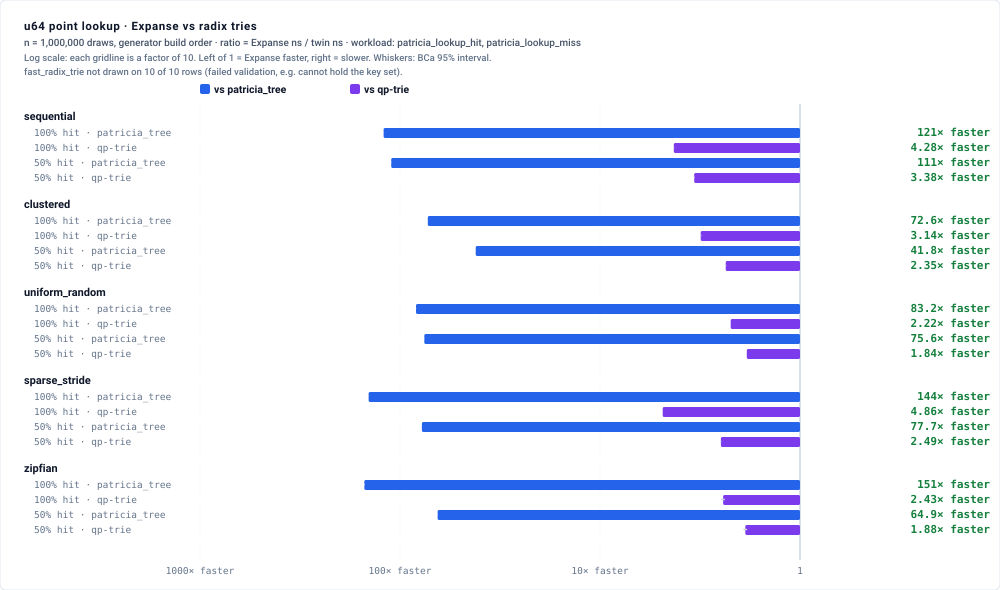
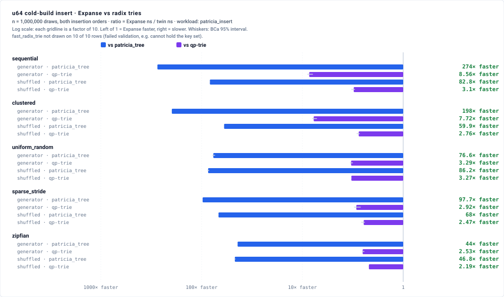
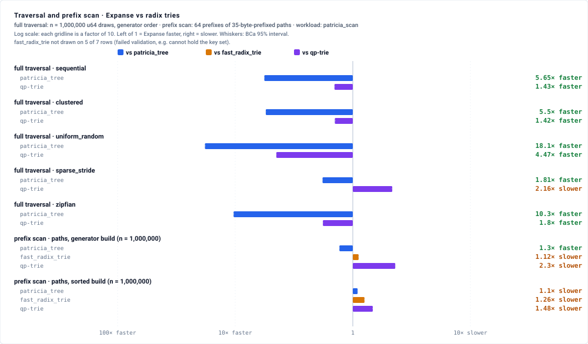
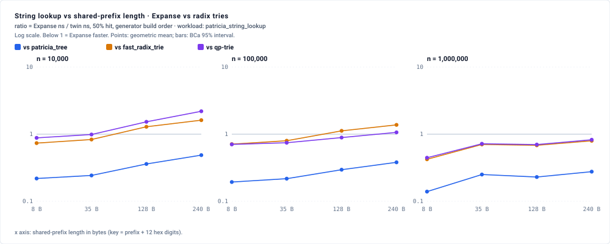
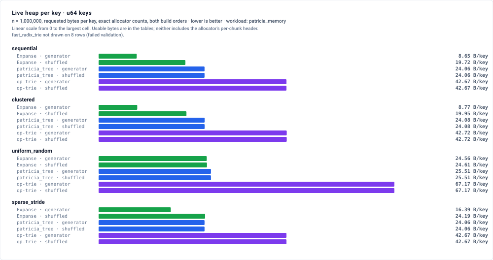
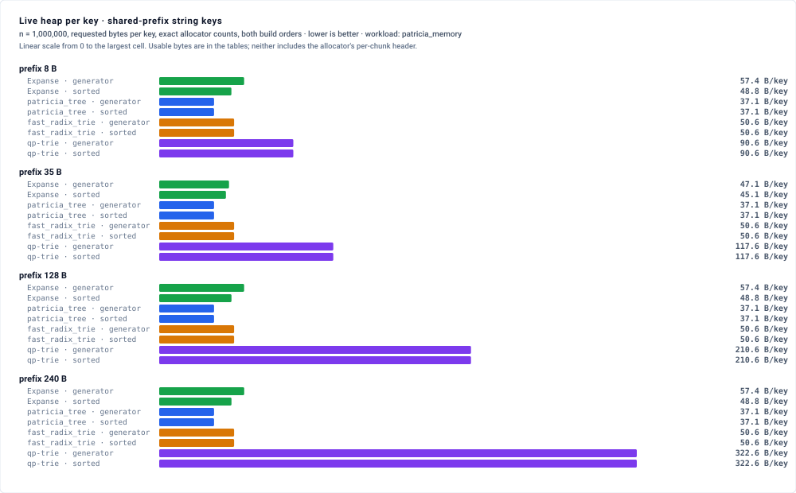

# Expanse vs. Patricia and Radix Tries

<!-- Generated by scripts/generate_readme.py from results/baseline_*.json; do not edit by hand. -->

`ExpanseMap` and `ExpanseStrMap` against three compressed radix tries that differ in how a node finds its child: [`patricia_tree`](https://github.com/sile/patricia_tree) `=0.10.2` (linked sibling list), [`fast_radix_trie`](https://github.com/bluecatengineering/fast_radix_trie) `=1.2.0` (inline child array; its `u8` child count cannot hold the `u64` key sets here, recorded `invalid`), and [`qp-trie`](https://github.com/sdleffler/qp-trie-rs) `=0.8.2` (nybble branch). Design, envelope, pre-registration and claims ceiling: [METHODOLOGY.md](METHODOLOGY.md).

## Provenance

- Host: 12th Gen Intel(R) Core(TM) i9-12900F (24 threads, 30 MiB L3, Linux 6.8.0-138-generic); core pin `0-15`; governor `performance`.
- Commit `c1b604ad`; run https://github.com/orieg/expanse/actions/runs/42438017772.
- Load: 21 snapshots, one before every harness population and one at the end (present); largest busy-CPU delta from processes outside the run 0.05 core-equivalents (§8.17 contamination threshold: about 1).

## Pre-registered verdicts

Evaluated at n ∈ {100,000, 1,000,000}, both build orders, under METHODOLOGY.md §3 (measured: 12th Gen Intel(R) Core(TM) i9-12900F (24 threads, 30 MiB L3, Linux 6.8.0-138-generic), c1b604ad). No independent peer review.

| Prediction | Cells | Verdict | Breakdown |
|---|---|---|---|
| P1 `patricia_lookup_hit` vs `patricia_tree` | 20 | PASS | PASS 20 |
| P2 `patricia_lookup_miss` vs `patricia_tree` | 20 | PASS | PASS 20 |
| P3 `patricia_insert` vs `patricia_tree` | 20 | PASS | PASS 20 |
| P4 `patricia_scan` full traversal vs `patricia_tree` | 20 | PASS | PASS 20 |
| P5 `fast_radix_trie` invalid on full-byte-range `u64` sets | 48 | PASS | exact |
| P6 `fast_radix_trie` valid on every path cell | 46 | PASS | exact |
| P7 `patricia_tree` requested bytes equal the census | 24 | PASS | exact |
| P8 Expanse fewer requested bytes than `patricia_tree` (sequential, clustered) | 8 | PASS | exact |
| T1 string-lookup ratio rises with prefix length | 6 | PASS | PASS 6 |

## Losses and qualifications

Every evaluated cell whose interval lies wholly above 1, where the ratio is Expanse ns ÷ twin ns (so Expanse is slower); none of them is covered by a prediction, so each is an `UNPREDICTED_LOSS`.

- T1 at n = 1,000,000 against `patricia_tree` passes on its 8-vs-240 rule, but the four point estimates are not monotone in prefix length.
- T1 at n = 1,000,000 against `fast_radix_trie` passes on its 8-vs-240 rule, but the four point estimates are not monotone in prefix length.
- T1 at n = 1,000,000 against `qp_trie` passes on its 8-vs-240 rule, but the four point estimates are not monotone in prefix length.
- UNPREDICTED_LOSS — `patricia_scan` full_traversal sequential generator, n = 100,000, against `qp_trie`: 1.2370 [1.2145, 1.2599]
- UNPREDICTED_LOSS — `patricia_scan` full_traversal sequential shuffled, n = 100,000, against `qp_trie`: 1.0511 [1.0481, 1.0539]
- UNPREDICTED_LOSS — `patricia_scan` full_traversal clustered generator, n = 100,000, against `qp_trie`: 1.2856 [1.2814, 1.2886]
- UNPREDICTED_LOSS — `patricia_scan` full_traversal clustered shuffled, n = 100,000, against `qp_trie`: 1.0651 [1.0608, 1.0678]
- UNPREDICTED_LOSS — `patricia_scan` full_traversal uniform_random generator, n = 100,000, against `qp_trie`: 1.2179 [1.2083, 1.2274]
- UNPREDICTED_LOSS — `patricia_scan` full_traversal uniform_random shuffled, n = 100,000, against `qp_trie`: 1.2191 [1.2085, 1.2294]
- UNPREDICTED_LOSS — `patricia_scan` full_traversal sparse_stride generator, n = 100,000, against `qp_trie`: 3.9706 [3.9636, 3.9773]
- UNPREDICTED_LOSS — `patricia_scan` full_traversal sparse_stride shuffled, n = 100,000, against `qp_trie`: 3.2066 [3.2000, 3.2123]
- UNPREDICTED_LOSS — `patricia_scan` prefix_scan prefixed_path 35 generator, n = 100,000, against `qp_trie`: 1.3344 [1.3252, 1.3464]
- UNPREDICTED_LOSS — `patricia_scan` prefix_scan prefixed_path 35 sorted, n = 100,000, against `qp_trie`: 1.4542 [1.4510, 1.4574]
- UNPREDICTED_LOSS — `patricia_scan` full_traversal sparse_stride generator, n = 1,000,000, against `qp_trie`: 2.1641 [2.1494, 2.1725]
- UNPREDICTED_LOSS — `patricia_scan` full_traversal sparse_stride shuffled, n = 1,000,000, against `qp_trie`: 1.0322 [1.0279, 1.0361]
- UNPREDICTED_LOSS — `patricia_scan` prefix_scan prefixed_path 35 generator, n = 1,000,000, against `fast_radix_trie`: 1.1205 [1.1150, 1.1266]
- UNPREDICTED_LOSS — `patricia_scan` prefix_scan prefixed_path 35 generator, n = 1,000,000, against `qp_trie`: 2.2963 [2.2862, 2.3071]
- UNPREDICTED_LOSS — `patricia_scan` prefix_scan prefixed_path 35 sorted, n = 1,000,000, against `patricia_tree`: 1.0984 [1.0939, 1.1021]
- UNPREDICTED_LOSS — `patricia_scan` prefix_scan prefixed_path 35 sorted, n = 1,000,000, against `fast_radix_trie`: 1.2577 [1.2511, 1.2613]
- UNPREDICTED_LOSS — `patricia_scan` prefix_scan prefixed_path 35 sorted, n = 1,000,000, against `qp_trie`: 1.4784 [1.4699, 1.4822]
- UNPREDICTED_LOSS — `patricia_string_lookup` prefixed_path 128 generator, n = 100,000, against `fast_radix_trie`: 1.1216 [1.1142, 1.1270]
- UNPREDICTED_LOSS — `patricia_string_lookup` prefixed_path 128 sorted, n = 100,000, against `fast_radix_trie`: 1.2160 [1.2068, 1.2241]
- UNPREDICTED_LOSS — `patricia_string_lookup` prefixed_path 240 generator, n = 100,000, against `fast_radix_trie`: 1.3774 [1.3618, 1.3830]
- UNPREDICTED_LOSS — `patricia_string_lookup` prefixed_path 240 generator, n = 100,000, against `qp_trie`: 1.0659 [1.0635, 1.0688]
- UNPREDICTED_LOSS — `patricia_string_lookup` prefixed_path 240 sorted, n = 100,000, against `fast_radix_trie`: 1.4843 [1.4782, 1.4892]
- UNPREDICTED_LOSS — `patricia_string_lookup` prefixed_path 240 sorted, n = 100,000, against `qp_trie`: 1.1306 [1.1272, 1.1345]
- Outside the evaluated n (`NOT_PREREGISTERED`), 23 further cells have Expanse slower; they are in the tables below.

## Charts

Generated by `scripts/generate_charts.py` from the same artifacts. Timing charts use a log axis centred on 1, so bar length understates large ratios; the tables below carry every value and interval (measured: 12th Gen Intel(R) Core(TM) i9-12900F (24 threads, 30 MiB L3, Linux 6.8.0-138-generic), c1b604ad).

## Results

(measured: 12th Gen Intel(R) Core(TM) i9-12900F (24 threads, 30 MiB L3, Linux 6.8.0-138-generic), c1b604ad)

### Point lookup, 100% hit (workload: patricia_lookup_hit)

Ratio = Expanse ns ÷ twin ns, geometric mean of per-round ratios with its BCa 95% interval; below 1 means Expanse is faster. `invalid` = the twin failed validation and was not timed.

| n | cell | vs `patricia_tree` | vs `fast_radix_trie` | vs `qp_trie` |
|---|---|---|---|---|
| 10,000 | sequential / generator | 0.0072 [0.0069, 0.0073] | invalid | 0.4031 [0.4012, 0.4060] |
| 10,000 | sequential / shuffled | 0.0052 [0.0052, 0.0053] | invalid | 0.4034 [0.4015, 0.4075] |
| 10,000 | clustered / generator | 0.0110 [0.0110, 0.0110] | invalid | 0.5605 [0.5595, 0.5617] |
| 10,000 | clustered / shuffled | 0.0077 [0.0077, 0.0077] | invalid | 0.5594 [0.5586, 0.5601] |
| 10,000 | uniform_random / generator | 0.0114 [0.0114, 0.0115] | invalid | 0.4997 [0.4980, 0.5013] |
| 10,000 | uniform_random / shuffled | 0.0112 [0.0112, 0.0113] | invalid | 0.4990 [0.4973, 0.5005] |
| 10,000 | sparse_stride / generator | 0.0076 [0.0075, 0.0076] | invalid | 0.4138 [0.4131, 0.4146] |
| 10,000 | sparse_stride / shuffled | 0.0051 [0.0051, 0.0051] | invalid | 0.4162 [0.4153, 0.4172] |
| 100,000 | sequential / generator | 0.0075 [0.0075, 0.0075] | invalid | 0.4188 [0.4179, 0.4196] |
| 100,000 | sequential / shuffled | 0.0040 [0.0040, 0.0041] | invalid | 0.4253 [0.4220, 0.4270] |
| 100,000 | clustered / generator | 0.0156 [0.0156, 0.0156] | invalid | 0.5132 [0.5117, 0.5140] |
| 100,000 | clustered / shuffled | 0.0069 [0.0069, 0.0069] | invalid | 0.5370 [0.5356, 0.5379] |
| 100,000 | uniform_random / generator | 0.0092 [0.0092, 0.0093] | invalid | 0.6626 [0.6581, 0.6647] |
| 100,000 | uniform_random / shuffled | 0.0091 [0.0091, 0.0091] | invalid | 0.6613 [0.6581, 0.6637] |
| 100,000 | sparse_stride / generator | 0.0069 [0.0069, 0.0069] | invalid | 0.4310 [0.4295, 0.4327] |
| 100,000 | sparse_stride / shuffled | 0.0036 [0.0036, 0.0036] | invalid | 0.4345 [0.4323, 0.4358] |
| 25,177 | zipfian / generator | 0.0090 [0.0090, 0.0090] | invalid | 0.4322 [0.4314, 0.4325] |
| 25,177 | zipfian / shuffled | 0.0090 [0.0090, 0.0090] | invalid | 0.4328 [0.4324, 0.4334] |
| 1,000,000 | sequential / generator | 0.0083 [0.0083, 0.0083] | invalid | 0.2338 [0.2326, 0.2352] |
| 1,000,000 | sequential / shuffled | 0.0027 [0.0027, 0.0028] | invalid | 0.2406 [0.2398, 0.2416] |
| 1,000,000 | clustered / generator | 0.0138 [0.0137, 0.0138] | invalid | 0.3188 [0.3169, 0.3215] |
| 1,000,000 | clustered / shuffled | 0.0050 [0.0049, 0.0050] | invalid | 0.3357 [0.3338, 0.3380] |
| 1,000,000 | uniform_random / generator | 0.0120 [0.0120, 0.0120] | invalid | 0.4502 [0.4493, 0.4514] |
| 1,000,000 | uniform_random / shuffled | 0.0121 [0.0121, 0.0123] | invalid | 0.4613 [0.4585, 0.4649] |
| 1,000,000 | sparse_stride / generator | 0.0070 [0.0069, 0.0070] | invalid | 0.2058 [0.2053, 0.2063] |
| 1,000,000 | sparse_stride / shuffled | 0.0023 [0.0023, 0.0023] | invalid | 0.2127 [0.2120, 0.2130] |
| 226,479 | zipfian / generator | 0.0066 [0.0066, 0.0067] | invalid | 0.4124 [0.4021, 0.4210] |
| 226,479 | zipfian / shuffled | 0.0066 [0.0066, 0.0066] | invalid | 0.4127 [0.4035, 0.4218] |

### Point lookup, 50% hit, in-range misses (workload: patricia_lookup_miss)

Ratio = Expanse ns ÷ twin ns, geometric mean of per-round ratios with its BCa 95% interval; below 1 means Expanse is faster. `invalid` = the twin failed validation and was not timed.

| n | cell | vs `patricia_tree` | vs `fast_radix_trie` | vs `qp_trie` |
|---|---|---|---|---|
| 10,000 | sequential / generator | 0.0201 [0.0197, 0.0205] | 0.1372 [0.1359, 0.1382] | 0.5392 [0.5375, 0.5414] |
| 10,000 | sequential / shuffled | 0.0150 [0.0149, 0.0150] | 0.1253 [0.1251, 0.1258] | 0.5411 [0.5400, 0.5429] |
| 10,000 | clustered / generator | 0.0400 [0.0399, 0.0401] | 0.2072 [0.2066, 0.2080] | 0.6221 [0.6178, 0.6258] |
| 10,000 | clustered / shuffled | 0.0272 [0.0271, 0.0273] | 0.1885 [0.1881, 0.1890] | 0.6243 [0.6199, 0.6283] |
| 10,000 | uniform_random / generator | 0.0151 [0.0150, 0.0151] | invalid | 0.6589 [0.6502, 0.6656] |
| 10,000 | uniform_random / shuffled | 0.0151 [0.0151, 0.0151] | invalid | 0.6567 [0.6453, 0.6649] |
| 10,000 | sparse_stride / generator | 0.0232 [0.0231, 0.0233] | 0.1611 [0.1605, 0.1618] | 0.6289 [0.6261, 0.6317] |
| 10,000 | sparse_stride / shuffled | 0.0169 [0.0168, 0.0169] | 0.1433 [0.1427, 0.1437] | 0.6319 [0.6295, 0.6336] |
| 100,000 | sequential / generator | 0.0103 [0.0103, 0.0104] | invalid | 0.4772 [0.4765, 0.4782] |
| 100,000 | sequential / shuffled | 0.0078 [0.0078, 0.0079] | invalid | 0.4851 [0.4829, 0.4861] |
| 100,000 | clustered / generator | 0.0326 [0.0326, 0.0327] | 0.1885 [0.1880, 0.1893] | 0.6109 [0.6084, 0.6127] |
| 100,000 | clustered / shuffled | 0.0184 [0.0183, 0.0184] | 0.1485 [0.1482, 0.1489] | 0.6263 [0.6247, 0.6276] |
| 100,000 | uniform_random / generator | 0.0102 [0.0102, 0.0103] | invalid | 0.6372 [0.6346, 0.6399] |
| 100,000 | uniform_random / shuffled | 0.0103 [0.0102, 0.0104] | invalid | 0.6341 [0.6293, 0.6393] |
| 100,000 | sparse_stride / generator | 0.0133 [0.0133, 0.0133] | invalid | 0.5830 [0.5815, 0.5847] |
| 100,000 | sparse_stride / shuffled | 0.0091 [0.0091, 0.0091] | invalid | 0.5932 [0.5909, 0.5948] |
| 24,298 | zipfian / generator | 0.0239 [0.0237, 0.0239] | invalid | 0.7733 [0.7701, 0.7763] |
| 24,298 | zipfian / shuffled | 0.0234 [0.0233, 0.0235] | invalid | 0.7728 [0.7698, 0.7759] |
| 1,000,000 | sequential / generator | 0.0090 [0.0090, 0.0091] | invalid | 0.2957 [0.2945, 0.2970] |
| 1,000,000 | sequential / shuffled | 0.0060 [0.0060, 0.0060] | invalid | 0.3385 [0.3366, 0.3407] |
| 1,000,000 | clustered / generator | 0.0239 [0.0239, 0.0240] | invalid | 0.4250 [0.4218, 0.4281] |
| 1,000,000 | clustered / shuffled | 0.0109 [0.0109, 0.0110] | invalid | 0.4599 [0.4580, 0.4622] |
| 1,000,000 | uniform_random / generator | 0.0132 [0.0132, 0.0132] | invalid | 0.5423 [0.5412, 0.5433] |
| 1,000,000 | uniform_random / shuffled | 0.0132 [0.0132, 0.0133] | invalid | 0.5445 [0.5433, 0.5466] |
| 1,000,000 | sparse_stride / generator | 0.0129 [0.0128, 0.0129] | invalid | 0.4023 [0.3984, 0.4044] |
| 1,000,000 | sparse_stride / shuffled | 0.0071 [0.0071, 0.0071] | invalid | 0.4147 [0.4114, 0.4162] |
| 219,472 | zipfian / generator | 0.0154 [0.0154, 0.0155] | invalid | 0.5329 [0.5210, 0.5441] |
| 219,472 | zipfian / shuffled | 0.0154 [0.0153, 0.0154] | invalid | 0.5370 [0.5233, 0.5472] |

### Cold-build insert (generator order, then shuffled) (workload: patricia_insert)

Ratio = Expanse ns ÷ twin ns, geometric mean of per-round ratios with its BCa 95% interval; below 1 means Expanse is faster. `invalid` = the twin failed validation and was not timed.

| n | cell | vs `patricia_tree` | vs `fast_radix_trie` | vs `qp_trie` |
|---|---|---|---|---|
| 10,000 | sequential | 0.0068 [0.0068, 0.0068] 0.0310 [0.0309, 0.0311] | invalid | 0.2251 [0.2235, 0.2262] 0.4598 [0.4572, 0.4619] |
| 10,000 | clustered | 0.0092 [0.0092, 0.0092] 0.0435 [0.0434, 0.0436] | invalid | 0.2652 [0.2644, 0.2663] 0.5665 [0.5645, 0.5682] |
| 10,000 | uniform_random | 0.0405 [0.0404, 0.0406] 0.0398 [0.0397, 0.0399] | invalid | 0.8208 [0.8155, 0.8233] 0.8262 [0.8243, 0.8280] |
| 10,000 | sparse_stride | 0.0165 [0.0164, 0.0165] 0.0388 [0.0387, 0.0389] | invalid | 0.5503 [0.5486, 0.5524] 0.5760 [0.5749, 0.5774] |
| 100,000 | sequential | 0.0039 [0.0039, 0.0039] 0.0155 [0.0154, 0.0156] | invalid | 0.1661 [0.1642, 0.1686] 0.3836 [0.3780, 0.3863] |
| 100,000 | clustered | 0.0080 [0.0080, 0.0081] 0.0292 [0.0291, 0.0293] | invalid | 0.1845 [0.1828, 0.1877] 0.4543 [0.4460, 0.4587] |
| 100,000 | uniform_random | 0.0166 [0.0165, 0.0167] 0.0159 [0.0158, 0.0161] | invalid | 0.4082 [0.4056, 0.4112] 0.4365 [0.4286, 0.4411] |
| 100,000 | sparse_stride | 0.0098 [0.0098, 0.0098] 0.0190 [0.0188, 0.0191] | invalid | 0.4338 [0.4282, 0.4454] 0.4748 [0.4674, 0.4783] |
| 25,177 | zipfian | 0.0342 [0.0341, 0.0343] 0.0324 [0.0322, 0.0328] | invalid | 0.4583 [0.4565, 0.4597] 0.4546 [0.4526, 0.4558] |
| 1,000,000 | sequential | 0.0036 [0.0036, 0.0036] 0.0121 [0.0120, 0.0121] | invalid | 0.1168 [0.1120, 0.1271] 0.3229 [0.3058, 0.3317] |
| 1,000,000 | clustered | 0.0051 [0.0051, 0.0051] 0.0167 [0.0166, 0.0168] | invalid | 0.1295 [0.1248, 0.1394] 0.3620 [0.3451, 0.3705] |
| 1,000,000 | uniform_random | 0.0131 [0.0128, 0.0136] 0.0116 [0.0115, 0.0119] | invalid | 0.3041 [0.2966, 0.3167] 0.3059 [0.3016, 0.3085] |
| 1,000,000 | sparse_stride | 0.0102 [0.0102, 0.0103] 0.0147 [0.0146, 0.0148] | invalid | 0.3429 [0.3253, 0.3787] 0.4054 [0.3834, 0.4163] |
| 226,479 | zipfian | 0.0227 [0.0227, 0.0228] 0.0214 [0.0212, 0.0217] | invalid | 0.3957 [0.3914, 0.4119] 0.4564 [0.4523, 0.4582] |

### String lookup, 50% hit, by shared-prefix length (workload: patricia_string_lookup)

Ratio = Expanse ns ÷ twin ns, geometric mean of per-round ratios with its BCa 95% interval; below 1 means Expanse is faster. `invalid` = the twin failed validation and was not timed.

| n | cell | vs `patricia_tree` | vs `fast_radix_trie` | vs `qp_trie` |
|---|---|---|---|---|
| 10,000 | prefix 8 / generator | 0.2187 [0.2182, 0.2191] | 0.7368 [0.7347, 0.7385] | 0.8819 [0.8787, 0.8855] |
| 10,000 | prefix 8 / sorted | 0.2419 [0.2416, 0.2426] | 0.7674 [0.7656, 0.7690] | 0.8957 [0.8919, 0.8985] |
| 10,000 | prefix 35 / generator | 0.2430 [0.2426, 0.2435] | 0.8342 [0.8314, 0.8371] | 0.9899 [0.9876, 0.9917] |
| 10,000 | prefix 35 / sorted | 0.2704 [0.2696, 0.2716] | 0.8755 [0.8727, 0.8803] | 1.0235 [1.0207, 1.0271] |
| 10,000 | prefix 128 / generator | 0.3602 [0.3565, 0.3642] | 1.2908 [1.2781, 1.3048] | 1.5280 [1.5103, 1.5453] |
| 10,000 | prefix 128 / sorted | 0.3996 [0.3961, 0.4038] | 1.3303 [1.3181, 1.3468] | 1.5537 [1.5392, 1.5707] |
| 10,000 | prefix 240 / generator | 0.4882 [0.4814, 0.4995] | 1.6174 [1.5920, 1.6528] | 2.1971 [2.1561, 2.2481] |
| 10,000 | prefix 240 / sorted | 0.5353 [0.5288, 0.5428] | 1.6943 [1.6755, 1.7186] | 2.2480 [2.2145, 2.2828] |
| 100,000 | prefix 8 / generator | 0.1937 [0.1929, 0.1945] | 0.7114 [0.7085, 0.7136] | 0.7055 [0.6905, 0.7135] |
| 100,000 | prefix 8 / sorted | 0.2492 [0.2484, 0.2497] | 0.7749 [0.7726, 0.7766] | 0.7311 [0.7232, 0.7378] |
| 100,000 | prefix 35 / generator | 0.2176 [0.2167, 0.2184] | 0.7991 [0.7972, 0.8007] | 0.7462 [0.7357, 0.7554] |
| 100,000 | prefix 35 / sorted | 0.2774 [0.2766, 0.2781] | 0.8803 [0.8776, 0.8829] | 0.7847 [0.7729, 0.7939] |
| 100,000 | prefix 128 / generator | 0.2958 [0.2952, 0.2964] | 1.1216 [1.1142, 1.1270] | 0.8909 [0.8847, 0.8962] |
| 100,000 | prefix 128 / sorted | 0.3741 [0.3697, 0.3763] | 1.2160 [1.2068, 1.2241] | 0.9523 [0.9450, 0.9579] |
| 100,000 | prefix 240 / generator | 0.3810 [0.3788, 0.3830] | 1.3774 [1.3618, 1.3830] | 1.0659 [1.0635, 1.0688] |
| 100,000 | prefix 240 / sorted | 0.4813 [0.4785, 0.4835] | 1.4843 [1.4782, 1.4892] | 1.1306 [1.1272, 1.1345] |
| 1,000,000 | prefix 8 / generator | 0.1394 [0.1390, 0.1398] | 0.4227 [0.4218, 0.4238] | 0.4455 [0.4444, 0.4465] |
| 1,000,000 | prefix 8 / sorted | 0.2080 [0.2076, 0.2086] | 0.5188 [0.5176, 0.5203] | 0.4891 [0.4883, 0.4902] |
| 1,000,000 | prefix 35 / generator | 0.2506 [0.2500, 0.2525] | 0.7036 [0.7017, 0.7081] | 0.7192 [0.7174, 0.7234] |
| 1,000,000 | prefix 35 / sorted | 0.3490 [0.3482, 0.3500] | 0.8631 [0.8619, 0.8655] | 0.7966 [0.7939, 0.7993] |
| 1,000,000 | prefix 128 / generator | 0.2302 [0.2297, 0.2309] | 0.6828 [0.6814, 0.6846] | 0.7010 [0.6994, 0.7028] |
| 1,000,000 | prefix 128 / sorted | 0.3505 [0.3500, 0.3509] | 0.8434 [0.8420, 0.8448] | 0.7779 [0.7765, 0.7793] |
| 1,000,000 | prefix 240 / generator | 0.2766 [0.2762, 0.2771] | 0.7969 [0.7956, 0.7983] | 0.8268 [0.8255, 0.8281] |
| 1,000,000 | prefix 240 / sorted | 0.4229 [0.4223, 0.4236] | 0.9790 [0.9768, 0.9814] | 0.9248 [0.9233, 0.9268] |

### Full traversal and prefix scan (workload: patricia_scan)

Ratio = Expanse ns ÷ twin ns, geometric mean of per-round ratios with its BCa 95% interval; below 1 means Expanse is faster. `invalid` = the twin failed validation and was not timed.

| n | cell | vs `patricia_tree` | vs `fast_radix_trie` | vs `qp_trie` |
|---|---|---|---|---|
| 10,000 | full_traversal sequential / generator | 0.1838 [0.1834, 0.1841] | invalid | 1.3463 [1.3447, 1.3478] |
| 10,000 | full_traversal sequential / shuffled | 0.1353 [0.1351, 0.1356] | invalid | 1.2345 [1.2322, 1.2367] |
| 10,000 | full_traversal clustered / generator | 0.1890 [0.1886, 0.1894] | invalid | 1.3597 [1.3558, 1.3638] |
| 10,000 | full_traversal clustered / shuffled | 0.1332 [0.1328, 0.1337] | invalid | 1.2455 [1.2431, 1.2511] |
| 10,000 | full_traversal uniform_random / generator | 0.7682 [0.7662, 0.7699] | invalid | 2.7224 [2.6878, 2.7531] |
| 10,000 | full_traversal uniform_random / shuffled | 0.7653 [0.7635, 0.7667] | invalid | 2.7065 [2.6732, 2.7339] |
| 10,000 | full_traversal sparse_stride / generator | 0.5698 [0.5689, 0.5705] | invalid | 4.0791 [4.0753, 4.0831] |
| 10,000 | full_traversal sparse_stride / shuffled | 0.3928 [0.3924, 0.3933] | invalid | 3.7029 [3.6938, 3.7087] |
| 10,000 | prefix_scan prefixed_path / generator | 1.4996 [1.4938, 1.5036] | 2.0036 [1.9845, 2.0197] | 4.7318 [4.6578, 4.7989] |
| 10,000 | prefix_scan prefixed_path / sorted | 1.6444 [1.6420, 1.6468] | 1.9709 [1.9550, 1.9926] | 4.4853 [4.3265, 4.6413] |
| 100,000 | full_traversal sequential / generator | 0.1764 [0.1687, 0.1825] | invalid | 1.2370 [1.2145, 1.2599] |
| 100,000 | full_traversal sequential / shuffled | 0.0711 [0.0709, 0.0711] | invalid | 1.0511 [1.0481, 1.0539] |
| 100,000 | full_traversal clustered / generator | 0.1883 [0.1880, 0.1887] | invalid | 1.2856 [1.2814, 1.2886] |
| 100,000 | full_traversal clustered / shuffled | 0.0728 [0.0724, 0.0730] | invalid | 1.0651 [1.0608, 1.0678] |
| 100,000 | full_traversal uniform_random / generator | 0.4430 [0.4419, 0.4438] | invalid | 1.2179 [1.2083, 1.2274] |
| 100,000 | full_traversal uniform_random / shuffled | 0.4415 [0.4401, 0.4428] | invalid | 1.2191 [1.2085, 1.2294] |
| 100,000 | full_traversal sparse_stride / generator | 0.5655 [0.5639, 0.5666] | invalid | 3.9706 [3.9636, 3.9773] |
| 100,000 | full_traversal sparse_stride / shuffled | 0.2160 [0.2156, 0.2162] | invalid | 3.2066 [3.2000, 3.2123] |
| 25,177 | full_traversal zipfian / generator | 0.1523 [0.1515, 0.1530] | invalid | 0.6578 [0.6548, 0.6613] |
| 25,177 | full_traversal zipfian / shuffled | 0.1514 [0.1502, 0.1522] | invalid | 0.6569 [0.6518, 0.6622] |
| 100,000 | prefix_scan prefixed_path / generator | 0.6318 [0.6198, 0.6381] | 0.8251 [0.8174, 0.8333] | 1.3344 [1.3252, 1.3464] |
| 100,000 | prefix_scan prefixed_path / sorted | 0.8713 [0.8695, 0.8735] | 0.9764 [0.9710, 0.9800] | 1.4542 [1.4510, 1.4574] |
| 1,000,000 | full_traversal sequential / generator | 0.1768 [0.1760, 0.1778] | invalid | 0.6982 [0.6942, 0.7029] |
| 1,000,000 | full_traversal sequential / shuffled | 0.0325 [0.0318, 0.0334] | invalid | 0.3861 [0.3845, 0.3884] |
| 1,000,000 | full_traversal clustered / generator | 0.1819 [0.1808, 0.1829] | invalid | 0.7028 [0.6961, 0.7106] |
| 1,000,000 | full_traversal clustered / shuffled | 0.0328 [0.0318, 0.0342] | invalid | 0.4000 [0.3982, 0.4023] |
| 1,000,000 | full_traversal uniform_random / generator | 0.0553 [0.0549, 0.0558] | invalid | 0.2236 [0.2229, 0.2246] |
| 1,000,000 | full_traversal uniform_random / shuffled | 0.0562 [0.0557, 0.0568] | invalid | 0.2245 [0.2239, 0.2253] |
| 1,000,000 | full_traversal sparse_stride / generator | 0.5529 [0.5495, 0.5552] | invalid | 2.1641 [2.1494, 2.1725] |
| 1,000,000 | full_traversal sparse_stride / shuffled | 0.0865 [0.0857, 0.0875] | invalid | 1.0322 [1.0279, 1.0361] |
| 226,479 | full_traversal zipfian / generator | 0.0968 [0.0961, 0.0975] | invalid | 0.5565 [0.5544, 0.5586] |
| 226,479 | full_traversal zipfian / shuffled | 0.0958 [0.0953, 0.0963] | invalid | 0.5580 [0.5557, 0.5604] |
| 1,000,000 | prefix_scan prefixed_path / generator | 0.7690 [0.7659, 0.7716] | 1.1205 [1.1150, 1.1266] | 2.2963 [2.2862, 2.3071] |
| 1,000,000 | prefix_scan prefixed_path / sorted | 1.0984 [1.0939, 1.1021] | 1.2577 [1.2511, 1.2613] | 1.4784 [1.4699, 1.4822] |

### Prefix scan: `cursor_prefix` vs the unbounded walk (workload: patricia_scan)

Ratio = `cursor_prefix` ns ÷ `cursor_at_or_after` + per-key `starts_with` ns, both on `ExpanseStrMap`, each on its own map, timed in the same rounds as the twins; geometric mean of per-round ratios with its BCa 95% interval. Below 1 means `cursor_prefix` is faster.

| n | order | `cursor_prefix` ns/prefix | unbounded ns/prefix | ratio |
|---|---|---|---|---|
| 10,000 | generator | 874 | 930 | 0.9400 [0.9383, 0.9415] |
| 10,000 | sorted | 854 | 921 | 0.9275 [0.9260, 0.9293] |
| 100,000 | generator | 4,866 | 5,535 | 0.8778 [0.8720, 0.8863] |
| 100,000 | sorted | 4,356 | 5,145 | 0.8471 [0.8456, 0.8486] |
| 1,000,000 | generator | 161,129 | 164,332 | 0.9725 [0.9521, 0.9788] |
| 1,000,000 | sorted | 57,549 | 61,806 | 0.9296 [0.9250, 0.9314] |

## Known limit: prefix scan against the radix twins (workload: patricia_scan)

#1096 closes on its option (a): the prefix scan is recorded as a known limit of `ExpanseStrMap` against these three tries, and this suite pursues no further remedy. The reading rule is registered in METHODOLOGY.md, section "Known limit", before the two runs below: a cell is reported as Expanse faster, or twin faster, only when its BCa 95% interval sits on that side of 1 in both runs (`docs/BENCHMARKING.md` rule 18); otherwise it is not confirmed.

- Run 1: commit `c1b604ad`, https://github.com/orieg/expanse/actions/runs/42438017772, pin `0-15` (`results/baseline_scan.json`).
- Run 2: commit `c1b604ad`, https://github.com/orieg/expanse/actions/runs/42462421849, pin `0-15` (`results/baseline_scan_run2.json`).
- Dispatches at the same commit that were voided or recorded no data are listed, with their causes, in METHODOLOGY.md, section "Known-limit outcome" (`AGENTS.md` §8.17).

Conditions: distribution `prefixed_path` (prefix length 35), Expanse timed through `cursor_prefix`, both build orders, n of 10,000, 100,000 and 1,000,000 (measured: 12th Gen Intel(R) Core(TM) i9-12900F (24 threads, 30 MiB L3, Linux 6.8.0-138-generic), c1b604ad). Ratio = Expanse ns ÷ twin ns, below 1 means Expanse is faster.

Of 18 cells: 5 Expanse faster, 13 twin faster, 0 not confirmed. The cells where Expanse is faster in both runs:

- `patricia_tree` at n = 100,000, generator: 0.6318 [0.6198, 0.6381] and 0.6338 [0.6298, 0.6369]
- `fast_radix_trie` at n = 100,000, generator: 0.8251 [0.8174, 0.8333] and 0.8151 [0.7687, 0.8277]
- `patricia_tree` at n = 100,000, sorted: 0.8713 [0.8695, 0.8735] and 0.8726 [0.8678, 0.8759]
- `fast_radix_trie` at n = 100,000, sorted: 0.9764 [0.9710, 0.9800] and 0.9727 [0.9690, 0.9764]
- `patricia_tree` at n = 1,000,000, generator: 0.7690 [0.7659, 0.7716] and 0.7644 [0.7507, 0.7707]

| n | order | twin | run 1 | run 2 | reading |
|---|---|---|---|---|---|
| 10,000 | generator | `patricia_tree` | 1.4996 [1.4938, 1.5036] | 1.5062 [1.5023, 1.5104] | twin faster |
| 10,000 | generator | `fast_radix_trie` | 2.0036 [1.9845, 2.0197] | 1.9784 [1.9302, 1.9960] | twin faster |
| 10,000 | generator | `qp_trie` | 4.7318 [4.6578, 4.7989] | 4.8634 [4.8059, 4.9157] | twin faster |
| 10,000 | sorted | `patricia_tree` | 1.6444 [1.6420, 1.6468] | 1.6043 [1.5983, 1.6148] | twin faster |
| 10,000 | sorted | `fast_radix_trie` | 1.9709 [1.9550, 1.9926] | 1.9998 [1.9742, 2.0298] | twin faster |
| 10,000 | sorted | `qp_trie` | 4.4853 [4.3265, 4.6413] | 4.6749 [4.6193, 4.7128] | twin faster |
| 100,000 | generator | `patricia_tree` | 0.6318 [0.6198, 0.6381] | 0.6338 [0.6298, 0.6369] | Expanse faster |
| 100,000 | generator | `fast_radix_trie` | 0.8251 [0.8174, 0.8333] | 0.8151 [0.7687, 0.8277] | Expanse faster |
| 100,000 | generator | `qp_trie` | 1.3344 [1.3252, 1.3464] | 1.3453 [1.3406, 1.3527] | twin faster |
| 100,000 | sorted | `patricia_tree` | 0.8713 [0.8695, 0.8735] | 0.8726 [0.8678, 0.8759] | Expanse faster |
| 100,000 | sorted | `fast_radix_trie` | 0.9764 [0.9710, 0.9800] | 0.9727 [0.9690, 0.9764] | Expanse faster |
| 100,000 | sorted | `qp_trie` | 1.4542 [1.4510, 1.4574] | 1.4505 [1.4462, 1.4538] | twin faster |
| 1,000,000 | generator | `patricia_tree` | 0.7690 [0.7659, 0.7716] | 0.7644 [0.7507, 0.7707] | Expanse faster |
| 1,000,000 | generator | `fast_radix_trie` | 1.1205 [1.1150, 1.1266] | 1.1187 [1.1130, 1.1287] | twin faster |
| 1,000,000 | generator | `qp_trie` | 2.2963 [2.2862, 2.3071] | 2.2886 [2.2776, 2.3129] | twin faster |
| 1,000,000 | sorted | `patricia_tree` | 1.0984 [1.0939, 1.1021] | 1.0984 [1.0950, 1.1024] | twin faster |
| 1,000,000 | sorted | `fast_radix_trie` | 1.2577 [1.2511, 1.2613] | 1.2565 [1.2549, 1.2582] | twin faster |
| 1,000,000 | sorted | `qp_trie` | 1.4784 [1.4699, 1.4822] | 1.4620 [1.4509, 1.4660] | twin faster |

What the limit does not say: it describes this build, these key sets and this host, and it does not say that no remedy exists (`AGENTS.md` §8.9 item 4). The 1M build-order gap is what D1 and D2 below recorded; D2's A5 outcome is final and was not re-run.

### Diagnostic D1: the 1M prefix scan's build-order gap (workload: example_perf_point_lookup)

Pre-registered in `METHODOLOGY.md` Amendment A3. Counts per yielded entry, `probe − build` over 10 paired runs on the `cpu_core` PMU, BCa 95% interval over the runs (measured: 12th Gen Intel(R) Core(TM) i9-12900F (24 threads, 30 MiB L3, Linux 6.8), c3e54ec2).

| Counter | generator build | sorted build |
|---|---|---|
| `cycles` | 158.4357 [158.0697, 159.0592] | 72.7027 [72.5676, 72.8163] |
| `instructions` | 284.9464 [284.9418, 284.9496] | 284.7763 [284.7621, 284.7821] |
| `L1-dcache-load-misses` | 1.9109 [1.9092, 1.9129] | 0.2349 [0.2306, 0.2379] |
| `LLC-load-misses` | 0.2507 [0.2486, 0.2529] | -0.0000 [-0.0012, 0.0004] |
| `dTLB-load-misses` | 0.8203 [0.8193, 0.8216] | 0.0097 [0.0093, 0.0101] |
| `branch-misses` | 0.4877 [0.4871, 0.4884] | 0.4923 [0.4915, 0.4931] |
| `cycle_activity.stalls_l3_miss` | 0.0000 [0.0000, 0.0000] | 0.0000 [0.0000, 0.0000] |
| `mem_load_retired.l3_miss` | 0.2360 [0.2340, 0.2380] | -0.0000 [-0.0010, 0.0003] |

- **D1a** instructions per entry differ by 0.06% — **PASS** (tolerance 2%).
- **D1b** generator interval above the sorted one for `mem_load_retired.l3_miss`, `dTLB-load-misses` — **PASS**.
- **D1c** **NOT EVALUABLE** in the pre-registered run: `cycle_activity.stalls_l3_miss` read 0 in both builds inside the driver's default event set, while `mem_load_retired.l3_miss` counted in the same runs.
- *Post hoc, not the pre-registered verdict:* counting only `cycles`, `instructions` and `cycle_activity.stalls_l3_miss`, same arms and parameters (measured: 12th Gen Intel(R) Core(TM) i9-12900F (24 threads, 30 MiB L3, Linux 6.8), c3e54ec2): L3-miss stalls 52.5390 [52.1232, 53.0671] vs 0.0359 [0.0102, 0.0705] cycles per entry, 61.1% of the cycle gap. `INTERMEDIATE`: the event set was changed after the pre-registered run read zero.

### Diagnostic D2: the build-order gap under 2 MiB pages (workload: example_perf_point_lookup)

Pre-registered in `METHODOLOGY.md` Amendment A4. Same arms and counters as D1, with the heap backed by 2 MiB transparent huge pages. Counts per yielded entry over 10 paired runs on the `cpu_core` PMU, pinned `0-15`, BCa 95% interval. D2b and D2c are the generator-build count minus the sorted-build count, taken run by run in recorded order; the two arms are separate blocks of processes, so that order pairs nothing. Evaluated under A4 by `scripts/patricia_d2_bounds.py --evaluate-a4` on `results/counters_prefix_scan_d2_2m_run1.json` and `_run2.json`.

**Verdict: `INTERMEDIATE` in both runs.** All three clauses are met in both runs, and A4's registered host condition is not met as written. A4 registers `loadavg <= 1.0` and `foreign_busy_cpus == 0`; the artifacts record a one-minute load average of up to 1.47 and 1.52 and foreign CPU of up to 0.02 core-equivalents. The condition was mis-specified: the measured workload is one thread, which reads a load average near 1 by itself, and the host guard judged both runs quiet. A PASS needs an amended condition and fresh runs (`AGENTS.md` §8.19). This section first recorded the runs as PASS without stating the condition.

| Clause | Bound | Run 1 (measured: 12th Gen Intel(R) Core(TM) i9-12900F (24 threads, 30 MiB L3, Linux 6.8), 7243adab) | Run 2 (measured: 12th Gen Intel(R) Core(TM) i9-12900F (24 threads, 30 MiB L3, Linux 6.8), 052b0a2a) |
|---|---|---|---|
| **D2a** `dTLB-load-misses`, generator build | upper ≤ 0.0410 | 0.0004 [0.0001, 0.0008] | 0.0001 [0.0001, 0.0002] |
| **D2b** `mem_load_retired.l3_miss` difference | lower ≥ 0.1416 | 0.1670 [0.1585, 0.1775] | 0.1797 [0.1631, 0.2031] |
| **D2c** `cycles` difference | lower ≥ 52.50 | 67.4421 [65.2845, 70.2814] | 70.5295 [66.1044, 76.8436] |

The same two dispatches ran the arms on 4 KiB pages (`counters_prefix_scan_d2_4k_run1.json`, `_run2.json`). Generator minus sorted, per entry:

| Counter | 4 KiB, run 1 | 2 MiB, run 1 | 4 KiB, run 2 | 2 MiB, run 2 |
|---|---|---|---|---|
| `cycles` | 90.8862 [90.5004, 91.3881] | 67.4421 [65.2845, 70.2814] | 90.9979 [90.4118, 91.3530] | 70.5295 [66.1044, 76.8436] |
| `mem_load_retired.l3_miss` | 0.2493 [0.2472, 0.2506] | 0.1670 [0.1585, 0.1775] | 0.2572 [0.2553, 0.2585] | 0.1797 [0.1631, 0.2031] |
| `LLC-load-misses` | 0.2640 [0.2618, 0.2655] | 0.2384 [0.2265, 0.2530] | 0.2733 [0.2715, 0.2746] | 0.2632 [0.2389, 0.2982] |
| `dTLB-load-misses` | 0.8092 [0.8074, 0.8113] | -0.0004 [-0.0007, 0.0000] | 0.8109 [0.8089, 0.8122] | -0.0004 [-0.0005, -0.0004] |

What the two runs show:

- **Huge pages remove the dTLB misses and part of the gap, not all of it.** The cycle gap falls from 90.9 and 91.0 per entry on 4 KiB pages to 67.4 and 70.5 on 2 MiB pages: 23.4 and 20.5 cycles per entry, 26% and 22% of it. At least 65 cycles per entry remain in both runs.
- **The retired-L3-miss count is not invariant under paging.** `mem_load_retired.l3_miss` falls by about 30% (0.249 to 0.167, 0.257 to 0.180) while `LLC-load-misses` falls by about 10% and 4%. Clause D2b's bound is still met. Why the two events diverge is not measured.
- **Nothing here says what the remaining cycles are spent on.** D2c's bound is D1's L3-stall figure, and meeting it shows the gap is at least that large. The stall counter itself was not counted in these runs (`cycle_activity.stalls_l3_miss` reads 0 in this event set and is withheld), so no share of the remaining gap is attributed to L3 misses.
- Run 2's D2a interval, and its `dTLB-load-misses` difference, are the bias-corrected construction (`ci_method: bc`); every other interval above is BCa.
- The two runs are at different commits. Between them `strmap.rs` changed by one documentation comment, and no other file on the plain string map's scan path changed.
- Under 2 MiB pages the generator arm varies more between processes than under 4 KiB pages (cycle-gap interval widths of 5.0 and 10.7 against 0.9). The cause is not measured.
- D2 tests no remedy: child and leaf co-allocation, prefetching and packed suffixes are each unmeasured.

#### D2 under errata A5: `FAIL` on D2b (workload: example_perf_point_lookup)

The A4-era verdict above stands as recorded and is not re-read. `METHODOLOGY.md` errata A5 replaced A4's host condition and registered a verdict from two new dispatches at one commit. Both ran at `256e7736a` (measured: 12th Gen Intel(R) Core(TM) i9-12900F (24 threads, 30 MiB L3, Linux 6.8), 256e7736a). Evaluated by `scripts/patricia_d2_bounds.py --evaluate` and `--verdict` on the four `results/counters_prefix_scan_d2_{2m,4k}_a5_run{1,2}.json` artifacts.

**Pair verdict: `FAIL`, final.** The one admissible dispatch (2) does not meet D2b. Under A5.5 an admissible dispatch that misses a clause is never replaced, so no further dispatch is made. The bound was not moved to the measurement (`AGENTS.md` §8.19).

| Dispatch | Run | Admissible | Verdict | Host readings (`provenance`, both artifacts) |
|---|---|---|---|---|
| 1 | [38424662601](https://github.com/orieg/expanse/actions/runs/38424662601) (`a5_run1`) | no: the host condition (H0 to H2) is met, the huge-page precondition of §3.4.2 is not | `VOID`: `strmap_prefix_scan: 12 huge-page fault(s) fell back to small pages` | guard start quiet, in-run undisturbed (61 samples, 0 voids, worst foreign 0.222, worst on-pin 0.167); `load1` 1.24 to 1.43 (2 MiB), 1.43 to 1.83 (4 KiB); foreign 0.02, 0.02 and 0.03, 0.02 |
| 2 | [38446328899](https://github.com/orieg/expanse/actions/runs/38446328899) (`a5_run2`) | yes | `FAIL` (D2b) | guard start quiet, in-run undisturbed (60 samples, 0 voids, worst foreign 0.108, worst on-pin 0.095); `load1` 1.24 to 1.43 (2 MiB), 1.43 to 1.84 (4 KiB); foreign 0.02 in all four windows |

Dispatch 1's 2 MiB artifact records `thp_fault_fallback` 12 for the generator arm (`thp_fault_alloc` 1,627) and 0 for the sorted arm (1,620). Under A5.3 a void dispatch's clauses are not evaluated and its counts are not published; the artifacts are committed so the void is reproducible. The cause of the fallback is not measured. An operator's observation on the reference host after the run, which is in no artifact: free memory was low with a large page cache, the kernel's `thp_fault_fallback` counter read 12 (equal to the run's), and compaction had failed; the cache was dropped and memory compacted before dispatch 2. The hypothesis it suggests, that memory was too full and fragmented to supply 2 MiB pages, is unmeasured. Dispatch 2 recorded `thp_fault_fallback` 0 in both arms (`thp_fault_alloc` 1,640 and 1,617).

Clauses of dispatch 2, per yielded entry, 10 runs, generator build minus sorted build for D2b and D2c (measured: 12th Gen Intel(R) Core(TM) i9-12900F (24 threads, 30 MiB L3, Linux 6.8), 256e7736a):

| Clause | Registered bound | Decided on | Point [95% interval] | `ci_method` | Met |
|---|---|---|---|---|---|
| **D2b** `mem_load_retired.l3_miss` difference | lower ≥ 0.1416 | lower | 0.1482 [0.1400, 0.1617] | `bca` | **no** (lower bound 0.0016 below the bound; point above it) |
| **D2a** `dTLB-load-misses`, generator build | upper ≤ 0.0410 | upper | 0.00016 [0.00012, 0.00022] | `bc` | yes |
| **D2c** `cycles` difference | lower ≥ 52.50 | lower | 61.4669 [59.4050, 64.6929] | `bca` | yes |

D2a's interval is the bias-corrected construction, not BCa (`ci_method: bc`). The D1 reference for D2b is 0.2360 (above): the point is 62.8% of it, the lower bound 59.3% and the upper bound 68.5% (derived), against the registered 60%.

The 4 KiB control of dispatch 2, same arms, generator minus sorted:

| Counter | 4 KiB | 2 MiB |
|---|---|---|
| `cycles` | 86.1969 [84.4773, 87.5085] | 61.4669 [59.4050, 64.6929] |
| `mem_load_retired.l3_miss` | 0.2322 [0.2237, 0.2384] | 0.1482 [0.1400, 0.1617] |
| `LLC-load-misses` | 0.2472 [0.2380, 0.2537] | 0.2160 [0.2040, 0.2359] |
| `dTLB-load-misses` | 0.8092 [0.8077, 0.8106] | -0.0001 [-0.0002, -0.0001] (`bc`) |

From the 4 KiB to the 2 MiB point, the cycle gap falls by 24.7 per entry (28.7%) and the retired-L3-miss difference by 36.2% (derived). Only one admissible dispatch exists, so no statement about the direction of a change between page sizes is made across dispatches (`docs/BENCHMARKING.md` rule 18). The two A4-era runs recorded D2b lower bounds of 0.1585 and 0.1631 at other commits; why dispatch 2's reading is lower is not measured, and those runs keep their label.

What `FAIL` says, in D2's registered terms: D2b's falsifier, a BCa lower bound below 0.1416, holds in the admissible dispatch, so the retired-L3-miss difference under 2 MiB pages could not be shown to retain 60% of D1's. The conclusion §3.4.4 registers for a PASS (translation misses an orthogonal overlay, with a dispersal effect that paging does not resolve) is therefore not supported by D2. §3.4.4's other branch, "If D2c is falsified", is not triggered, because D2c is met. D2 registers no other consequence. D2a and D2c are reported as measured; they do not change the verdict, and the verdict does not say what the remaining cycle gap consists of. D2 tests no remedy.

### Live heap (workload: patricia_memory)

Requested / usable bytes per key (`malloc_usable_size`); exact counts. Usable size excludes the allocator's per-chunk header, so neither column is the full resident footprint of small nodes. Orders: `u64` generator / shuffled, paths generator / sorted.

| n | key set | `expanse` | `patricia_tree` | `fast_radix_trie` | `qp_trie` |
|---|---|---|---|---|---|
| 100,000 | sequential | 9.29 / 9.55 20.35 / 20.66 | 24.06 / 24.10 24.06 / 24.10 | invalid invalid | 42.73 / 43.27 42.73 / 43.48 |
| 100,000 | clustered | 9.56 / 9.82 20.70 / 21.00 | 24.08 / 24.13 24.08 / 24.13 | invalid invalid | 42.76 / 43.30 42.76 / 43.51 |
| 100,000 | uniform_random | 30.49 / 30.62 30.58 / 30.69 | 30.54 / 34.68 30.54 / 34.68 | invalid invalid | 64.60 / 67.62 64.60 / 67.60 |
| 100,000 | sparse_stride | 17.09 / 17.16 24.87 / 24.97 | 24.06 / 24.11 24.06 / 24.11 | invalid invalid | 42.73 / 43.27 42.73 / 43.47 |
| 100,000 | path, prefix 8 | 58.05 / 58.40 50.43 / 50.72 | 37.94 / 43.59 37.94 / 43.59 | 51.93 / 60.74 51.93 / 60.75 | 94.20 / 104.15 94.20 / 103.79 |
| 100,000 | path, prefix 35 | 55.32 / 55.55 46.96 / 47.25 | 37.94 / 43.59 37.94 / 43.60 | 51.93 / 60.78 51.93 / 60.75 | 121.20 / 135.05 121.20 / 134.76 |
| 100,000 | path, prefix 128 | 58.38 / 58.67 50.76 / 51.04 | 37.94 / 43.59 37.94 / 43.61 | 51.93 / 60.76 51.93 / 60.76 | 214.20 / 231.86 214.20 / 231.97 |
| 100,000 | path, prefix 240 | 58.54 / 58.91 50.93 / 51.22 | 37.94 / 43.60 37.94 / 43.61 | 51.93 / 60.76 51.93 / 60.77 | 326.20 / 342.75 326.20 / 342.72 |
| 1,000,000 | sequential | 8.65 / 8.91 19.72 / 20.01 | 24.06 / 24.09 24.06 / 24.09 | invalid invalid | 42.67 / 43.20 42.67 / 43.41 |
| 1,000,000 | clustered | 8.77 / 9.03 19.95 / 20.23 | 24.08 / 24.12 24.08 / 24.12 | invalid invalid | 42.72 / 43.26 42.72 / 43.47 |
| 1,000,000 | uniform_random | 24.56 / 24.81 24.61 / 24.85 | 25.51 / 26.27 25.51 / 26.27 | invalid invalid | 67.17 / 70.01 67.17 / 69.95 |
| 1,000,000 | sparse_stride | 16.39 / 16.46 24.19 / 24.28 | 24.06 / 24.10 24.06 / 24.10 | invalid invalid | 42.67 / 43.20 42.67 / 43.41 |
| 1,000,000 | path, prefix 8 | 57.36 / 57.68 48.78 / 49.13 | 37.07 / 42.91 37.07 / 42.91 | 50.60 / 58.84 50.60 / 58.84 | 90.59 / 100.40 90.59 / 100.15 |
| 1,000,000 | path, prefix 35 | 47.13 / 47.76 45.06 / 45.71 | 37.07 / 42.91 37.07 / 42.91 | 50.60 / 58.84 50.60 / 58.84 | 117.59 / 131.28 117.59 / 130.87 |
| 1,000,000 | path, prefix 128 | 57.39 / 57.70 48.81 / 49.16 | 37.07 / 42.91 37.07 / 42.91 | 50.60 / 58.84 50.60 / 58.84 | 210.59 / 228.24 210.59 / 228.29 |
| 1,000,000 | path, prefix 240 | 57.40 / 57.73 48.82 / 49.18 | 37.07 / 42.91 37.07 / 42.91 | 50.60 / 58.84 50.60 / 58.85 | 322.59 / 338.88 322.59 / 338.84 |
